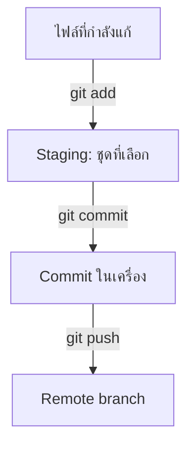

# Git / GitHub — ใช้คำสั่งทำงานร่วมกับทีม

## เรื่องนี้คืออะไร?

Git เก็บประวัติไฟล์ในเครื่อง ส่วน GitHub เป็นบริการเก็บ Repository กลางและช่วยตรวจงานผ่าน Pull Request (PR) ใช้ Git ได้โดยยังไม่ต่อ GitHub และการ Commit ไม่ได้ส่งข้อมูลออกจากเครื่องทันที

หมวดนี้อธิบาย **เครื่องมือและคำสั่ง** ส่วนลำดับงานและข้อตกลง Branch, Commit, PR และ Code Review ต้องกำหนดตามโปรเจกต์ ไม่สร้างนโยบายทีมอีกชุด

## เข้าใจ 4 จุดที่งานอยู่



ภาพแสดงการย้ายข้อมูล 4 จุด Staging หรือ Index คือชุดที่เลือกสำหรับ Commit ถ้าแก้ไฟล์เพิ่มหลัง add การแก้รอบใหม่ยังไม่อยู่ในชุดนั้น GitHub PR เป็นขั้นตรวจและขอรวม Remote branch ไม่ใช่ผลที่เกิดจาก Push อัตโนมัติ

## เริ่มอ่านตรงไหน?

1. [Getting Started](/development-workflow/git-pull-request/getting-started): Clone, Author identity และการเข้าถึง GitHub
2. [Inspect Changes](/development-workflow/git-pull-request/inspect-changes): อ่าน status/diff/log ก่อนเลือกคำสั่ง
3. [Remotes & Sync](/development-workflow/git-pull-request/remotes-and-sync): fetch/pull/push และ Branch tracking
4. [Conflicts & Merge](/development-workflow/git-pull-request/conflicts-and-merge): รวมงานพร้อม Lab ทดลองแยก
5. [Undo & Recovery](/development-workflow/git-pull-request/undo-and-recovery): Unstage, Restore, Stash, Revert และ Reflog
6. [GitHub CLI](/development-workflow/git-pull-request/github-cli): ดู PR/Diff/Checks และเตรียม Draft PR
7. [Troubleshooting](/development-workflow/git-pull-request/troubleshooting) และ [Commands](/development-workflow/git-pull-request/commands): เปิดดูระหว่างทำงาน

## ตัวอย่างงาน Login

ตัวอย่างลำดับงานคือสร้าง Feature branch → แก้โค้ดและทดสอบ → Commit และ Push → เปิด PR → Code Review ส่วนรับงานเพื่อนหรือแก้ Conflict ใช้คำสั่งในหมวดนี้ตามจังหวะที่จำเป็น

ก่อนทำอะไรกับ Repository ที่เปิดอยู่ เริ่มด้วยคำสั่งอ่านข้อมูล:

```bash
git status -sb
git diff --stat
git diff --staged --stat
```

status บอก Branch กับไฟล์ที่ค้าง diff สองแบบแยกงานที่ยังไม่เลือกกับงานที่เลือกแล้ว ไฟล์ใหม่ที่ยังเป็น Untracked ต้องเปิดอ่านเพิ่ม ตัวอย่างไฟล์ src/Login.tsx ในบทคำสั่งต้องมีอยู่จริงในโปรเจกต์ที่ทดลอง ให้ปรับ Path ตามงานของคุณ ไม่ได้สร้างแอป Login จากเอกสารนี้

ชื่อ `main`, `develop`, `origin` และ `feature/login` อ้างจากตัวอย่าง Workflow ไม่ใช่ชื่อที่ทุกทีมต้องใช้ หากโปรเจกต์ใช้ main เป็นฐานเดียวให้เปลี่ยน Base ให้ตรง โดย Branch ไม่ใช่ DEV/UAT/Production และ Merge ยังไม่ใช่ Deploy

## ข้อควรระวัง

ก่อนคำสั่งเปลี่ยนไฟล์/ประวัติ ให้รู้ว่างานอยู่จุดไหนและมีคนใช้ร่วมไหม ไม่ใช้ reset `--hard`, clean -fd หรือ force push เป็นวิธีแก้เริ่มต้น อย่าใส่ Credential ใน Remote URL/Commit/PR และแยก Git lab ออกจาก Repository งานจริง

## ขอบเขตการตรวจตัวอย่าง

ตรวจวันที่ 2026-11-01 ด้วย Git 2.39.5 (Apple Git-154): Bash syntax 30 Code blocks ผ่าน และรัน 22 จุดตรวจใน Repositories ชั่วคราวกับ Bare remote แบบ Local โดยแยก Git configuration จากเครื่องผู้ใช้ ไม่ Commit/Push Repository ของ Hub

ครอบคลุม Conflict/Resolve/Abort, Fetch ที่ไม่เปลี่ยน HEAD, Pull `--ff-only` ทั้งสำเร็จและหยุดเมื่อ Diverged, Push/Upstream/Push rejected, Diff ของ Index/Working tree, Unstage/Restore, Stash ที่มี Untracked/Ignored files, Revert, Reset soft, Reflog rescue และ Amend ของ Local commit

GitHub CLI 2.103.0 ตรวจ Flags จาก `--help` เท่านั้น **ไม่ได้ Login, เรียก GitHub API, สร้าง PR, ส่ง Review, Push ไป GitHub หรือทดสอบ Branch rules/CI จริง** ผลนี้ไม่รับประกันทุก Platform/การแก้ตัวอย่างในอนาคต และเอกสารยังเป็น Draft

## สรุปสิ่งที่ต้องจำ

- add เลือก Commit บันทึก Push ส่งไป Remote
- status/diff ช่วยตรวจงานก่อนเปลี่ยน State
- GitHub PR ช่วย Review ไม่ได้ Deploy ให้อัตโนมัติ
- ใช้ Workflow ของทีมและเลือกคำสั่งให้ตรงสถานะ

## อ่านต่อ

- [Overview](/)
- [Git documentation](https://git-scm.com/docs)
