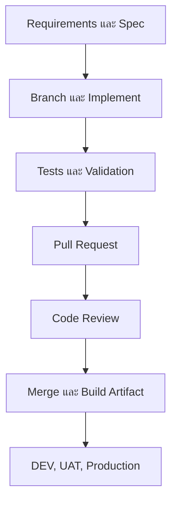

# Development Workflow

## ภาพรวม (Overview)

หมวดนี้รวบรวมขั้นตอนที่ทีมใช้เปลี่ยน Requirement ให้เป็น Code ที่ตรวจสอบและตามรอยได้ เริ่มจาก Spec และ Branch ไปจนถึง Pull Request, Code Review และการส่ง Artifact ไปยัง Environment

เอกสารเป็นแนวทางกลาง ชื่อ Branch, Required approvals, CI checks และผู้มีสิทธิ์ Deploy ต้องใช้กติกาจริงของแต่ละ Project

## เริ่มอ่านตรงไหน?

1. [Git & Pull Request](/development-workflow/git-pull-request) — ดู Diff, Commit, Push และเตรียม PR
2. [Code Review](/engineering-standards/code-review-coding-standards/code-review-process) — ตรวจ Correctness, Security, Tests และ Scope ตามมาตรฐานกลาง
3. [Spec-Driven Development](/development-workflow/spec-driven-development) — กำหนด Requirements, Plan และ Validation ก่อนลงมือ
4. [DEV / UAT / Production](/development-workflow/environments) — เข้าใจหน้าที่ของแต่ละ Environment และการ Promote Artifact

## Workflow แบบย่อ

ภาพมี 7 ขั้นตอน Branch ไม่ใช่ Environment และ Merge ไม่ได้หมายความว่า Deploy แล้ว การส่งต่อควรใช้ Artifact รุ่นเดิมที่ผ่านการตรวจเมื่อทำได้

## กติกาที่ต้องจำ

- แก้ Code ผ่าน Git และ Pull Request ตามกติกา Project
- ไม่แก้ Code หรือ Database บน UAT/Production โดยตรงเป็นขั้นตอนปกติ
- Schema และ Data change ที่ต้องตามรอยใช้ Version-controlled migration
- Code rollback ไม่ได้ย้อน Database ตาม
- บันทึก Commit, Tests, Artifact และ Environment ให้ตามกลับได้

## อ่านต่อ

- [Code Review & Coding Standards](/engineering-standards/code-review-coding-standards)
- [CI/CD & Operations](/technology-guides/devops)
- [Projects](/projects)
