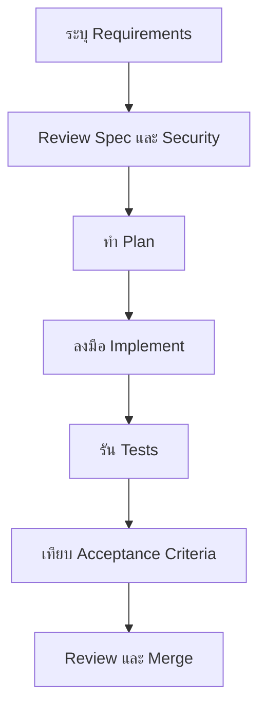

# Spec-Driven Development

## เรื่องนี้คืออะไร?

Spec-Driven Development หรือ SDD คือการตกลงว่า **จะสร้างอะไรและถือว่าสำเร็จเมื่อไร** ก่อนเริ่มแก้โค้ด Spec คือคำอธิบายที่ทีมและ AI Agent ใช้อ้างอิงร่วมกัน ไม่จำเป็นต้องเป็นเอกสารยาว

SDD ไม่ได้แทนการคุยกับทีม การทดสอบ หรือ Code Review แต่ช่วยให้แต่ละขั้นตรวจกลับไปยัง Requirements และ Acceptance Criteria ได้

## ทำไมต้องใช้กับ AI Agent?

ถ้าสั่งเพียง “สร้างฟังก์ชันเพิ่ม Task” Agent อาจเดา Business rules, API contract หรือ Database design เอง ผลที่ตามมาคือแก้ไฟล์เกินขอบเขต Review ยาก และต้องทำใหม่หลายรอบ

เมื่อมี Spec ทีมจะทำตามลำดับนี้:

ภาพนี้มี 7 ขั้นตอน จุดสำคัญคือ Human review ก่อนงานใหญ่เริ่ม และตรวจผลจริงกับ Acceptance Criteria ก่อน Merge

## ใช้เมื่อไร?

ใช้เมื่อ Change มี Business rule, API, Database, Security หรือหลาย Component เกี่ยวข้อง งานเล็กมาก เช่นแก้คำผิด อาจใช้ Issue สั้น ๆ พร้อม Acceptance Criteria โดยไม่สร้างโฟลเดอร์ Spec

| ระดับงาน | ตัวอย่าง | เอกสารที่พอเหมาะ |
| --- | --- | --- |
| Small | แก้ข้อความ, UI เล็กน้อย, Bug ตรงจุด | Issue + Acceptance Criteria |
| Medium | เพิ่ม API, หน้าใหม่, Validation | `requirements.md`, `plan.md`, Validation checklist |
| Large | Module ใหม่, Schema ใหญ่, Integration | Requirements ละเอียด, Architecture, Plan, Validation และ ADR เมื่อมี Decision สำคัญ |

ปริมาณเอกสารควรตามความเสี่ยง ไม่ใช่สร้างทุกไฟล์เพียงเพราะ Template มีให้

## เริ่มอ่านตรงไหน?

1. [โครงสร้าง Spec](/development-workflow/spec-driven-development/spec-structure) — รู้ว่าแต่ละไฟล์ตอบคำถามอะไร
2. [Workflow ของทีม](/development-workflow/spec-driven-development/workflow) — เดินงานตั้งแต่ Branch ถึง Merge
3. [Engineering Frameworks](/standards-compliance/frameworks) — เลือก Security requirements และ Verification framework ให้ตรงกับ Risk
4. [AI Agent Security](/development-workflow/spec-driven-development/ai-agent-security) — จำกัดข้อมูล สิทธิ์ และรับมือ Untrusted instructions
5. [Claude Code](/development-workflow/spec-driven-development/claude-code) หรือ [Codex](/development-workflow/spec-driven-development/codex) — ใช้ Agent โดยไม่เดาคำสั่งพิเศษ
6. [Prompt Templates](/development-workflow/spec-driven-development/prompts) — คัดลอก Prompt สำหรับงานประจำวัน
7. [ตัวอย่าง Task Creation](/development-workflow/spec-driven-development/task-creation-example) — ดู Requirements, Plan และ Validation ที่เชื่อมกัน

## กติกาหลัก

- Human ต้องยืนยัน Business rule ที่คลุมเครือ
- Agent ต้องไม่เปลี่ยน Requirements เงียบ ๆ
- Security requirements ต้องมี Acceptance criteria ที่ตรวจได้ตามความเสี่ยง
- Spec, Tests และ Implementation ต้องสอดคล้องกัน
- งานจาก AI ต้องผ่าน Review และการทดสอบก่อน Production
- ห้ามให้สอง Agent แก้ไฟล์เดียวกันพร้อมกันใน Working tree เดียว

## สรุป

- เริ่มจากขอบเขตและเกณฑ์สำเร็จ ไม่เริ่มจากการสั่งเขียนโค้ด
- ใช้เอกสารเท่าที่ความเสี่ยงต้องการ
- Plan และ Validation ต้องอ้าง Requirements ชุดเดียวกัน
- AI ช่วยร่างและลงมือได้ แต่ Human ยังเป็นผู้ตัดสินใจ

## อ่านต่อ

- [Git / GitHub](/development-workflow/git-pull-request)
- [CI/CD & Operations](/technology-guides/devops)
