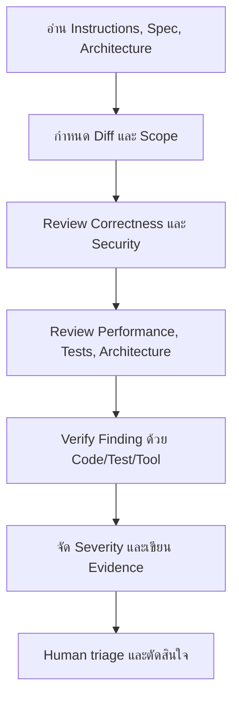

# AI-Assisted Code Review

## ภาพรวม (Overview)

AI-assisted review ใช้ AI ช่วยอ่าน Diff, หา Edge cases, Security/Performance risk, เสนอ Tests และสรุป Technical debt ผลลัพธ์เป็น Finding ที่ Human ต้อง Verify ไม่ใช่ Approval และไม่ควรได้รับ Secret หรือสิทธิ์มากกว่างานที่จำเป็น

## Mandatory Rules สำหรับ AI

AI **MUST**:

- อ่าน `AGENTS.md`, `CLAUDE.md` หรือ Instructions ที่ Project กำหนด รวมทั้ง Spec/Architecture ที่เกี่ยวข้อง
- ตรวจ Code และ Context จริงก่อนให้ Finding; ถ้าเปิดไฟล์หรือรัน Check ไม่ได้ต้องบอกข้อจำกัด
- อ้าง File/line หรือ Scenario, Impact และ Evidence ที่ตรวจซ้ำได้
- แยก Fact, Inference และ Question; หลีกเลี่ยง Finding ที่คาดเดาโดยไม่มี Path ที่เกิดได้
- ระบุ Severity/Priority ตามเกณฑ์ Project และไม่ลดระดับเพื่อให้ Merge
- ปกปิด Secret, Personal data และรายละเอียดช่องโหว่ที่จำกัดสิทธิ์
- รายงาน Command/Check ที่รันจริงและผลที่ไม่ได้รัน

AI **MUST NOT**:

- Approve, Merge หรือแทน Required human approval
- Bypass/ปิด Quality Gate, Security control หรือ Test
- แก้ Source code ในงาน `review-only`
- สร้าง Test แล้วถือว่าผ่านโดยไม่รัน
- ส่ง Code/Log/Repository content ไป External service นอกสิทธิ์และ Policy
- ขยาย Scope หรือ Apply significant changes โดยไม่มีคำขอแก้ไขที่ชัดเจน

## Workflow



Human reviewer ต้องตรวจ Finding กับ Source และ Risk จริง โดยเฉพาะ Authentication, Authorization, Migration, Concurrency และ Business logic

## มุมที่ AI ช่วยตรวจได้

| งาน | คำถามที่ควรถาม | Human ต้องยืนยัน |
| --- | --- | --- |
| Git diff / PR | Change มี Unrelated file, Missing case หรือ Contract เปลี่ยนหรือไม่ | Scope/Requirement และ Business intent |
| Security | Source → validation → sink และ Permission path มีช่องว่างหรือไม่ | Exploitability, Data classification, Threat model |
| Performance | Query count, Loop/I/O, N+1, unbounded work หรือ cache risk | Workload, measurements, SLO/cost |
| Architecture | Boundary/ADR/State/Transaction/Failure model ถูกละเมิดหรือไม่ | Trade-off และ approved deviation |
| Tests | Acceptance/negative/edge cases อะไรยังไม่มี | Test strategy และ assertion quality |
| Refactoring | ลด Duplication/Complexity โดยรักษา Behavior ได้อย่างไร | Scope, regression risk, timing |
| Technical debt | Debt ที่เกิดใหม่มี Trigger/Impact/Owner หรือไม่ | Business priority และ remediation plan |

## Prompt: Review-only สำหรับ Claude Code หรือ Codex

```text
Review this change without modifying files or approving/merging the PR.

Read the repository instructions and the relevant approved requirements,
architecture decisions, and validation criteria first. Review the actual diff
and the code paths it affects.

Focus on:
1. correctness and edge cases,
2. authentication, authorization, input/output handling, and sensitive data,
3. API/database compatibility, transactions, concurrency, and reliability,
4. performance and bounded resource use,
5. tests and documentation required by the behavior change.

For each actionable finding, provide:
- severity or engineering priority,
- file and smallest useful line range,
- concrete failure/attack scenario,
- impact,
- evidence from the code,
- a safe remediation direction and verification method.

Separate confirmed findings from questions. Avoid speculative findings.
State which checks you actually ran and what you could not verify.
```

## Prompt: SDD conformance review

```text
Review the implementation against this project's approved SDD artifacts.
The project may use different filenames, so identify the equivalent sources for
mission, technology constraints, architecture, requirements, plan, and validation.

Verify traceability from changed behavior to requirements and acceptance criteria,
architecture/security constraints, tests, migrations, and documentation.
Report undocumented deviations as findings; do not invent requirements.
Do not modify files in this review-only task.
```

## Prompt: Re-review หลังแก้ Finding

```text
Re-review only the previously reported findings and the new changes made to resolve
them. Confirm whether each finding is resolved, partially resolved, unchanged, or
replaced by a new risk. Check for regressions introduced by the fix and report the
checks actually executed. Do not reopen unrelated style preferences.
```

## วิธีประเมินคุณภาพ AI finding

- Reproduce/trace ได้จาก Code หรือ Test หรือไม่
- Scenario เกิดได้จริงภายใต้ Preconditions ที่ระบุหรือไม่
- Impact ตรงกับ Severity หรือไม่
- Tool/Model เห็น Context ครบหรืออ่านเพียง Diff บางส่วน
- Proposed fix รักษา Contract/Security และไม่ขยาย Scopeหรือไม่

Finding ที่ไม่มี Evidence ให้เปลี่ยนเป็น Question หรือไม่รับ ไม่ใช้จำนวน Finding เป็น KPI เพราะทำให้เกิด Noise

## อ่านต่อ

- [Findings & Severity](/engineering-standards/code-review-coding-standards/findings-severity)
- [Code Review Process](/engineering-standards/code-review-coding-standards/code-review-process)
- [AI Agent Security](/development-workflow/spec-driven-development/ai-agent-security)
- [Review & Validation](/development-workflow/spec-driven-development/review-validation)
