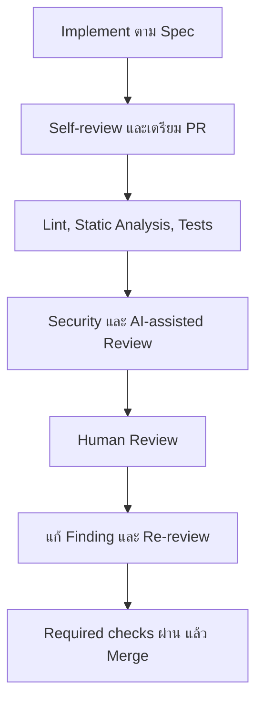

# Code Review Process

## ภาพรวม (Overview)

Code Review Process ทำให้ทุก Pull Request มี Context, Evidence และผู้ตัดสินใจที่ชัดเจน ก่อนเริ่มใช้ Project ต้องกำหนด Branch rules, Required checks, Reviewer/Code Owners และสิทธิ์ Merge ที่เปิดใช้จริง เอกสารนี้ไม่สมมติว่าค่าเหล่านั้นถูกเปิดแล้ว

## Workflow มาตรฐาน

Diagram รวม 12 กิจกรรมเป็น 7 ขั้นหลัก AI ให้ Finding เพิ่มเติมได้ แต่ไม่แทน Human approval และไม่ควรเป็นผู้ Merge

## 1. Developer เตรียม Pull Request

Developer **MUST**:

1. Implement ตาม Requirement/Plan ที่อนุมัติและไม่เพิ่ม Scope โดยเงียบ ๆ
2. Self-review ทั้ง Diff ไม่ใช่เฉพาะไฟล์ที่จำได้ว่าแก้
3. รัน Formatter, Lint, Tests, Static/Security checks ที่ Repository กำหนด
4. อัปเดต Tests, Migration, Documentation และ Runbook เมื่อ Behavior เปลี่ยน
5. เขียน PR description พร้อม Risk, Validation ที่รันจริง และสิ่งที่ไม่ได้รัน
6. แยก PR ให้เล็กพอ Review ได้ หรืออธิบายเหตุผลที่แยกไม่ได้

Draft PR **MAY** ใช้รับ Feedback เร็ว แต่ต้องไม่ขอ Final approval จน Context และ Required evidence พร้อม

## 2. Automated และ AI-assisted checks

- Formatting/Lint ตรวจความสม่ำเสมอและ Pattern ที่กำหนด
- Static analysis/SAST/SCA/Secret scanning ตรวจขอบเขตที่ Tool รองรับ
- Automated tests ตรวจ Behavior ที่มี Test
- AI review ช่วยสรุป Diff, หา Edge case และเสนอ Finding พร้อม Evidence

Failure ต้องแก้หรือบันทึก Exception ที่อนุมัติ ห้าม Rerun จนผ่านโดยไม่เข้าใจสาเหตุของ Flaky test และห้ามลด Rule/Threshold เพื่อให้ PR เขียวโดยไม่มี Review

## 3. Human Reviewer ตรวจอะไร?

Reviewer **MUST**:

- อ่าน Objective, Requirement, Architecture และ Out of scope ก่อน Diff
- ตรวจ Correctness, Edge cases, Authorization, Data handling, Compatibility และ Failure paths
- ตรวจว่า Tests พิสูจน์ Acceptance criteria ที่เกี่ยวข้อง ไม่ใช่แค่จำนวน Coverage
- แยก Blocking finding, Recommendation และ Question ให้ชัด
- ให้ Evidence: Path/line, Scenario, Impact และวิธี Verify โดยไม่เปิดเผย Secret
- ตรวจผลแก้ Finding สำคัญและ Required checks ใหม่ก่อน Approve

Reviewer **MUST NOT** Approve เพราะ CI เขียวอย่างเดียว หรือบังคับ Style preference ที่ไม่อยู่ใน Standard/Tool config

## Approval และ Merge rules

| เรื่อง | Baseline กลาง | Project ต้องกำหนด |
| --- | --- | --- |
| Human approval | AI approval ใช้แทนไม่ได้ | จำนวน/Role/Code Owners |
| Required checks | Check ที่กำหนดต้องสำเร็จบน Commit ที่จะ Merge | รายชื่อ Check และ Merge queue strategy |
| Unresolved findings | Critical/High และ Blocking finding ต้องแก้หรือมี Accepted risk ที่อนุมัติ | ผู้มีอำนาจรับ Risk |
| Stale approval | Change ที่กระทบ Finding/Logic หลัง Approve ต้อง Re-review | Dismiss stale approvals หรือ Ruleset |
| Merge method | รักษา Traceability ระหว่าง PR, Commit และ Release | Merge/Squash/Rebase ตาม Repository |

## Turnaround และการจัดลำดับ

ไม่มี SLA เดียวที่เหมาะกับทุกทีม Project **SHOULD** กำหนดเวลาตอบรับและ Review ตาม Risk/ขนาดงาน เช่น Security hotfix, Production incident หรือ Change ที่ Block ทีมอื่นควรถูก Triage ก่อน PR ปกติ หาก Review ช้าให้ลดขนาด PR, ส่ง Context เพิ่ม หรือ Escalate ผ่านช่องทางทีม ไม่ข้าม Reviewer

## เมื่อเห็นต่างกัน

1. กลับไปที่ Requirement, Standard, Evidence และ Risk ไม่ตัดสินจากความชอบ
2. ทดลองหรือเพิ่ม Test/Benchmark ขนาดเล็กเมื่อช่วยตัดสิน
3. บันทึก Trade-off และ Alternative ใน PR/ADR
4. Escalate ให้ Engineering Lead/Architect/Product/Security ตามเรื่อง
5. หากยอมรับ Exception ให้บันทึก Owner, Approval และ Review date

## Emergency changes

Emergency ไม่ได้แปลว่าไม่ Review:

- จำกัด Scope และใช้ Reviewer ที่มี Context เท่าที่สถานการณ์อนุญาต
- รัน Minimum safe checks ที่กำหนดไว้ล่วงหน้า
- บันทึกเหตุผล, ผู้อนุมัติ, Evidence และ Known risk
- Monitor และเตรียม Rollback/Forward fix
- ทำ Post-review และ Sync Fix กลับ Branch หลักภายในเวลาที่ Project กำหนด

ห้ามแก้ Code หรือ Database บน Production โดยตรงเป็นขั้นตอนปกติ ดู [Release & Rollback](/technology-guides/devops/rollback-and-release)

## Auditability

เก็บ Link/ID ของ Requirement, PR, Commit, Check run, Findings, Approval, Exception, Artifact และ Deployment ตามระบบที่องค์กรอนุมัติ ห้ามคัดลอก Secret, Customer data หรือรายละเอียดช่องโหว่ที่จำกัดสิทธิ์ลง Comment สาธารณะ

## อ่านต่อ

- [Code Review Checklist](/engineering-standards/code-review-coding-standards/code-review-checklist)
- [Findings & Severity](/engineering-standards/code-review-coding-standards/findings-severity)
- [Git & Pull Request](/development-workflow/git-pull-request)
- [Review & Validation](/development-workflow/spec-driven-development/review-validation)
