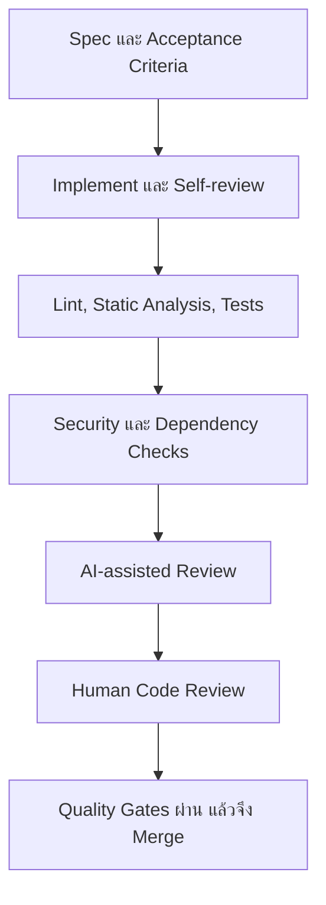

# Code Review & Coding Standards

## ภาพรวม (Overview)

**Code Review** คือการตรวจการเปลี่ยนแปลงก่อน Merge โดยเทียบ Code กับ Requirement, Architecture, Security และหลักฐานการทดสอบ ส่วน **Coding Standards** คือข้อตกลงว่าทีมจะเขียนและจัดโครงสร้าง Code อย่างไร เพื่อให้คนอื่นอ่าน แก้ และตรวจสอบได้

เอกสารชุดนี้เป็นมาตรฐานกลางแบบ Technology-independent กฎเฉพาะ Python, React, PostgreSQL หรือ Platform ให้ดูจาก [Technology Guides](/technology-guides) และการตั้งค่า Threshold, Reviewer count หรือ Tool จริงต้องกำหนดในแต่ละ Project

## ทำไมต้องใช้ร่วมกัน?

- ลด Defect และ Security regression ก่อน Change เข้าสู่ Branch หลัก
- ทำให้ Decision, Finding, Test และ Exception ตามรอยได้
- ลดการถกเรื่อง Style ที่ Formatter ตรวจแทนได้ และให้ Reviewer ใช้เวลากับ Logic/Risk
- ทำให้ AI, Automated checks และ Human review ทำงานเสริมกันโดยไม่สับสนเรื่องความรับผิดชอบ
- ช่วยให้การแก้ Code สอดคล้องกับ Spec และ Architecture ที่อนุมัติ

## ใครรับผิดชอบอะไร?

| Role | ความรับผิดชอบหลัก |
| --- | --- |
| Developer | ทำตาม Spec, Self-review, รัน Checks, อธิบาย Risk และตอบ Findings |
| Human Reviewer | ตรวจ Diff และ Context, ให้ Finding ที่มี Evidence, ตัดสิน Approve/Request changes ตามสิทธิ์จริง |
| Engineering Lead / Architect | ตัดสิน Architecture trade-off, Exception และความขัดแย้งที่กระทบหลายระบบ |
| QA / Security / DevOps | ตรวจ Acceptance, Security, Delivery/Operation ตาม Risk และ Scope |
| AI Coding Agent | ช่วยวิเคราะห์ Diff, เสนอ Tests/Findings และระบุข้อจำกัด แต่ไม่ Approve หรือ Merge |

## Review และ Automation ทำงานร่วมกันอย่างไร?

Diagram แสดงลำดับหลัก 7 ขั้น Automation ให้ Feedback ที่ทำซ้ำได้ ส่วน Human ต้องตรวจ Business logic, Architecture, Risk และ Context ที่เครื่องมือไม่รู้ การผ่าน CI ไม่ได้พิสูจน์ว่า Change ถูกต้องหรือปลอดภัยทั้งหมด

## Manual, Automated และ AI Review ต่างกันอย่างไร?

| วิธี | เหมาะกับ | ข้อจำกัด |
| --- | --- | --- |
| Automated | Formatting, Known patterns, Tests, Dependency/Secret scanning | อาจมี False positive/negative และไม่เข้าใจ Business intent |
| AI-assisted | สรุป Diff, หา Pattern, เสนอ Edge cases/Tests, ช่วยตรวจหลายมุม | อาจขาด Context หรือสร้าง Finding ที่คาดเดา ต้องตรวจ Evidence |
| Human | Business logic, Architecture, Authorization intent, Risk acceptance | ใช้เวลาและอาจพลาดสิ่งที่ Automation ตรวจซ้ำได้ |

## Governance ของมาตรฐาน

| หัวข้อ | แนวทางกลาง |
| --- | --- |
| Purpose | ป้องกัน Change ที่ผิด Requirement ไม่ปลอดภัย หรือดูแลต่อไม่ได้ |
| Scope | Code, Configuration, Migration, Tests, Documentation และ Dependency changes |
| Mandatory | กฎที่ระบุ MUST และ Required checks ที่ Project เปิดใช้จริง |
| Recommendations | กฎ SHOULD/MAY และ Tool selection ตาม Technology/Risk |
| Exceptions | ต้องมี Owner, เหตุผล, Compensating controls, Approval reference และ Review/expiry date |
| Enforcement | PR review, CI status checks, Rulesets/Branch protection และ Audit trail ตาม Project |
| Verification | Diff, Check results, Test evidence, Review comments และ Exception record |

## ตรวจงานแบบ Spec-Driven Development

ชื่อไฟล์อาจต่างกันตาม Project แต่ Reviewer ต้องหา Source of truth ที่เทียบเท่า:

- `mission.md` — Change ยังสนับสนุนเป้าหมายหรือไม่
- `tech.md` — ใช้ Technology/ข้อจำกัดที่ตกลงหรือไม่
- `architecture.md` — เคารพ Boundary, Data flow และ ADR หรือไม่
- `requirements.md` — Functional/Non-functional/Security requirements ครบหรือไม่
- `plan.md` — Scope, Migration, Rollout และ Dependency ตรงแผนหรือไม่
- `validation.md` — Acceptance criteria มีผลตรวจจริงและระบุสิ่งที่ไม่ได้ตรวจหรือไม่

ไม่บังคับทุก Project ใช้ชื่อไฟล์เดียวกัน แต่ **MUST** ตามกลับจาก Change ไป Requirement, Decision และ Validation ที่ได้รับอนุมัติได้

## เส้นทางแนะนำ

1. เริ่มจาก [General Coding Standards](/engineering-standards/code-review-coding-standards/general-coding-standards) และ [Secure Coding Standards](/engineering-standards/code-review-coding-standards/secure-coding-standards)
2. ใช้ [Code Review Process](/engineering-standards/code-review-coding-standards/code-review-process) กับทุก Pull Request ที่อยู่ใน Scope
3. เลือก [Static Code Analysis](/engineering-standards/code-review-coding-standards/static-code-analysis) และ [Quality Gates](/engineering-standards/code-review-coding-standards/quality-gates-cicd) ตาม Stack
4. ใช้ [Checklist](/engineering-standards/code-review-coding-standards/code-review-checklist) และ [Templates](/engineering-standards/code-review-coding-standards/templates-resources) ใน Repository ของ Project

## แหล่งอ้างอิงทางการ

- [OWASP Secure Code Review Cheat Sheet](https://cheatsheetseries.owasp.org/cheatsheets/Secure_Code_Review_Cheat_Sheet.html)
- [NIST SP 800-218 — Secure Software Development Framework 1.1](https://csrc.nist.gov/pubs/sp/800/218/final)
- [GitHub — About pull request reviews](https://docs.github.com/en/pull-requests/collaborating-with-pull-requests/reviewing-changes-in-pull-requests/about-pull-request-reviews)

## อ่านต่อ

- [Code Review Process](/engineering-standards/code-review-coding-standards/code-review-process)
- [Spec-Driven Development](/development-workflow/spec-driven-development)
- [Engineering Frameworks](/standards-compliance/frameworks)
