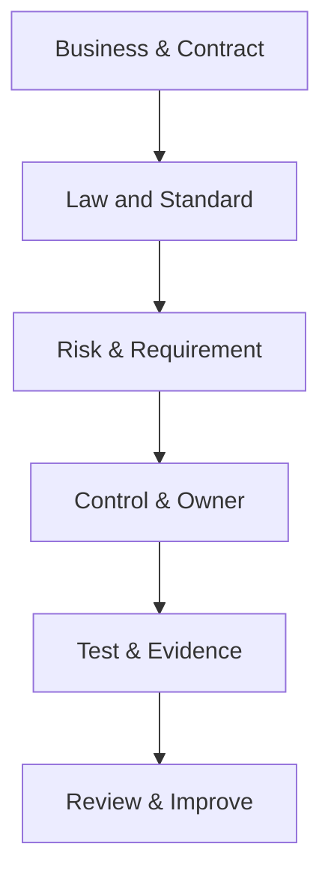

# Customer Management — Compliance Case Study

## ภาพรวม (Overview)

บริษัทต้องการระบบ Customer Management สำหรับเก็บข้อมูลผู้ติดต่อ ประวัติการติดต่อ และผู้รับผิดชอบบัญชี ระบบมี Web application, API, Database และบริการส่งอีเมล

กรณีศึกษานี้เป็น **ตัวอย่างเอกสาร** ไม่ได้หมายความว่าระบบถูกสร้าง ทดสอบ Deploy ผ่าน Audit หรือ Compliant แล้ว สมมติฐานทั้งหมดต้องให้ Owner, DPO/Legal และ Security ยืนยัน

### ขอบเขตตัวอย่าง

## จาก Business ไปสู่ Control

Flow นี้บังคับให้ทุก Control ย้อนกลับไปหาเหตุผลและ Owner ได้ และให้ทุก Requirement มีวิธี Verify

## 1. Scope และข้อมูล

- ผู้ใช้: Sales, Customer Support, Manager, Administrator
- ข้อมูล: ชื่อ อีเมล เบอร์โทร บริษัท ประวัติการติดต่อ และ Audit log
- Integration: Identity provider และ Email service
- Out of scope ตัวอย่าง: Payment card และระบบ Billing

## 2. คำถามที่ต้องยืนยัน

- Business purpose และ Lawful basis ของแต่ละ Data field คืออะไร
- บริษัทเป็น Controller/Processor ในแต่ละ Flow อย่างไร
- Contract บังคับ ISO/IEC 27001, Service level หรือ Data location หรือไม่
- ระบบอยู่ใน CII หรือกฎหมาย/ประกาศเฉพาะอุตสาหกรรมหรือไม่
- ใครยอมรับ Risk และอนุมัติ Access model

## 3. Requirement matrix ตัวอย่าง

| Source / Risk | Requirement ตัวอย่าง | Owner ที่ต้องยืนยัน | Verification / Evidence |
| --- | --- | --- | --- |
| ผู้ใช้เห็นข้อมูลเกินหน้าที่ | API ต้องตรวจ Authorization ทุก Object ตาม Role/Account scope | Business/System owner | Negative authorization tests และ Access review record |
| Personal data | แสดง Notice และเก็บเฉพาะ Field ที่มี Purpose ยืนยัน | Data owner/DPO/Legal | Data inventory, UI review และ API schema |
| Account takeover | Admin ใช้ MFA และ Session policy ตาม Risk | Security/System owner | Configuration reference และ Authentication tests |
| Service continuity | Restore ข้อมูลภายใน Target ที่ Owner อนุมัติ | Business/Service owner | Restore exercise record ที่รันจริง |
| Electronic record | Audit event ต้องระบุ Actor, Action, Target และเวลา โดยป้องกันการแก้โดยไม่ได้รับอนุญาต | Legal/System/Security owner | Log schema, Access test และ Integrity review |

ตารางนี้เป็น Proposal; ไม่มี Owner หรือ Result จริงจนกว่าทีมจะยืนยันและดำเนินการ

## 4. Definition of Done ด้าน Compliance

- Requirement มี Source, Scope, Owner และ Acceptance criteria
- Threat model และ Data flow ผ่าน Review ตาม Process จริง
- Automated tests และ Manual review ครอบคลุม Risk ที่ยืนยัน
- Finding มี Severity, Owner, Due date และ Risk decision
- Deployment artifact ตามรอยกลับ Commit/PR/Test ได้
- Operation มี Monitoring, Incident, Backup/Restore และ Access review ที่กำหนด

## 5. Failure scenario

หาก Sales user เรียก API ของลูกค้านอก Account ได้ ทีมต้องหยุด Exposure, เก็บ Evidence อย่างปลอดภัย, ประเมิน Scope/Impact กับ Incident team และให้ DPO/Legal พิจารณาหน้าที่แจ้งเหตุ ไม่ควรลบ Log หรือแจ้งภายนอกเองโดยข้าม Process

หลังแก้ ต้องเพิ่ม Regression test, ตรวจข้อมูลที่เข้าถึงได้, ทำ Root cause และ Sync Fix เข้าสู่ Main development history

## ข้อควรระวัง

- ไม่ใช้ Production personal data ใน DEV/UAT เป็นค่าเริ่มต้น
- ไม่เก็บ Token, Password หรือ Sensitive payload ใน Log
- ไม่ตั้ง Retention/RTO/RPO สมมติ
- ไม่อ้าง “ผ่าน ISO/PDPA” จาก Checklist หรือ Test ชุดเดียว

## สรุป

- เริ่มจาก Business, Data, Law/Contract และ Risk
- ทุก Requirement ต้องมี Owner และ Verification
- Evidence ต้องมาจากการทำงานจริงและเก็บอย่างปลอดภัย
- ทบทวนเมื่อ Scope, Supplier, Law หรือ Threat เปลี่ยน

## อ่านต่อ

- [Compliance Checklist](/standards-compliance/compliance-checklist)
- [PDPA](/standards-compliance/laws-regulations/pdpa)
- [Frameworks](/standards-compliance/frameworks)
- [Compliance Checklist](/standards-compliance/compliance-checklist)
