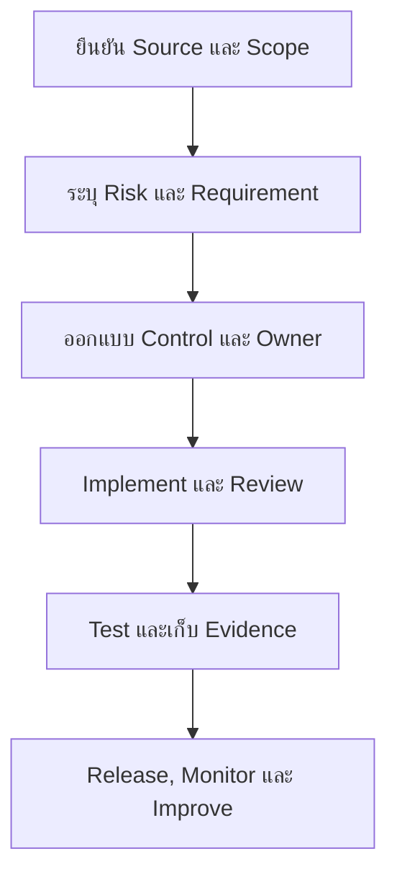

# ISO Implementation Guidelines for Software Development

## Overview

หน้านี้แสดงวิธีเชื่อม Standard กับงานจริงโดยไม่บังคับ Technology Stack เดียว ตัวอย่างเป็น Documentation-only ต้องปรับให้ตรงกับ Risk, Architecture, Framework version, Contract และ Policy ของแต่ละ Project

## Workflow

Flow เริ่มจาก Source ที่มีอำนาจจริง ไม่เริ่มจาก Tool หรือ Checklist จากนั้นจึงเลือก Control, วิธีตรวจ และ Evidence ตาม Risk

## ทำอย่างไร?

1. **Source:** ระบุ Standard/Edition, Law, Contract, Policy และ Customer requirement
2. **Scope:** ระบุ System, Data, Environment, Supplier, User และ Interface
3. **Requirement:** เขียนให้ Test ได้และแยกข้อบังคับจาก Recommendation
4. **Control:** ระบุ Preventive/Detective/Corrective control, Owner และ Exception path
5. **Implementation:** Link ไป Engineering Standard และ Technology Guide ที่เป็น Canonical
6. **Verification:** ระบุ Reviewer, Test method, Environment และ Expected result
7. **Evidence:** เก็บ Reference, Version, Period, Scope และ Access classification
8. **Operation:** Monitor, Incident, Corrective action และ Review trigger

## Practical Examples: Identity และ Application Security

| ตัวอย่าง | ปัญหาที่ต้องป้องกัน | แนวทางปฏิบัติ | ISO ที่เกี่ยวข้อง | วิธีตรวจและ Evidence |
| --- | --- | --- | --- | --- |
| Login/Authentication | Credential stuffing, Session theft | Framework-supported Auth, Rate/abuse protection ตาม Risk, Secure cookie/MFA เมื่อเหมาะสม | 27001, 27002, 27034 | Auth tests, config review, approved risk/design |
| RBAC/Ownership | Horizontal/vertical privilege escalation | บังคับ Backend permission และ Object ownership ทุก Request | 27002, 27034 | Allowed/denied API tests, permission matrix, PR evidence |
| Password hashing | Password disclosure | ใช้ Adaptive password hasher ของ Framework และ Upgrade policy | 27002, 27034 | Framework config review, hash-upgrade test; ไม่เก็บ password จริง |
| API security | Injection, Broken access, Abuse | Schema validation, Parameterized access, AuthZ, limits/timeouts ตาม Threat | 27034, 27002 | Negative/API tests, threat model, DAST/SAST scope |
| Secure file upload | Malware, path traversal, unauthorized download | Allowlist size/type, generated name, isolated storage, scan และ Download AuthZ | 27034, 27002 | Malicious/invalid cases, storage/IAM review, test result |
| Error handling | Sensitive detail leakage | Safe error contract, correlation ID และ Restricted diagnostic log | 27002, 27034 | API/log review ด้วยข้อมูลจำลอง |

ห้ามแนะนำให้เก็บ Sensitive authentication token ใน `localStorage` เป็นค่าเริ่มต้น และห้ามปิด CSRF, TLS หรือ Certificate verification เพื่อให้ตัวอย่างทำงาน

## Practical Examples: Data และ Privacy

| ตัวอย่าง | ปัญหาที่ต้องป้องกัน | แนวทางปฏิบัติ | ISO ที่เกี่ยวข้อง | วิธีตรวจและ Evidence |
| --- | --- | --- | --- | --- |
| Database encryption | Media/backup disclosure | TLS, encryption at rest และ Key lifecycle ตาม Classification/Risk | 27001, 27002, 27701 | DB/cloud config review, key-access review, architecture record |
| Audit logging | ไม่รู้ว่าใครทำอะไร หรือ Log รั่ว | บันทึก Actor/action/result/time/correlation เท่าที่จำเป็น ป้องกันแก้ไขและจำกัดสิทธิ์ | 27001, 27002, 27701 | Event tests, retention/access review, sample ที่ Redact แล้ว |
| Personal data | Over-collection/retention | Data inventory, minimization, purpose, access, retention/deletion | 27701, 27001 | Data-flow review, deletion test, DPO/Legal decision reference |
| Backup/recovery | Data loss หรือ Restore ไม่ได้ | Backup ตาม Recovery requirement, แยกสิทธิ์ และทำ Restore exercise | 27001, 27002 | Backup job + Restore record + gap/action ไม่ใช้ Job success อย่างเดียว |

Encryption ไม่แทน Authorization, Data minimization, Retention หรือ Backup และ Backup ไม่แทน Business continuity plan

## Practical Examples: Delivery และ Production

| ตัวอย่าง | ปัญหาที่ต้องป้องกัน | แนวทางปฏิบัติ | ISO ที่เกี่ยวข้อง | วิธีตรวจและ Evidence |
| --- | --- | --- | --- | --- |
| CI/CD security | Supply-chain/secret leakage | Least-privilege runner/token, pinned/reviewed dependency, protected environment, artifact trace | 27001, 27002, 27034, 9001 | Workflow review, scan result, provenance/change record |
| Production deployment | Untested change/config drift | Promote tested immutable artifact, separate config/secrets, approval and health verification | 27002, 9001, 25010 | Commit→PR→test→artifact→deployment trace |
| Logging/monitoring | Incident ตรวจพบช้าหรือ Alert ไม่มี Owner | Define security/quality signals, route alert, retain safely และทดสอบ response | 27001, 27002, 25010 | Alert test, dashboard/runbook reference, incident exercise |
| Quality acceptance | “เร็ว/เสถียร” ตรวจไม่ได้ | Quality scenario พร้อม workload/environment/measure | 25010, 9001 | Approved NFR, test config, raw result, analysis/limits |

## Verification Strategy

- **Review:** Requirements, Architecture, Threat/Privacy, Code, Configuration และ Change
- **Automated:** Unit/API/Integration, SAST, DAST, dependency, secret และ IaC scans ตาม Risk
- **Operational:** Access review, Alert test, Restore exercise, Incident simulation และ Metric review
- **Independent:** Internal audit/assessment หรือ Certification audit เมื่อ Scope กำหนด

Tool output เป็น Evidence ส่วนหนึ่ง ต้องระบุ Tool version, Configuration, Scope, Exclusion, Result และผู้ Review ไม่ถือว่า Scan ผ่านเท่ากับ Secure หรือ Compliant

## Required Team Policy กับ Recommendation

- สิ่งที่องค์กรอนุมัติแล้วและใช้คำว่า MUST ต้องมี Owner/Source/Scope ชัด
- ข้อความ SHOULD คือ Recommendation ที่อาจมี Exception พร้อมเหตุผล
- ตัวอย่างในหน้านี้ยังเป็น Draft guidance ไม่เปลี่ยน Project policy อัตโนมัติ

## Common Mistakes

- เริ่มซื้อ Tool ก่อนรู้ Requirement และ Risk
- Copy Checklist จากมาตรฐานอื่นแล้วอ้างว่าเป็น ISO requirement
- เก็บ Screenshot อย่างเดียวโดยไม่มี Scope/Period/Source
- ใช้ Environment หรือ Production data ร่วมกันโดยไม่มีการประเมินและควบคุม
- สร้าง Evidence หลังเหตุการณ์โดยไม่มี Audit trail จากการทำงานจริง

## อ่านต่อ

- [ISO Compliance Checklist](/standards-compliance/iso-standards/compliance-checklist)
- [Secure Coding Standards](/engineering-standards/code-review-coding-standards/secure-coding-standards)
- [Technology Guides](/technology-guides)
- [Projects](/projects)
