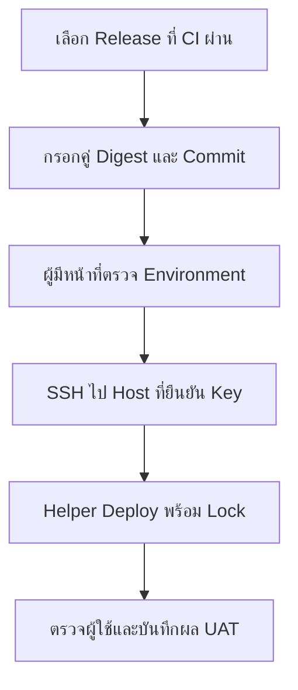

# Deployment Workflow — กดปล่อย DEV/UAT ผ่าน GitHub Actions

## เรื่องนี้คืออะไร?

Continuous Delivery เตรียมรุ่นให้พร้อมปล่อยและรอการยืนยันได้ ตัวอย่างนี้ใช้ workflow_dispatch คือคนเลือก Run พร้อม Release record แล้ว GitHub Job เรียก Server helper ผ่าน SSH ไม่ Clone/Build ใหม่บน Server

**ยังไม่มี Workflow file หรือ Pipeline ที่เปิดใช้จากเอกสารนี้** ตัวอย่างจำกัด dev/uat ของ Docker Task Lab ไม่ใส่ production เป็นตัวเลือก เพราะแอป Lab ไม่มี Auth และยังไม่พร้อมให้ผู้ใช้จริง

## ใช้เมื่อไร?

ใช้หลังทำ Manual runbook กับเครื่องทดลองผ่านและทบทวนสิทธิ์/Secret delivery แล้ว เหมาะกับ Migration ที่อนุมัติ Plan/Backup/Compatibility ล่วงหน้า หากต้องหยุดตัดสินใจระหว่าง Deploy ให้ใช้ [Manual Deploy Runbook](/technology-guides/devops/deploy-compose)



ภาพแยก Job สำเร็จออกจากการรับงานของ UAT ต้องตรวจ Approval จากการตั้งค่า Environment จริง ไม่ใช่จากรูปหรือชื่อ Job

## เตรียมก่อนใช้ตัวอย่าง

1. ใช้แอป Repo ของ Docker Task Lab ที่มี Source/Images ตาม [Build & Publish](/technology-guides/devops/image-release) ไม่ใช่ Repo Hub นี้
2. สร้าง Environment dev/uat พร้อม Branch restrictions, Reviewers และ Vars/Secrets ตาม [Environments & Secrets](/technology-guides/devops/environments-and-secrets) ล่วงหน้า ชื่อใน YAML อย่างเดียวไม่พอ
3. ผู้ดูแลติดตั้ง `ops/validate-release.py` ในแอป Repo และติดตั้ง Server helper/Policy ตาม [Source และขั้นตอน](/technology-guides/devops/deploy-compose) ไฟล์ฝั่ง Server ต้องไม่เขียนได้โดย Deploy user
4. เตรียม SSH identity ที่ได้รับอนุญาตเฉพาะคำสั่ง `sudo -n /usr/local/sbin/task-demo-deploy` โดยผู้ดูแลกำหนดสิทธิ์จริง และ Registry read credential บน Server
5. ตรวจ Network: GitHub-hosted runner อาจเข้า Private host ไม่ได้ ต้องเลือก VPN/Bastion/Runner ที่เหมาะสมในงาน Infrastructure แยก ไม่เปิด SSH สู่ทุก IP เพื่อให้ผ่าน
6. ตรวจ CI run, Commit, Digests, Migration plan, Backup และข้อจำกัดหยุดบริการก่อนอนุมัติ ไม่ให้คนกรอก URL เป็นการพิสูจน์ผล CI ด้วยตัวมันเอง

Key ของ SSH ต้องเป็นรูปแบบที่ SSH อ่านได้โดยไม่โต้ตอบในงานที่ได้รับอนุญาต พร้อมวงจร Rotate/Revoke ที่ชัด ตัวอย่างไม่ใช้ SSH agent และไม่มีขั้นป้อน Passphrase อย่าเอา Key ส่วนตัวของ Developer มาใช้แทน Deploy identity

## ตัวอย่าง Workflow

```yaml filename=".github/workflows/deploy-lab.yml"
name: Deploy Task Lab
on:
  workflow_dispatch:
    inputs:
      target_environment:
        description: Lab environment
        type: choice
        options: [dev, uat]
        required: true
      source_commit:
        description: Full source commit from successful trusted image CI
        type: string
        required: true
      frontend_digest:
        description: Full frontend repo@sha256 digest from release record
        type: string
        required: true
      backend_digest:
        description: Full backend repo@sha256 digest from release record
        type: string
        required: true
      source_run_url:
        description: Successful trusted image workflow run URL for review
        type: string
        required: true
permissions:
  contents: read
concurrency:
  group: deploy-task-${{ inputs.target_environment }}
  cancel-in-progress: false
jobs:
  deploy:
    if: github.ref == 'refs/heads/main'
    runs-on: ubuntu-24.04
    timeout-minutes: 20
    environment: ${{ inputs.target_environment }}
    steps:
      - uses: actions/checkout@3d3c42e5aac5ba805825da76410c181273ba90b1 # v7.0.1
        with:
          persist-credentials: false
      - name: Prepare and validate release metadata
        env:
          INPUT_COMMIT: ${{ inputs.source_commit }}
          INPUT_FRONTEND: ${{ inputs.frontend_digest }}
          INPUT_BACKEND: ${{ inputs.backend_digest }}
          INPUT_RUN_URL: ${{ inputs.source_run_url }}
          FRONTEND_REPOSITORY: ${{ vars.FRONTEND_REPOSITORY }}
          BACKEND_REPOSITORY: ${{ vars.BACKEND_REPOSITORY }}
        run: |
          python3 - <<'PYCODE'
          import json, os
          with open('candidate.json', 'w') as target:
              json.dump({
                  'source_commit': os.environ['INPUT_COMMIT'],
                  'source_run_url': os.environ['INPUT_RUN_URL'],
                  'images': {'frontend': os.environ['INPUT_FRONTEND'],
                             'backend': os.environ['INPUT_BACKEND']},
              }, target)
          PYCODE
          python3 ops/validate-release.py --input candidate.json \
            --output validated-candidate.json \
            --frontend-repository "$FRONTEND_REPOSITORY" \
            --backend-repository "$BACKEND_REPOSITORY"
      - name: Deploy using fixed server command
        env:
          DEPLOY_HOST: ${{ vars.DEPLOY_HOST }}
          DEPLOY_USER: ${{ vars.DEPLOY_USER }}
          DEPLOY_PORT: ${{ vars.DEPLOY_PORT }}
          DEPLOY_SSH_KEY: ${{ secrets.DEPLOY_SSH_KEY }}
          DEPLOY_KNOWN_HOSTS: ${{ secrets.DEPLOY_KNOWN_HOSTS }}
        run: |
          set -euo pipefail
          [[ "$DEPLOY_HOST" =~ ^[A-Za-z0-9][A-Za-z0-9.-]*$ ]]
          [[ "$DEPLOY_USER" =~ ^[a-z_][a-z0-9_-]*$ ]]
          [[ "$DEPLOY_PORT" =~ ^[0-9]{1,5}$ ]]
          (( 10#$DEPLOY_PORT >= 1 && 10#$DEPLOY_PORT <= 65535 ))
          test -n "$DEPLOY_SSH_KEY" && test -n "$DEPLOY_KNOWN_HOSTS"
          umask 077
          task_ssh_dir=$(mktemp -d "$RUNNER_TEMP/task-ssh.XXXXXXXX")
          trap 'rm -rf -- "$task_ssh_dir"' EXIT
          printf '%s\n' "$DEPLOY_SSH_KEY" > "$task_ssh_dir/key"
          printf '%s\n' "$DEPLOY_KNOWN_HOSTS" > "$task_ssh_dir/known_hosts"
          ssh -i "$task_ssh_dir/key" -p "$DEPLOY_PORT" \
            -o BatchMode=yes -o IdentitiesOnly=yes \
            -o StrictHostKeyChecking=yes -o ConnectTimeout=10 \
            -o "UserKnownHostsFile=$task_ssh_dir/known_hosts" \
            "$DEPLOY_USER@$DEPLOY_HOST" \
            'sudo -n /usr/local/sbin/task-demo-deploy' < validated-candidate.json
      - uses: actions/upload-artifact@cf430e030ddbb5b0abf93d22962f4752f3646cd9 # v7.0.2
        with:
          name: task-lab-deploy-${{ inputs.target_environment }}-${{ github.run_id }}-${{ github.run_attempt }}
          path: validated-candidate.json
          if-no-files-found: error
          retention-days: 14
```

Workflow ที่มี workflow_dispatch ต้องอยู่บน Default branch ก่อนจะเห็นให้เรียกจาก GitHub UI และตัวอย่างยอมรันจาก main เท่านั้น ต้องปรับให้ตรง Default/Trusted branch จริงพร้อม Protection rules ไม่แก้ if ให้รับทุก Branch เพื่อข้ามปัญหา

Host validation รองรับชื่อ DNS/IPv4 ของตัวอย่าง ไม่รองรับ IPv6 literal ที่มี `:` ส่วน Known hosts ต้องตรง Host/Port; Non-default port ใช้รูป `[HOST]:PORT` ตาม SSH client ไม่ปิดการตรวจ Key

## ทำไมส่ง JSON แทนส่งคำสั่ง?

Inputs ผ่าน env → Python JSON → Validator ก่อนส่ง stdin ให้ **คำสั่ง Remote คงที่** จึงไม่แทรก Digest/Commit ที่คนกรอกเป็น Shell code โดยตรง ฝั่ง Server ตรวจ Allowlist อีกชั้น ไม่รับ arbitrary command หรือ Source script จาก Workflow input

ไม่มี Secrets DB ใน Artifact ที่ Upload มีเฉพาะ Metadata ของ Candidate การ Upload สำเร็จบอกว่าผ่านขั้นเทคนิคตามลำดับ แต่ยังต้องเก็บ Server release path, Config revision และผล User/UAT tests จริง

## ตรวจหลัง Job จบอย่างไร?

1. เปิด Run URL ดู Environment/Inputs/Commit และสถานะของทุก Step ไม่ดูแต่หน้าสรุปสีเขียว
2. ตรวจ Host ว่าใช้คู่ Digests ที่เลือกจริง และไม่มี Migration/Container ค้างผิดรุ่น
3. ใช้ SSH tunnel ตรวจสร้าง/อ่าน Task ด้วยข้อมูลทดสอบที่ได้รับอนุญาต ให้ QA บันทึกผล UAT
4. ถ้าจะย้ายไป Environment ถัดไป ใช้คู่เดิมและเปลี่ยนเฉพาะ Config/Secrets ที่กำหนด ไม่ Build ใหม่
5. หาก Step/Network timeout ให้ตรวจ Remote state ก่อนกดซ้ำ SSH ขาดหรือ Job ถูกยกเลิกไม่ได้รับประกันว่า Remote process หยุดแล้ว

concurrency ป้องกันงานในกลุ่มนี้และไม่ยกเลิก Run ที่กำลังทำ แต่ไม่ใช่คิวเก็บทุก Pending run และไม่ล็อก Manual commands จึงใช้ Host flock ร่วมด้วย DEV/UAT ต้องเป็น Host/Resources แยก ถ้าใช้ร่วมต้องออกแบบ Lock/Project/Volumes ใหม่ให้ชัดก่อน

## ก่อนใช้ Production

ต้องใช้แอปที่มี Auth/Authorization, HTTPS และ Security checks ครบตาม Requirement พร้อม Runbook/Backup/Restore/Monitoring/Approval และการทดสอบใน Environment ก่อนหน้า การเพิ่มคำว่า production ใน options ไม่ทำให้ Task Lab พร้อมใช้งานจริง

หากใช้ Kubernetes ให้สร้าง Workflow/Service account/Migration Job/Rollout verification ตาม Project runbook แยก ไม่ใช้ SSH Compose helper ไปควบคุม Cluster ดู [Kubernetes deployment](/technology-guides/kubernetes/deployments)

## ข้อควรระวัง

อย่าเปิด Workflow นี้ก่อนเตรียม Protection rules และสิทธิ์ครบ อย่าเก็บ DB credentials ไว้ใน Inputs หรือ Artifact อย่ากด Re-run ทั้งชุดเมื่อไม่รู้ว่า Migration ครั้งก่อนทำไปถึงไหน และอย่าใช้ Workflow นี้สำหรับ Rollback เพราะ Server helper เรียก migrate

## สรุป

- Manual dispatch ยังต้องมี Environment protection และ Trusted branch
- ยืนยัน CI หลักฐานจริง; Validator ตรวจได้เพียงรูปแบบ/Allowlist
- ส่ง Metadata ให้คำสั่งคงที่ ไม่สร้าง Remote shell จาก Input
- Technical success, UAT acceptance และ Production approval เป็นผลคนละชุด

## อ่านต่อ

- [Deploy Runbook และ Helper source](/technology-guides/devops/deploy-compose)
- [Troubleshooting](/technology-guides/devops/troubleshooting)
- [workflow_dispatch](https://docs.github.com/en/actions/how-tos/manage-workflow-runs/manually-run-a-workflow)
