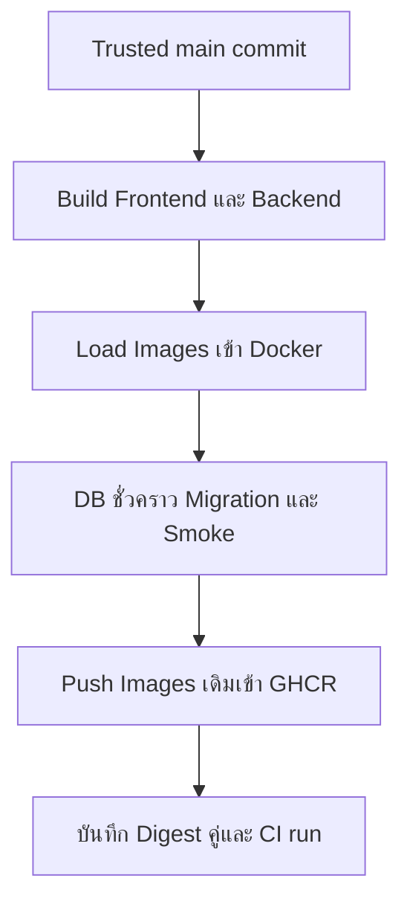

# Build & Publish Images — ทดสอบก่อนส่ง Registry

## เรื่องนี้คืออะไร?

Registry คือที่เก็บ Container images ส่วน Digest เป็นรหัสเนื้อหาที่ใช้ระบุ Image แบบไม่ขึ้นกับ Tag ที่อาจถูกเขียนทับ Release ของตัวอย่างนี้เป็น **คู่ Frontend/Backend digests + Source commit + CI run** ไม่ใช่เลขรุ่นอย่างเดียว

ตัวอย่างนี้ใช้ **Repository ทดลองของ Docker Task Lab แยกจาก Hub** ต้องคัด Source, Dockerfiles, nginx.conf, Migration และ Frontend lockfile จาก [Docker guides](/technology-guides/docker/reference-project) ให้ครบ ไม่มี Login/Automated business tests ใน Baseline นี้ Smoke test ด้านล่างเพิ่มการตรวจสร้าง/อ่าน Task แต่ไม่แทนชุด Tests ของระบบจริง

## ทำงานอย่างไร?



ภาพมี 6 ขั้นตอน ตัวอย่างใช้ linux/amd64 เพียง Platform เดียว และ Push Image ที่ Load/Smoke ไปแล้วโดยไม่ Build รอบสอง ถ้าต้องรองรับ arm64 ต้องเพิ่มการ Build/Test สำหรับ Platform นั้น ไม่อ้างว่าผล amd64 ครอบคลุมทั้งหมด

## ไฟล์ที่ต้องเตรียมใน Repo ทดลอง

เพิ่ม `ci/compose.ci.yaml` และ `ci/smoke-task.py` จาก Code blocks นี้ก่อนเปิด Workflow ไม่มีไฟล์เหล่านี้ใน Hub จริง Compose ชุดนี้ใช้ DB ชั่วคราวใน CI ไม่ใช้ Volume/DB ของ DEV/UAT/Production:

```yaml filename="ci/compose.ci.yaml"
services:
  db:
    image: postgres:17-alpine
    environment:
      POSTGRES_DB: task_ci
      POSTGRES_USER: task_ci
      POSTGRES_PASSWORD: ${POSTGRES_PASSWORD:?temporary CI password required}
    tmpfs:
      - /var/lib/postgresql/data
    healthcheck:
      test: ["CMD-SHELL", "pg_isready -h 127.0.0.1 -U \"$$POSTGRES_USER\" -d \"$$POSTGRES_DB\""]
      interval: 5s
      timeout: 3s
      retries: 12
  backend:
    image: ${BACKEND_TAG:?built image required}
    pull_policy: never
    environment:
      POSTGRES_DB: task_ci
      POSTGRES_USER: task_ci
      POSTGRES_PASSWORD: ${POSTGRES_PASSWORD:?temporary CI password required}
      DJANGO_SECRET_KEY: ${DJANGO_SECRET_KEY:?temporary CI key required}
      DJANGO_ALLOWED_HOSTS: localhost,127.0.0.1,backend
      DB_HOST: db
      DB_PORT: "5432"
    depends_on:
      db: {condition: service_healthy}
    healthcheck:
      test: ["CMD", "python", "-c", "import urllib.request; urllib.request.urlopen('http://127.0.0.1:8000/api/health/', timeout=2)"]
      interval: 5s
      timeout: 3s
      retries: 12
  frontend:
    image: ${FRONTEND_TAG:?built image required}
    pull_policy: never
    ports:
      - "127.0.0.1:8080:8080"
    depends_on:
      backend: {condition: service_healthy}
    healthcheck:
      test: ["CMD", "wget", "-q", "-O", "/dev/null", "http://127.0.0.1:8080/"]
      interval: 5s
      timeout: 3s
      retries: 12
```

pull_policy:never ของแอปบังคับใช้ Images ที่เพิ่ง Build ใน Runner ส่วน DB รับ Password สุ่มเฉพาะ Run และ Data เป็น tmpfs ที่หายเมื่อ Container ถูกถอด ไม่ Publish พอร์ต DB คำสั่ง Cleanup ด้านล่างใช้เฉพาะ CI project ใหม่ของ Run นั้น ห้ามคัดไปล้าง Project จริง

```python filename="ci/smoke-task.py"
import json
import os
from urllib.request import Request, urlopen

BASE = "http://127.0.0.1:8080"


def request(path, data=None):
    payload = None if data is None else json.dumps(data).encode()
    headers = {} if data is None else {"Content-Type": "application/json"}
    with urlopen(Request(BASE + path, data=payload, headers=headers), timeout=10) as response:
        return response.status, json.load(response)


status, health = request("/api/health/")
assert status == 200 and health["status"] == "ok"
title = "ci-smoke-" + os.environ["GITHUB_RUN_ID"]
status, task = request("/api/tasks/", {"title": title})
assert status == 201 and isinstance(task["id"], int) and task["title"] == title
status, tasks = request("/api/tasks/")
assert status == 200 and isinstance(tasks, list)
assert any(row["id"] == task["id"] and row["title"] == title for row in tasks)
print("Task create/read smoke passed on disposable CI database")
```

Script เขียนข้อมูลเฉพาะ DB ชั่วคราว ตรวจเส้นทางผ่าน Frontend proxy ถึง DB ไม่ใช้ยิง Production และไม่ใช้แทน Login/Ownership tests ของ [Fullstack Task v1](/technology-guides/fullstack)

## ตัวอย่าง Workflow: Trusted main เท่านั้น

ก่อนเปิดต้องมี Branch main ที่ Review/ป้องกันตามโปรเจกต์, GHCR ที่อนุญาต Package write และชื่อ Repository ที่ใช้เป็น OCI image path ได้ Job นี้ไม่รับ pull_request เพราะมีสิทธิ์ Publish:

```yaml filename=".github/workflows/task-images.yml"
name: Task Lab images
on:
  push:
    branches: [main]
  workflow_dispatch:
permissions:
  contents: read
concurrency:
  group: task-images-${{ github.ref }}
  cancel-in-progress: false
jobs:
  build-test-publish:
    if: github.ref == 'refs/heads/main'
    runs-on: ubuntu-24.04
    timeout-minutes: 25
    permissions:
      contents: read
      packages: write
    env:
      CI_PROJECT: task-ci-${{ github.run_id }}-${{ github.run_attempt }}
    steps:
      - uses: actions/checkout@3d3c42e5aac5ba805825da76410c181273ba90b1 # v7.0.1
        with:
          persist-credentials: false
      - uses: docker/setup-buildx-action@f87e5991a6d7451dcb8d9637bfbc97413f497069 # v4.4.1
      - name: Prepare image names and disposable credentials
        shell: bash
        run: |
          repo="$(printf '%s' "$GITHUB_REPOSITORY" | tr '[:upper:]' '[:lower:]')"
          tag="sha-${GITHUB_SHA}-run-${GITHUB_RUN_ID}-${GITHUB_RUN_ATTEMPT}"
          printf 'FRONTEND_TAG=ghcr.io/%s/frontend:%s\n' "$repo" "$tag" >> "$GITHUB_ENV"
          printf 'BACKEND_TAG=ghcr.io/%s/backend:%s\n' "$repo" "$tag" >> "$GITHUB_ENV"
          db_password="$(openssl rand -hex 24)"
          django_key="$(openssl rand -hex 48)"
          printf '::add-mask::%s\n' "$db_password"
          printf '::add-mask::%s\n' "$django_key"
          printf 'POSTGRES_PASSWORD=%s\nDJANGO_SECRET_KEY=%s\n' "$db_password" "$django_key" >> "$GITHUB_ENV"
      - name: Build backend once
        uses: docker/build-push-action@c3c9e263c25d99ce0380d002d59b67737d91b0dc # v7.4.0
        with:
          context: ./backend
          platforms: linux/amd64
          load: true
          push: false
          tags: ${{ env.BACKEND_TAG }}
          labels: org.opencontainers.image.revision=${{ github.sha }}
      - name: Build frontend once
        uses: docker/build-push-action@c3c9e263c25d99ce0380d002d59b67737d91b0dc # v7.4.0
        with:
          context: ./frontend
          platforms: linux/amd64
          load: true
          push: false
          tags: ${{ env.FRONTEND_TAG }}
          labels: org.opencontainers.image.revision=${{ github.sha }}
      - name: Validate and migrate disposable database
        shell: bash
        run: |
          compose=(docker compose -p "$CI_PROJECT" -f ci/compose.ci.yaml)
          "${compose[@]}" config -q
          "${compose[@]}" up -d --wait --wait-timeout 120 db
          "${compose[@]}" run --rm --no-deps backend python manage.py check
          "${compose[@]}" run --rm --no-deps backend python manage.py makemigrations --check --dry-run
          "${compose[@]}" run --rm --no-deps backend python manage.py migrate --noinput
          "${compose[@]}" up -d --wait --wait-timeout 120 backend frontend
      - name: Smoke through frontend
        run: python3 ci/smoke-task.py
      - name: Show service state on failure
        if: failure()
        run: docker compose -p "$CI_PROJECT" -f ci/compose.ci.yaml ps -a
      - name: Remove only this disposable CI project
        if: always()
        run: docker compose -p "$CI_PROJECT" -f ci/compose.ci.yaml down --remove-orphans
      - name: Login to GHCR after checks
        uses: docker/login-action@81c6f93d4bc991e510b342a00b419b3bb4efc5c6 # v4.7.0
        with:
          registry: ghcr.io
          username: ${{ github.actor }}
          password: ${{ secrets.GITHUB_TOKEN }}
      - name: Push tested images and record immutable identity
        shell: bash
        run: |
          docker push "$FRONTEND_TAG"
          docker push "$BACKEND_TAG"
          frontend_ref="$(docker image inspect --format '{{index .RepoDigests 0}}' "$FRONTEND_TAG")"
          backend_ref="$(docker image inspect --format '{{index .RepoDigests 0}}' "$BACKEND_TAG")"
          export FRONTEND_REF="$frontend_ref" BACKEND_REF="$backend_ref"
          python3 - <<'PYCODE'
          import json, os
          record = {
              "source_commit": os.environ["GITHUB_SHA"],
              "images": {"frontend": os.environ["FRONTEND_REF"], "backend": os.environ["BACKEND_REF"]},
              "source_run_url": os.environ["GITHUB_SERVER_URL"] + "/" + os.environ["GITHUB_REPOSITORY"] + "/actions/runs/" + os.environ["GITHUB_RUN_ID"],
          }
          with open("release-candidate.json", "w") as target:
              json.dump(record, target, indent=2)
          PYCODE
      - uses: actions/upload-artifact@cf430e030ddbb5b0abf93d22962f4752f3646cd9 # v7.0.2
        with:
          name: task-release-${{ github.run_id }}-${{ github.run_attempt }}
          path: release-candidate.json
          if-no-files-found: error
          retention-days: 14
```

Build Frontend จะรัน npm ci/build ตาม Dockerfile และ Backend ตรวจ Migration state ก่อน Apply ลงฐานทิ้งได้ หากขั้น Smoke ล้มเหลว ขั้น Login/Push ที่ใช้ success ตามปกติจะไม่รัน แม้ Cleanup ใช้ always งานไม่ได้กลับมาเป็นผ่านเพียงเพราะ Cleanup สำเร็จ

Tag แยกด้วย Commit/Run/Attempt เพื่อไม่ชนเมื่อรันซ้ำ แต่การ Promote ใช้ Digest ใน JSON หลัง Push ไม่ใช้ Tag แทน หลักฐาน URL/Artifact ต้องตรวจว่าเป็น Run จาก Workflow/Branch ที่เชื่อถือและสำเร็จจริงก่อนเลือก Candidate JSON ไม่ใช่หลักฐาน Approval ในตัวมันเอง

## ข้อควรระวัง

- Checkout Source ที่ใช้ Release ต้องถูกตรวจอีกครั้งหลัง Merge ไม่ใช้ Artifact จาก Untrusted PR มารันใน Job ที่มี Packages/Deploy credentials
- GITHUB_TOKEN อาจ Push ไม่ได้หาก Package/Organization settings ไม่อนุญาต ต้องตรวจสิทธิ์จริง ไม่เพิ่ม Write token ให้ PR เพื่อแก้ Error
- ไม่ฝัง Runtime secrets ใน Build arguments/Image/Artifacts และอย่า Dump Compose config แบบไม่ -q เพราะอาจเห็น Password
- นี่ไม่ใช่ Multi-architecture, Security scan, Provenance attestation หรือ Production readiness ที่ตรวจแล้ว ต้องเพิ่มตาม Requirement

## สรุปสิ่งที่ต้องจำ

- Build/Test/Push ต้องเป็น Image identity ที่ตามรอยได้
- CI ใช้ฐานชั่วคราว ไม่ใช้ข้อมูลจริง
- Release record เก็บคู่ Digests และ Commit/Run
- Promote ใช้ Digest เดิมและ Config/Secrets ของปลายทาง

## อ่านต่อ

- [Deploy Runbook](/technology-guides/devops/deploy-compose)
- [Environments & Secrets](/technology-guides/devops/environments-and-secrets)
- [Docker test-before-push](https://docs.docker.com/build/ci/github-actions/test-before-push/)
- [GHCR authentication](https://docs.github.com/en/packages/working-with-a-github-packages-registry/working-with-the-container-registry)
