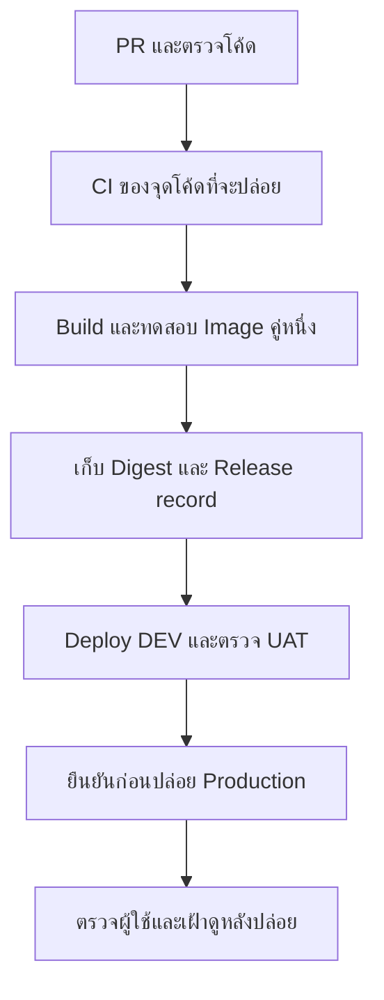

# DevOps & Infrastructure

## ภาพรวม (Overview)

DevOps คือการทำให้คนพัฒนา ทดสอบ และดูแลระบบส่งมอบงานร่วมกันได้อย่างตามรอย ตั้งแต่ตรวจ PR ไปจนถึงเฝ้าดูหลังปล่อย ไม่ใช่ชื่อเครื่องมือหรือหน้าที่ของคนใดคนหนึ่งเท่านั้น

หมวดนี้เป็น **เอกสารก่อนลงมือเปิดระบบจริง** YAML/Scripts อยู่ใน MDX ไม่มีการสร้าง `.github/workflows/`, เปิด Pipeline, ตั้ง Secrets, Push Image หรือ Deploy Server/Cluster จากงานนี้ Host/ผู้รับผิดชอบ/สิทธิ์จริงต้องบันทึกใน Project runbook ก่อนใช้

## เริ่มอ่านตรงไหน?

1. [GitHub Actions & CI](/technology-guides/devops/github-actions): เข้าใจ Workflow/Job/Step แล้วดู CI สำหรับ Engineering Hub ที่ใช้ Scripts ของ Repo นี้
2. [Build & Publish Images](/technology-guides/devops/image-release): ตัวอย่าง Task App ที่ Build → ทดสอบ Image → Push คู่ Image → เก็บ Release record
3. [Environments & Secrets](/technology-guides/devops/environments-and-secrets): แยก DEV/UAT/Production, Credentials และ Approval gates
4. [Deploy Runbook](/technology-guides/devops/deploy-compose): ลำดับตรวจ เตรียม Migration ปล่อย และยืนยันผลบน Ubuntu/Compose
5. [Deployment Workflow](/technology-guides/devops/deployment-workflow): ตัวอย่าง Manual GitHub Actions สำหรับ DEV/UAT Lab หลังเตรียมปลายทางครบ
6. [Release & Rollback](/technology-guides/devops/rollback-and-release), [Operations](/technology-guides/devops/operations) และ [Troubleshooting](/technology-guides/devops/troubleshooting): ทำอย่างไรเมื่อปล่อยแล้วต้องตรวจต่อหรือมีปัญหา

## CI/CD

Artifact คือไฟล์ผลลัพธ์จากงาน เช่น Image หรือ Release record ที่ส่งไปใช้ต่อ ส่วน CI หรือ Continuous Integration ตรวจโค้ดเมื่อมีการเปลี่ยน ส่วน Continuous Delivery เตรียมรุ่นให้พร้อมปล่อยโดยยังรอผู้มีสิทธิ์ยืนยันได้ Continuous Deployment จึงเป็นอีกแบบที่ปล่อยอัตโนมัติเมื่อครบเงื่อนไข ตัวอย่างนี้เน้น Delivery ที่มีจุดตรวจและอนุมัติ

ภาพมี 7 ขั้นตอน Image คือแพ็กโปรแกรมพร้อมสิ่งที่ใช้รัน ส่วน Digest คือรหัสเนื้อหาของ Image ที่ระบุรุ่นแน่นอน Frontend/Backend ต้องตามกลับ Commit และผลตรวจได้ นำ **Digest คู่เดิม** ไป Environment ถัดไปโดยแยกค่าตั้ง/Secrets ไม่ Build ใหม่กลางทางแล้วอ้างว่าเป็นรุ่นที่ UAT ตรวจแล้ว

กติกา Git, PR, Commit และลำดับงานต้องตกลงตามโปรเจกต์ ส่วนตัวอย่าง YAML และรายละเอียดเครื่องมืออยู่ในหมวดนี้

## Docker Deployment

ตัวอย่าง Image/Compose ใช้ [Docker Task Lab](/technology-guides/docker/reference-project): React + Django + PostgreSQL, ชื่อ frontend/backend/db, `/api/tasks/` และ `/api/health/` เป็น Lab ไม่มี Login จึงจำกัด Loopback/SSH tunnel และ **ไม่ใช้เปิด Production**

[Fullstack Task v1](/technology-guides/fullstack) มี Auth/Ownership และ Routes ต่างกัน ต้องเปลี่ยน Tests/Settings/Deployment runbook ให้ตรงเมื่อเลือก Baseline นั้น ไม่สลับไฟล์สองชุดแล้วถือว่าต่อกันได้ทันที ดู [Deploy Runbook](/technology-guides/devops/deploy-compose)

## Kubernetes Deployment

ใช้เมื่อมี Requirement และคนดูแล Cluster ที่พร้อม ไม่จำเป็นสำหรับทุกระบบ ลำดับ Artifact → Config → Migration → Rollout → Verify ยังใช้หลักเดียวกัน แต่คำสั่งและการดูแลข้อมูลต่างจาก Compose ดู [Kubernetes Guide](/technology-guides/kubernetes) และ Project runbook ของระบบจริง

## Environment Management

แยก Build-time/Runtime configuration, Secret source และสิทธิ์ของแต่ละ Environment ใช้ชื่อตัวแปรแทนค่าจริง ดู [Environments & Secrets](/technology-guides/devops/environments-and-secrets) หากยังไม่มี Host/Environment ให้บันทึก Not configured ไม่สร้าง URL สมมติเป็นของที่เปิดใช้แล้ว

## SIT / UAT / Production

DEV ให้ทีมทดสอบร่วม UAT ตรวจความต้องการ Production ให้ผู้ใช้จริง บางโครงการมี SIT สำหรับการเชื่อมหลายระบบ ชื่อเหล่านี้ไม่ใช่ Git branch การมี Environment ชื่อ production ใน YAML ยังไม่สร้าง Approval policy ให้ครบ ดู [Environments & Secrets](/technology-guides/devops/environments-and-secrets)

## Monitoring

ตรวจ Error rate, Latency, Resource pressure และความถูกต้องของข้อมูลตามเส้นทางผู้ใช้จริง Alert ต้องบอกว่าทำอะไรต่อและใครรับผิดชอบจริง ดู [Operations](/technology-guides/devops/operations)

## Backup & Recovery

Volume/Replication ไม่แทน Backup ต้องรู้ข้อมูลที่เก็บ Retention จุดล้มเหลว และผล Restore ที่ทำจริง กำหนด RPO/RTO เป็นเป้าหมายก่อน ไม่อ้างว่าได้ตามเป้าเพียงเพราะมีคำสั่ง Dump ดู [Operations: Backup](/technology-guides/devops/operations#backup--recovery)

## Rollback Procedures

กลับ Image รุ่นก่อนต้องตรวจว่าเข้ากับ Schema/Config ปัจจุบันได้ Code rollback ไม่ย้อน Database ตาม และไม่ควร Undo ทุกครั้งที่ Migration ล้มโดยอัตโนมัติ ดู [Release & Rollback](/technology-guides/devops/rollback-and-release)

## Release Management

เก็บ Commit, CI run, Image digests, Config revision และผล DEV/UAT/Production แยกจากกันตาม [Release & Rollback](/technology-guides/devops/rollback-and-release) ไม่สร้าง Release หรือผลอนุมัติที่ยังไม่ได้เกิดขึ้น

## Incident Management

ถ้าปล่อยแล้วผู้ใช้ได้รับผลกระทบ ให้หยุด Promote ต่อ เก็บ Timeline พร้อม Timezone แยกข้อเท็จจริง/สมมติฐาน และ Mitigate ตาม Runbook ก่อนทบทวนสาเหตุ ดู [Operations: Incident](/technology-guides/devops/operations#incident-management)

## Checklist

- [ ] รู้ Baseline และ Project runbook ที่จะใช้จริง
- [ ] CI ตรวจจุดโค้ดเดียวกับที่จะสร้าง Release
- [ ] รู้ Digest คู่เดิมและ Config ของแต่ละ Environment
- [ ] มี Migration/Backup/Recovery plan และสิทธิ์ที่ได้รับอนุญาต
- [ ] ผลตรวจและผู้อนุมัติบันทึกตามที่เกิดขึ้นจริง

## เอกสารที่เกี่ยวข้อง (Related Documentation)

- [Projects](/projects)
- [Operations & Incident](/technology-guides/devops/operations)
- [Troubleshooting](/technology-guides/devops/troubleshooting)
