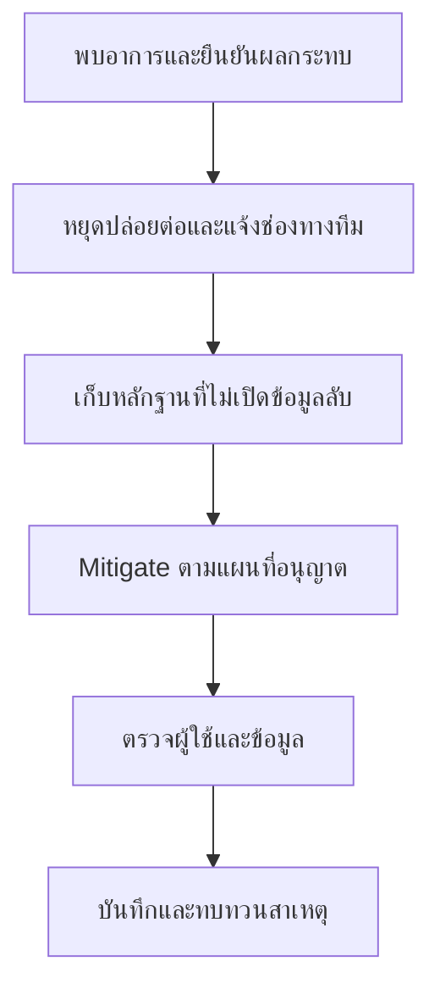

# Operations — ดูแลหลังปล่อยและเตรียมรับปัญหา

## เรื่องนี้คืออะไร?

งานยังไม่จบเมื่อ Deploy เสร็จ ต้องรู้ว่าผู้ใช้ทำงานได้ ข้อมูลถูกต้อง และมีคนรับเรื่องเมื่อผิดปกติ Operations คือการดูแลระบบระหว่างใช้งาน ไม่ใช่การเข้า Server แก้สดทุกครั้งที่มีปัญหา

หน้านี้เป็นแนวทางจัด Runbook ยังไม่ได้ติดตั้ง Monitoring/Backup/Alerting หรือรับรองผลกู้คืนจริง Configuration ของแต่ละระบบให้เก็บใน `projects/<slug>/` และลิงก์กลับมา

## Monitoring

Monitoring คือการติดตามสัญญาณสุขภาพระบบ เริ่มจากสิ่งที่ผู้ใช้ทำ เช่น เปิดเว็บ/สร้าง Task แล้วค่อยดูว่า API หรือ DB ส่วนใดช้า

| ดูอะไร | ช่วยตอบอะไร |
| --- | --- |
| Request success/error rate และ Latency | ผู้ใช้เรียก API สำเร็จและรอนานเท่าไร |
| Container restarts, Memory/CPU/Disk | ระบบขาดทรัพยากรหรือหยุดซ้ำหรือไม่ |
| DB connections, Locks, Slow queries | มีคิวรอหรือใช้ Connection จนเต็มหรือไม่ |
| ผลเส้นทางสำคัญและความถูกต้องข้อมูล | HTTP 200 แต่ทำงานผิดหรือข้อมูลหายหรือไม่ |

Health check ตรวจได้เฉพาะสิ่งที่เขียนไว้ `/api/health/` ของ Docker Lab ตรวจ DB connection ไม่ได้ตรวจทุก Business flow ส่วน Compose บนเครื่องเดียวไม่ทำ High Availability ให้โดยอัตโนมัติ

### ตรวจหลัง Deploy ทีละขั้น

1. จด Commit/คู่ Digest/เวลาเริ่มปล่อย เพื่อเทียบสัญญาณก่อนและหลัง
2. ตรวจ Container state และเว็บ/API ตาม [Deploy Runbook](/technology-guides/devops/deploy-compose)
3. ทดสอบเส้นทางผู้ใช้ด้วยข้อมูลที่ได้รับอนุญาต ถ้าเป็นระบบ Login ต้องรวมกรณีไม่มีสิทธิ์ด้วย
4. ดู Error/Latency/ทรัพยากรในช่วงเฝ้าระวังที่โครงการตกลง ไม่แต่งระยะเวลาว่าเป็นนโยบายทีม
5. หากผิดปกติหยุด Promote และทำตามแผน Mitigate/Incident

ตัวอย่างคำสั่งอ่านสถานะบน Host ที่ได้รับสิทธิ์ ใช้ Config/Release เดียวกับ Runbook:

```bash
"${release_compose[@]}" ps
"${release_compose[@]}" logs --since 10m --tail 100 backend
```

คำสั่งใช้ Bash array ที่ตั้งไว้ใน [Deploy Runbook](/technology-guides/devops/deploy-compose) Logs อาจมีข้อมูลอ่อนไหว ต้องตรวจ/ปิดบังก่อนแนบ Issue ไม่ Dump env/config ทั้งหมด ตั้ง Log rotation/Retention และพื้นที่จัดเก็บจริงแยกต่างหาก

Alert ที่ดีบอกอาการ/ผลกระทบ/Environment/Runbook และผู้รับผิดชอบจริง ปรับ Threshold จากข้อมูลจริง ไม่ตั้ง CPU ตัวเลขเดียวแล้วถือว่าครอบคลุมทุก Incident

## Backup & Recovery

Backup คือสำเนาที่ใช้กู้ข้อมูล Recovery คือการนำระบบกลับมาทำงาน ต้องครอบคลุม DB, ไฟล์ผู้ใช้ถ้ามี, Config revisions และวิธีนำ Secrets กลับมาอย่างปลอดภัย Volume และ Replication ไม่ใช่ Backup

1. ระบุว่าจะสำรองอะไร ที่ไหน ความถี่/Retention เท่าไร และใครมีสิทธิ์อ่าน/กู้คืน
2. แยกสำเนาจาก Host ต้นทางและเข้ารหัสตาม Requirement อย่าเก็บไว้เฉพาะ Disk ที่ DB ใช้อยู่
3. ทดสอบ Restore ลงฐานที่ทิ้งได้และแยกจากระบบจริง ห้ามเขียนทับ UAT/Production เพียงเพื่อทดลอง
4. ตรวจข้อมูลสำคัญ/Constraints และเปิดแอปกับฐานที่ Restore แล้วตามแผน
5. บันทึก Version, ขนาด/เวลา, ผลตรวจจริง และข้อจำกัดก่อนอ้างว่ากู้ได้

RPO คือเป้าหมายยอมสูญข้อมูลย้อนหลังได้เท่าไร RTO คือเป้าหมายใช้เวลาคืนบริการเท่าไร สองค่านี้ต้องตกลงตามธุรกิจและวัดจากการซ้อมจริง ไม่สรุปจากคำสั่ง Backup จบอย่างเดียว

คำสั่ง PostgreSQL ใช้แหล่งเดียวที่ [Backup & Restore](/technology-guides/postgresql/backup-restore) และ [Docker Volumes](/technology-guides/docker/docker-volume) ไม่ใส่ SQL/Restore script ซ้ำที่นี่ เพราะ Restore ผิดปลายทางอาจทำข้อมูลหาย

## Incident Management

Incident คือเหตุที่กระทบการใช้งานหรือข้อมูลและต้องมีคนร่วมแก้ เริ่มจากลดผลกระทบก่อน แล้วค่อยหาสาเหตุอย่างมีหลักฐาน



Mitigate คือทำให้ผลกระทบลดลง เช่น ปิด Feature ตามแผนหรือกลับรุ่นที่เข้ากันได้ ไม่จำเป็นต้องรู้ Root cause ครบก่อน แต่ต้องรู้ขอบเขตสิทธิ์และบันทึกสิ่งที่ทำ

### ตัวอย่าง: หลังปล่อยแล้วสร้าง Task ไม่ได้

บันทึกว่า POST `/api/tasks/` ผิดพลาดเมื่อไร Environment/รุ่นใด และกี่คนได้รับผลกระทบ แยกข้อเท็จจริงว่า API ตอบ Error ออกจากสมมติฐานว่า Migration ไม่ครบ ตรวจ App/DB logs อย่างระวัง แล้วเลือก [Rollback/Forward fix](/technology-guides/devops/rollback-and-release) ตาม Schema จริง

ห้าม Retry POST/Deploy/Migration ซ้ำโดยไม่รู้ว่างานเดิมสำเร็จบางส่วนหรือไม่ ถ้าต้องแก้ข้อมูลให้ทำผ่าน Migration/Script ที่ Review พร้อมตรวจผลและแผนย้อน ไม่ใช้ Manual SQL เป็นการแก้ปกติ

## ข้อควรระวัง

อย่าใส่ Token, Password, Cookie หรือข้อมูลลูกค้าจริงใน Logs/Screenshots/Incident report เก็บ Timeline พร้อม Timezone และบันทึกผู้ดำเนินการตามจริง การทบทวนเหตุควรหาช่องว่างของระบบ/ขั้นตอน พร้อม Action items ที่มีคนรับ ไม่โทษบุคคลโดยไม่มีหลักฐาน

## สรุป

- ดูเส้นทางผู้ใช้ ข้อมูล และทรัพยากรร่วมกัน
- Backup ต้องทดสอบ Restore และเก็บหลักฐาน
- Incident ต้องมี Timeline, Mitigation และ Verification
- ผลที่ยังไม่ตรวจให้ระบุว่ายังไม่ตรวจ

## อ่านต่อ

- [Overview](/)
- [Troubleshooting](/technology-guides/devops/troubleshooting)
