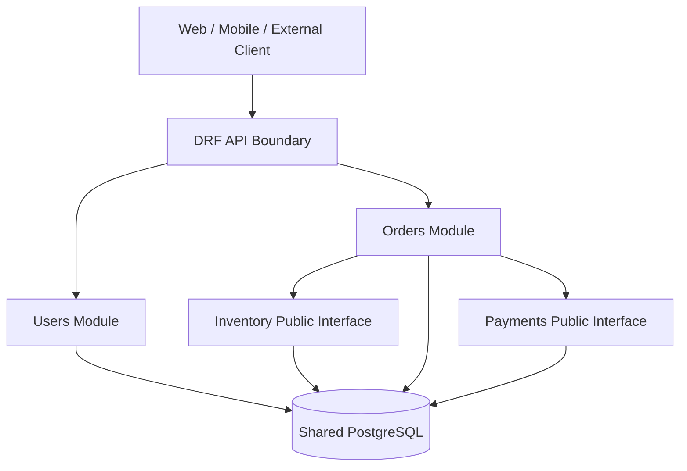
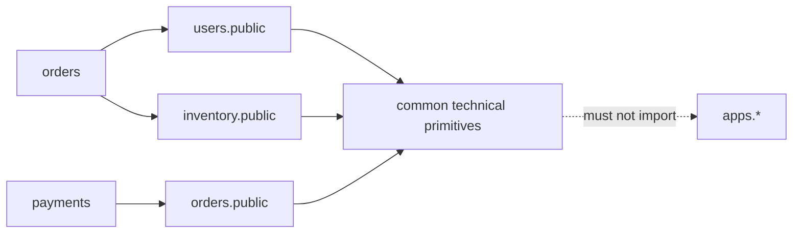
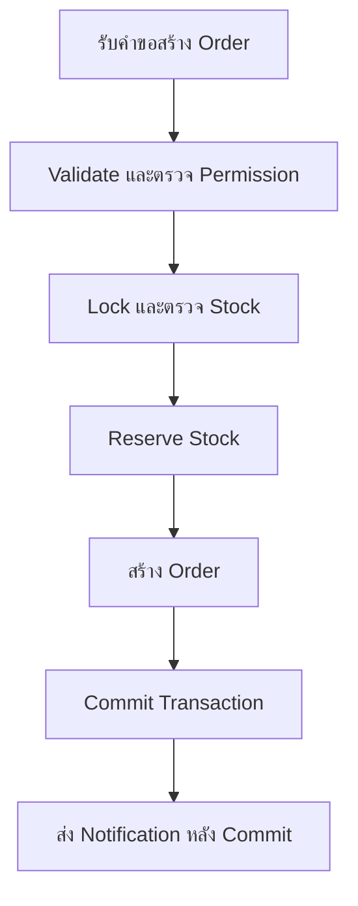

# Django Modular Monolith Architecture

## ภาพรวม (Overview)

**Modular Monolith** คือ Application ที่ Build และ Deploy เป็นหน่วยเดียว แต่แบ่ง Code ภายในเป็น Modules ตาม Business Domain แต่ละ Module มีหน้าที่ ข้อมูล Public Interface และ Dependency rules ที่ชัดเจน จึงยังใช้ Transaction และการดูแลระบบแบบ Monolith ได้ โดยไม่ปล่อยให้ทุกส่วน Import หรือแก้ข้อมูลของกันและกันตามสะดวก

เป้าหมายไม่ใช่สร้าง Folder ให้เยอะ แต่ทำให้ทีมตอบได้ว่า Business rule อยู่ที่ใด ใครควรแก้ Module นี้ Module อื่นเรียกใช้อย่างไร และ Change ใดอาจกระทบระบบส่วนอื่น

เอกสารนี้เป็น **Proposed standard** สำหรับ Django Project ขนาดกลางถึงใหญ่หรือมี Developer หลายคน ตัวอย่าง Code ยังไม่ได้รันเป็น Application จริง Project ต้องยืนยัน Domain, Versions, Ownership, Database behavior และ Tool configuration ก่อนนำไปใช้

## ใช้เมื่อไร?

พิจารณา Modular Monolith เมื่อระบบมีหลาย Business capabilities เช่น Users, Inventory, Orders และ Payments แต่ยังไม่ต้องการ Cost และ Distributed-system complexity ของ Microservices

| รูปแบบ | ลักษณะ | เหมาะเมื่อ | Risk หลัก |
| --- | --- | --- | --- |
| Traditional Monolith | Code อยู่ Deployment เดียวและ Boundary ภายในไม่ชัด | ระบบเล็ก ทีมเล็ก Flow ยังไม่ซับซ้อน | Coupling สูงและแก้ส่วนหนึ่งกระทบอีกส่วนโดยไม่รู้ตัว |
| Modular Monolith | Deployment เดียว แต่แบ่ง Domain และบังคับ Dependency | ระบบกลาง–ใหญ่ หลายทีม ต้องการ Transaction เดียวและแยก Ownership | Boundary เป็นเพียงกฎใน Code ถ้าไม่ตรวจจะเสื่อมกลับเป็น Monolith แบบพันกัน |
| Microservices | แต่ละ Service Deploy และเก็บ State แยกได้ | ต้อง Scale, Release หรือแยก Ownership อย่างอิสระจริง | Network failure, Event consistency, Observability และ Operations ซับซ้อนขึ้น |

อย่าเลือก Microservices เพียงเพราะระบบ “อาจโต” และอย่าเลือก Modular Monolith หากทีมยังไม่สามารถกำหนด Domain boundary ได้ การเริ่มจากโครงสร้างเรียบง่ายแล้วค่อยเพิ่ม Boundary เมื่อมี Evidence มักปลอดภัยกว่าการสร้าง Layer ล่วงหน้า

## ทำไมเหมาะกับ Django?

- Django App เป็นหน่วยจัดกลุ่ม Models, Migrations, Admin, URLs และ Tests ได้ตาม Domain
- Django ORM และ Shared Database รองรับ Transaction ข้ามหลาย Apps ใน Database เดียว
- URL configuration และ DRF ทำให้แยก API boundary ของแต่ละ Module ได้
- Migration graph ช่วยตามรอย Schema change แต่ไม่ได้ป้องกัน Module coupling ให้อัตโนมัติ
- Python imports ตรวจ Dependency ได้ด้วย Code Review และ Architecture tests

Django App ไม่เท่ากับ Microservice และไม่ควรสร้างหนึ่ง App ต่อหนึ่ง Table การแยก App ต้องสะท้อน Business responsibility และเหตุผลที่เปลี่ยนร่วมกัน

## Architecture Diagram



Diagram แสดง Deployment เดียวและ Shared Database แต่แต่ละ Module เป็นเจ้าของ Behavior และ Tables ของตนเอง `Orders` เรียก `Inventory` หรือ `Payments` ผ่าน Public Interface ไม่ Query Internal models ของ Module อื่นโดยตรง Client ไม่ควรรู้โครงสร้างภายในเหล่านี้

## หลักการออกแบบ Module

### Domain-Based Modules

แบ่ง Module ตามคำศัพท์และความสามารถทาง Business เช่น `inventory` จัดการ Stock และ Reservation ส่วน `orders` จัดการ Sales Order และ Order lifecycle ไม่แบ่งเป็น Apps ชื่อ `models`, `views`, `reports` หรือหนึ่ง App ต่อ Table เพราะจะกระจาย Business flow ไปตาม Technical layer

### High Cohesion และ Low Coupling

- **High Cohesion:** Code ที่เปลี่ยนเพราะ Business capability เดียวกันอยู่ใกล้กัน
- **Low Coupling:** Module รู้รายละเอียดของ Module อื่นเท่าที่จำเป็นผ่าน Contract ขนาดเล็ก
- Module ต้องมี Responsibility ที่อธิบายได้ในหนึ่งหรือสองประโยค
- Public Interface ควรรับ/คืนค่า Contract ที่ชัด ไม่เปิด QuerySet หรือ Internal model ให้ผู้เรียกนำไปแก้ต่อ

### Separation of Concerns

| ส่วน | หน้าที่ |
| --- | --- |
| Views / ViewSets | HTTP, Authentication context, Input/output และ Status code |
| Serializers | Parse/validate รูปแบบ Input และแปลง Representation |
| Application Services | Orchestrate Use case, Permission เชิง Business, Transaction และการเรียก Module อื่น |
| Models / Domain methods | State, Invariant และ Behavior ที่เป็นเจ้าของโดย Domain |
| Selectors | Query ที่อ่านซับซ้อนและใช้ซ้ำ เมื่อการแยกช่วยให้ Intent ชัด |
| Public Interface | Contract ที่ Module อื่นได้รับอนุญาตให้เรียก |

`services.py`, `selectors.py`, `public.py` และไฟล์อื่นในตารางเป็น **Optional conventions** ไม่ใช่ข้อบังคับของ Django CRUD สั้น ๆ ไม่ต้องมีทุก Layer หากเพิ่มแล้วทำให้ตาม Flow ยากกว่าเดิม

### Module Ownership และ Team Collaboration

Project ควรบันทึก Owner หรือทีมที่รับผิดชอบ Domain, Public Interface, Review path และ Runbook ที่เกี่ยวข้อง หากยังไม่มี Owner ให้ระบุว่า Unassigned แทนการสมมติชื่อ

Owner ไม่ได้หมายความว่าทีมอื่นแก้ไม่ได้ แต่ Change ที่กระทบ Public Interface, Migration, Permission หรือ Business invariant ต้องมี Reviewer ที่เข้าใจ Module และต้องแจ้ง Consumer ที่เกี่ยวข้อง

## Recommended Project Structure

```text
project/
├── config/
│   ├── settings/
│   │   ├── base.py
│   │   ├── development.py
│   │   ├── testing.py
│   │   └── production.py
│   ├── urls.py
│   ├── asgi.py
│   └── wsgi.py
│
├── apps/
│   ├── users/
│   │   ├── models.py
│   │   ├── views.py
│   │   ├── serializers.py
│   │   ├── services.py
│   │   ├── selectors.py
│   │   ├── permissions.py
│   │   ├── urls.py
│   │   ├── migrations/
│   │   └── tests/
│   │
│   ├── inventory/
│   ├── orders/
│   └── payments/
│
├── common/
│   ├── exceptions.py
│   ├── pagination.py
│   └── utils.py
│
├── tests/
├── docs/
├── pyproject.toml
├── manage.py
├── AGENTS.md
└── README.md
```

### หน้าที่ของ Directory และไฟล์

| Path | หน้าที่ |
| --- | --- |
| `config/` | Composition root และ Configuration ระดับ Project ไม่เก็บ Business logic |
| `config/settings/base.py` | Settings กลาง เช่น Installed apps, Middleware และค่าที่ทุก Environment ใช้ |
| `config/settings/development.py` | ค่า Local development เช่น Debug tooling โดย Import จาก `base.py` |
| `config/settings/testing.py` | ค่า Test ที่แยก DB/External side effects และทำให้ผลทดสอบทำซ้ำได้ |
| `config/settings/production.py` | Secure runtime defaults และการอ่านค่าจาก Environment/Secret references ไม่ Hardcode Secret |
| `config/urls.py` | Root URL routing แล้ว Include URLs ของแต่ละ Module |
| `config/asgi.py` / `wsgi.py` | Entrypoint สำหรับ ASGI/WSGI server ตาม Runtime ที่ Project เลือก |
| `apps/` | Python package ที่รวม Business Modules ไม่ใช่ที่เก็บ Utility ทุกชนิด |
| `apps/users/` | ตัวอย่าง Module ที่เป็นเจ้าของ Identity/Profile และ Public user contract ตาม Scope จริง |
| `models.py` | Models, constraints และ Domain behavior ที่ Module เป็นเจ้าของ |
| `views.py` | HTTP entrypoint ที่ควรสั้นและเรียก Application Service |
| `serializers.py` | Input/output validation ของ API ไม่ควรเป็นที่รวม Workflow หลาย Modules |
| `services.py` | Optional Application services สำหรับ Use case หรือ Transaction ที่ซับซ้อน |
| `selectors.py` | Optional read queries ที่ซับซ้อนหรือใช้ซ้ำ ไม่จำเป็นสำหรับ Query สั้นจุดเดียว |
| `permissions.py` | DRF permission และ Policy adapter ที่เกี่ยวกับ API boundary |
| `urls.py` | URL routes ที่ Module เปิดให้ Project include |
| `migrations/` | Version-controlled Schema/Data changes ของ Tables ที่ Module เป็นเจ้าของ |
| `tests/` | Unit, Module integration และ API tests ของ Module |
| `common/` | Shared kernel ขนาดเล็กสำหรับ Technical primitives ที่ Stable และไม่มี Business ownership เฉพาะ Domain |
| `common/exceptions.py` | Base/transport-safe exceptions ที่ใช้ร่วมกันจริง ไม่รวม Error ของทุก Domain |
| `common/pagination.py` | API pagination primitives ที่ใช้หลาย Modules |
| `common/utils.py` | Utility ที่ไม่มี Business rule ควรใช้เท่าที่จำเป็น; ชื่อกว้างทำให้กลายเป็นถังรวมได้ง่าย |
| Root `tests/` | Cross-module, Architecture, End-to-end หรือ System-level tests |
| `docs/` | Architecture, ADR, Contracts, Runbooks และ Module ownership |
| `pyproject.toml` | Python/dependency/tool configuration ที่ Project Review และ Pin ตาม Policy |
| `manage.py` | Django management entrypoint |
| `AGENTS.md` | Repository instructions สำหรับ Coding agents และ Contributors |
| `README.md` | วิธี Setup, Run, Test และ Link ไปเอกสาร Canonical |

เมื่อมี Public Interface ชัด อาจเพิ่ม `public.py`, `events.py` หรือ `commands.py` ภายใน Module ได้ แต่ต้องมี Use case และ Tests รองรับ ไม่ต้องเพิ่มเพราะ Template บอกให้มี

### เมื่อใดควรสร้าง Django App ใหม่?

| สร้าง App ใหม่เมื่อ | ใช้ Module เดิมเมื่อ |
| --- | --- |
| มี Business capability และคำศัพท์เฉพาะของตน | เป็น Feature ย่อยใน Responsibility เดิม |
| มี Data ownership และ Invariants ที่แยกอธิบายได้ | ใช้ Models และ Lifecycle เดิมเป็นหลัก |
| มี Public Interface/Consumer ที่ระบุได้ | แยกเพียงเพราะต้องเพิ่ม Table หนึ่งตาราง |
| เปลี่ยนด้วยเหตุผลต่างจาก Module เดิมและอาจมี Owner ต่างกัน | แยกแล้วต้อง Import กลับไปมาจำนวนมากจน Boundary ไม่ชัด |
| มีแนวโน้มต้อง Scale/Release แยกและมี Evidence รองรับ | ต้องการเพียง Folder ให้ไฟล์สั้นลง |

ก่อนสร้าง App ใหม่ ให้เขียน Responsibility, Owned data, Public Interface, Dependencies, Owner และ Migration impact แบบสั้น ๆ หากตอบไม่ได้ให้เริ่มใน Module เดิมหรือทำ Design review ก่อน

## Architecture & Dependency Rules

### Mandatory Rules

| กฎบังคับ | เหตุผล |
| --- | --- |
| แบ่ง Apps ตาม Business Domain ไม่ใช่ Database table | ลด Fragmentation และเก็บ Business behavior ใกล้ข้อมูลที่เกี่ยวข้อง |
| ทุก Module ต้องมี Responsibility และ Owned data ที่ชัด | ป้องกัน Logic ซ้ำและไม่มีผู้รับผิดชอบ |
| Cross-module operation ต้องผ่าน Public Interface/Application Service | ทำให้ Contract, Permission และผลกระทบ Review ได้ |
| ห้าม Circular dependency | Cycle ทำให้แยก Test, Deploy หรือ Extract ยากและ Init order เปราะบาง |
| Business workflow ที่ซับซ้อนต้องไม่อยู่ใน View/Serializer | HTTP boundary ไม่ควรเป็นเจ้าของ Transaction และ Domain orchestration |
| ห้ามใช้ Signals เป็นกลไกหลักของ Workflow ที่ต้องรู้ลำดับ | Hidden control flow ตรวจ Error, Retry และ Transaction boundary ยาก |
| ใช้ `transaction.atomic()` เมื่อ DB changes ต้องสำเร็จหรือ Rollback ร่วมกัน | รักษา Atomicity ใน Database เดียว |
| Migration และ Constraint ต้องอยู่ใน Version control | ทำให้ Schema change Review, Deploy และตามรอยได้ |
| Business logic ของหลาย Domain ห้ามย้ายไป `common/` | Shared kernel จะกลายเป็น Coupling center ที่ไม่มี Owner |

### Recommended Rules

| แนวทาง | เหตุผล |
| --- | --- |
| ให้ Public Interface รับ Primitive, Dataclass หรือ Explicit DTO | ลดการผูกกับ Internal Django model |
| ให้ Module อื่นอ่านข้อมูลผ่าน Selector/Public query เมื่อ Boundary สำคัญ | คุม Permission, Query shape และ Compatibility ได้ |
| ใช้ Domain event สำหรับผลที่เกิดตามหลังและไม่ต้องตอบทันที | ลด Coupling แต่ต้องออกแบบ Delivery/Idempotency |
| เก็บ Transaction ให้สั้นและไม่เรียก Network ภายใน Lock โดยไม่จำเป็น | ลด Lock contention และความเสี่ยง Timeout |
| ใช้ Database constraints ป้องกัน Invariant สำคัญ | Application validation อย่างเดียวมี Race condition ได้ |
| บันทึก Dependency exceptions พร้อม Owner และวัน Review | ป้องกัน Temporary shortcut กลายเป็น Architecture ถาวร |

### Do / Don't

```python filename="apps/orders/views.py"
# Don't: View รู้ Models ของหลาย Modules และเป็นเจ้าของ Workflow ทั้งหมด
def create_order(request):
    stock = Inventory.objects.get(product_id=request.data["product_id"])
    stock.quantity -= request.data["quantity"]
    stock.save()
    order = Order.objects.create(user=request.user)
    send_email(order.id)
    return Response({"id": order.id})
```

```python filename="apps/orders/views.py"
# Do: HTTP boundary ตรวจรูปแบบ Input แล้วเรียก Use case ที่มี Contract ชัด
class OrderViewSet(ViewSet):
    def create(self, request):
        serializer = CreateOrderInput(data=request.data)
        serializer.is_valid(raise_exception=True)
        order = create_sales_order(
            actor=request.user,
            command=serializer.validated_data,
        )
        return Response({"id": order.id}, status=201)
```

ตัวอย่างเป็นโครงสร้างประกอบคำอธิบาย ยังไม่ได้รันกับ Project จริง ชื่อ Permission, Serializer และ Error contract ต้องปรับให้ตรงกับระบบ

## Dependency Diagram



ลูกศรทึบหมายถึง Dependency ที่อนุญาตและต้องไม่มี Cycle ส่วนเส้นประเตือนว่า `common` ต้องไม่ Import กลับเข้า Business Modules หาก `orders` และ `inventory` ต้องเรียกกันสองทิศ ให้ทบทวน Boundary หรือย้าย Orchestration ไป Application Service ที่เป็นเจ้าของ Use case แทนการยอมให้เกิด Cycle

## Inter-module Communication

| วิธี | ใช้เมื่อ | ข้อควรระวัง |
| --- | --- | --- |
| Direct Service Call | ต้องการผลทันทีและอยู่ Process/Database เดียว | เรียกเฉพาะ Public Interface และป้องกัน Cycle |
| Application Service | Use case ประสานหลาย Modules และมี Transaction เดียว | ต้องมีเจ้าของ Workflow ชัด ไม่กลายเป็น God service |
| Domain Event แบบ In-process | Consumer ทำงานตามเหตุการณ์และ Failure จัดการได้ใน Process | Handler order และ Error ต้องชัด อย่าซ่อน Workflow สำคัญใน Signal |
| Asynchronous Event | งานช้า ต้อง Retry หรือแยก Availability | ต้องมี Broker/Worker, Idempotency, Observability และ Delivery policy |
| Outbox Pattern | DB commit และการประกาศ Event ต้องตามรอยอย่างเชื่อถือได้ | ให้ At-least-once ได้ ไม่ใช่ Exactly-once; Consumer ต้อง Idempotent |

ไม่จำเป็นต้องใช้ Message Broker หรือ Event-Driven Architecture ทุก Project เริ่มด้วย Explicit synchronous call เมื่อ Requirement ยังไม่ต้องการ Async แล้วเปลี่ยนเมื่อมี Evidence เรื่อง Latency, Reliability หรือ Independent scaling

### Transaction Boundaries และ Side Effects

`transaction.atomic()` ครอบเฉพาะ Database connection ที่เลือก ไม่สามารถ Rollback Email, HTTP request, Message broker หรือ Database อื่นได้ อย่าเรียก External service ระหว่างถือ Row lock หากไม่จำเป็น

ใช้ `transaction.on_commit()` เมื่อต้องให้ Side effect เริ่มหลัง Commit สำเร็จ:

```python filename="apps/orders/services.py"
from django.db import transaction


def create_order_and_schedule_notification(*, actor, command):
    with transaction.atomic():
        order = create_order_records(actor=actor, command=command)
        transaction.on_commit(
            lambda order_id=order.id: notify_order_created(order_id)
        )
    return order
```

Callback จะไม่ทำงานเมื่อ Transaction Rollback แต่ `on_commit()` ไม่ใช่ Durable queue หาก Process หยุดหลัง Commit ก่อนส่งงาน Side effect อาจหาย และหาก Callback ล้ม Database ที่ Commit แล้วจะไม่ Rollback

เมื่อต้องรับประกันว่ามี Record สำหรับ Retry ให้บันทึก Outbox row ใน Transaction เดียวกัน แล้วให้ Worker ส่ง Event ภายหลัง:

```python filename="apps/orders/services.py"
with transaction.atomic():
    order = create_order_records(actor=actor, command=command)
    OutboxMessage.objects.create(
        event_type="orders.order_created.v1",
        aggregate_id=str(order.id),
        payload={"order_id": order.id},
    )
```

Worker ต้อง Lock/Claim งานอย่างปลอดภัย บันทึก Attempt และใช้ Idempotency key ฝั่ง Consumer ตัวอย่างนี้ยังไม่ใช่ Outbox implementation ที่พร้อม Production

## Example: ERP Sales Order Workflow

ตัวอย่างประกอบด้วย Modules `users`, `inventory`, `orders` และ `payments` การสร้าง Sales Order ใช้ `orders` เป็นเจ้าของ Use case และเรียก `inventory` ผ่าน Public Interface ส่วน `payments` เริ่มทำงานเมื่อ Order พร้อมชำระตาม Contract ของ Project



Flow มี 7 ขั้นและใช้ Transaction เดียวใน Shared PostgreSQL สำหรับ Stock reservation กับ Order records หาก Notification สำคัญจนหายไม่ได้ให้ใช้ Outbox แทน Callback ธรรมดา

### Database Constraint ของ Inventory

```python filename="apps/inventory/models.py"
from django.db import models
from django.db.models import Q


class Stock(models.Model):
    product_id = models.UUIDField(unique=True)
    available_quantity = models.PositiveIntegerField(default=0)
    reserved_quantity = models.PositiveIntegerField(default=0)

    class Meta:
        constraints = [
            models.CheckConstraint(
                condition=Q(available_quantity__gte=0),
                name="inventory_stock_available_gte_0",
            ),
            models.CheckConstraint(
                condition=Q(reserved_quantity__gte=0),
                name="inventory_stock_reserved_gte_0",
            ),
        ]
```

`PositiveIntegerField` และ Constraints เป็น Defense in depth แต่ยังต้อง Lock/Update ให้ถูกต้อง Constraint ป้องกัน State ที่ผิด ไม่ได้ตอบผู้ใช้แทน Business error ที่เหมาะสม

### Public Interface และการจอง Stock

```python filename="apps/inventory/public.py"
from dataclasses import dataclass
from uuid import UUID

from django.db import transaction

from .models import Stock, StockReservation


class InsufficientStock(Exception):
    pass


@dataclass(frozen=True)
class ReservationResult:
    reservation_id: int
    product_id: UUID
    quantity: int


@transaction.atomic
def reserve_stock(*, product_id: UUID, quantity: int) -> ReservationResult:
    if quantity <= 0:
        raise ValueError("quantity must be greater than zero")

    stock = Stock.objects.select_for_update().get(product_id=product_id)
    if stock.available_quantity < quantity:
        raise InsufficientStock(product_id)

    stock.available_quantity -= quantity
    stock.reserved_quantity += quantity
    stock.save(update_fields=["available_quantity", "reserved_quantity"])
    reservation = StockReservation.objects.create(
        stock=stock,
        quantity=quantity,
        status="reserved",
    )
    return ReservationResult(reservation.id, product_id, quantity)
```

`select_for_update()` Lock row จน Transaction จบ ช่วยป้องกันสอง Request อ่านจำนวนคงเหลือเดียวกันแล้วจองเกิน Stock ต้องทดสอบกับ PostgreSQL และ Transaction test จริง เพราะ SQLite/Test setup บางแบบไม่สะท้อน Row locking เหมือน Production

### Orders Application Service

```python filename="apps/orders/services.py"
from django.db import transaction

from apps.inventory.public import reserve_stock
from .models import Order, OrderLine
from .permissions import ensure_can_create_order


def create_sales_order(*, actor, command) -> Order:
    ensure_can_create_order(actor=actor, customer_id=command["customer_id"])
    lines = validate_order_lines(command["lines"])

    with transaction.atomic():
        reservations = [
            reserve_stock(
                product_id=line["product_id"],
                quantity=line["quantity"],
            )
            for line in lines
        ]
        order = Order.objects.create(
            customer_id=command["customer_id"],
            created_by=actor,
            status="pending",
        )
        OrderLine.objects.bulk_create([
            OrderLine(
                order=order,
                product_id=line["product_id"],
                quantity=line["quantity"],
                reservation_id=reservation.reservation_id,
            )
            for line, reservation in zip(lines, reservations, strict=True)
        ])
        transaction.on_commit(
            lambda order_id=order.id: notify_order_created(order_id)
        )

    return order
```

ลำดับที่สำคัญคือ Permission/รูปแบบ Input ถูกตรวจ ก่อน Lock ข้อมูล จากนั้น Reservation และ Order สำเร็จหรือ Rollback ร่วมกัน การใช้ `bulk_create()` ต้องพิจารณา Validation, Signals และ Database behavior ของ Project ไม่ใช้เพียงเพราะเร็วกว่า

หาก `inventory` และ `orders` อยู่คนละ Database หรือ Service จะไม่สามารถใช้ `atomic()` เดียวกัน ต้องออกแบบ Saga/Compensation, Idempotency และ Failure recovery ใหม่ ไม่ควรย้าย Code ออกเป็น Microservice แล้วคงสมมติฐาน Transaction เดิม

## Shared Database และ Data Ownership

- แต่ละ Module เป็นเจ้าของ Models, Migrations และ Business invariants ของ Tables ตนเอง
- Module อื่นไม่ควร Update Table โดยตรงหรือ Import Internal model เพื่อข้าม Public Interface
- ForeignKey ข้าม Module ทำได้เมื่อ Trade-off ชัด แต่เพิ่ม Schema coupling และทำให้ Extract ยากขึ้น
- Report/read model ที่รวมหลาย Domains ต้องมี Owner, Permission และ Query contract ชัด
- Shared Database ไม่เท่ากับ Shared ownership

Transaction ข้าม Modules ใช้ได้เมื่อทุก Write อยู่ Database connection เดียวกัน หากใช้หลาย Databases Django ไม่ได้ให้ Distributed transaction อัตโนมัติ ต้องออกแบบ Consistency model ตาม Requirement

## Testing & Enforcement

| ระดับ | ตรวจอะไร |
| --- | --- |
| Unit Tests | Business rule และ Domain method ภายใน Module โดยไม่เรียก Network |
| Module Integration Tests | Model, Service, Selector และ Constraint ของ Module ร่วมกัน |
| Cross-module Integration Tests | Public Interface และ Workflow เช่น Orders → Inventory |
| API Tests | Authentication, Permission, Validation, Error contract และ Response |
| Database Transaction Tests | Lock, Constraint, Rollback, `on_commit()` และ Concurrent requests บน Database ที่รองรับจริง |
| Architecture Tests | Forbidden imports, Cycles และ Layer/Module dependency rules |

ตัวอย่าง Import Linter configuration สำหรับ Project ที่เลือก Tool นี้แล้ว:

```toml filename="pyproject.toml"
[tool.importlinter]
root_package = "apps"

[[tool.importlinter.contracts]]
name = "Orders must not import inventory internals"
type = "forbidden"
source_modules = ["apps.orders"]
forbidden_modules = [
  "apps.inventory.models",
  "apps.inventory.selectors",
]

[[tool.importlinter.contracts]]
name = "Business modules must be acyclic"
type = "acyclic_siblings"
ancestors = ["apps"]
```

ตรวจ Syntax และ Contract types กับ Version ที่ Project Pin ก่อนเปิด CI ตัวอย่างนี้เป็น Documentation-only และยังไม่ได้รันใน Repository Application

### Tooling ที่แนะนำให้ประเมิน

- **Ruff:** Lint/format และตรวจ Import hygiene ตาม Rules ที่ Project เลือก
- **Django test runner:** ใช้กับ `TestCase`/`TransactionTestCase` โดยไม่เพิ่ม Dependency
- **pytest-django:** ใช้เมื่อ Project เลือก pytest และต้องการ Fixtures/Markers; Transaction tests ต้องตั้งให้ตรง
- **Import Linter:** ตรวจ Forbidden imports, Layers และ Cycles จาก Contract

Tool ต้อง Pin version และตรวจ Python/Django compatibility ก่อนใช้ เอกสารนี้ไม่ได้เพิ่ม Dependency หรือเปิด Pipeline จริง

### CI Quality Gates

Project ควรกำหนด Gate ตาม Risk และ Baseline เช่น:

1. Ruff lint/format check
2. Unit และ Module tests
3. Cross-module/API tests
4. PostgreSQL transaction tests สำหรับ Lock/Constraint ที่สำคัญ
5. Migration drift/conflict checks
6. Import Linter หรือ Architecture tests
7. Security/Dependency checks ตาม Project

ไม่กำหนด Coverage percentage หรือ Required approvals เป็นนโยบายกลางโดยไม่มี Owner และข้อมูลจริง ดูรายละเอียดที่ [Quality Gates & CI/CD](/engineering-standards/code-review-coding-standards/quality-gates-cicd)

### Code Review Checklist สำหรับ Module Boundaries

- [ ] Change อยู่ใน Module ที่เป็นเจ้าของ Business capability หรือไม่
- [ ] มีการ Import Internal model/helper ของ Module อื่นหรือไม่
- [ ] Public Interface เปลี่ยนหรือมี Consumer ที่ต้องอัปเดตหรือไม่
- [ ] Dependency ใหม่ทำให้เกิด Cycle หรือไม่
- [ ] Business logic หลุดไปอยู่ View/Serializer/Signal หรือไม่
- [ ] Transaction ครอบ Write ที่ต้องสำเร็จร่วมกันและสั้นพอหรือไม่
- [ ] Side effect เกิดหลัง Commit และต้องการ Durability ระดับใด
- [ ] Lock, Constraint, Migration และ Rollback/Forward fix ถูกพิจารณาหรือไม่
- [ ] Unit, Integration, API, Transaction และ Architecture tests อัปเดตตาม Scope หรือไม่
- [ ] Ownership, ADR, Contract หรือ Runbook ต้องอัปเดตหรือไม่

## Best Practices และ Anti-patterns

| Best Practice | Anti-pattern |
| --- | --- |
| Module มีคำอธิบาย Responsibility/Public API สั้นและชัด | App ชื่อกว้าง เช่น `core`, `misc`, `management` แล้วเก็บทุกอย่าง |
| Orchestrate Workflow ด้วย Function/Service ที่เรียกตามได้ | ซ่อน Workflow ใน Signals หลายตัว |
| `common` เก็บ Technical primitive ที่ Stable | ย้าย Business logic ข้าม Domain ไป `utils.py` |
| Query/Transaction อยู่ใกล้ Owner และมี Tests | Module หนึ่ง Query/Update Table ของอีก Module โดยตรง |
| Event schema มี Version และ Idempotency | Publish Dict ที่เปลี่ยนได้โดยไม่มี Contract |
| Extract Service เมื่อมี Business/Operational need | แยก Microservice เพียงเพื่อให้ Repository เล็กลง |

## Architecture Decision Guidelines

ก่อนเลือกหรือเปลี่ยน Architecture ให้บันทึกอย่างน้อย:

1. Business capabilities, Team boundaries และ Ownership ที่ยืนยันแล้ว
2. Quality attributes เช่น Availability, Throughput, Security และ Release independence
3. Data ownership, Consistency และ Transaction requirements
4. Alternatives: Simple Monolith, Modular Monolith, Microservices และเหตุผลที่ไม่เลือก
5. Dependency direction, Public interfaces และ Exceptions
6. Deployment/Operations cost, Observability และ Failure modes
7. Migration path, Verification และ Trigger ที่ต้องทบทวน Decision

### เมื่อใดจึงค่อย Extract เป็น Microservice?

พิจารณาเมื่อ Module มี Boundary และ Contract ที่เสถียร พร้อม Requirement จริงอย่างน้อยหนึ่งข้อ เช่น ต้อง Scale แยก, Release แยก, Isolation ด้าน Security/Availability หรือมีทีมรับผิดชอบอิสระ

แนวทาง Extract:

1. ลด Direct database access ให้เหลือ Public Interface
2. ระบุ Contract, Consumer และ Compatibility window
3. แยก Data ownership และวาง Data migration/Sync plan
4. เพิ่ม Idempotency, Timeout, Retry และ Observability
5. เปลี่ยน In-process call เป็น Network/Event แบบค่อยเป็นค่อยไป
6. ทดสอบ Failure/Recovery ก่อนตัด Dependency เดิม

การแยก Service ไม่ได้แก้ Coupling หาก Module boundary ภายในยังไม่ชัด

## ข้อจำกัดและข้อควรระวัง

- Boundary อยู่ใน Codebase เดียว จึงต้องอาศัย Review, Tests และ Tooling บังคับ
- Shared Database ทำ Transaction ง่าย แต่ Schema coupling ยังเกิดได้
- Module มากเกินไปเพิ่ม Navigation และ Coordination cost
- `select_for_update()` เพิ่ม Lock contention ได้ ต้อง Lock ตามลำดับคงที่และทำ Transaction ให้สั้น
- `on_commit()` ไม่แทน Durable queue
- Signals เหมาะกับ Framework-level hooks บางกรณี แต่ไม่ควรซ่อน Business workflow สำคัญ
- อย่าอ้างว่า Architecture รองรับ Scale, Concurrency หรือ Production จนกว่าจะทดสอบใน Environment และ Workload ที่เกี่ยวข้อง

## เอกสารที่เกี่ยวข้อง (Related Documentation)

- [Django Project Structure](/technology-guides/django-python/project-structure)
- [Django Models & ORM](/technology-guides/django-python/models-and-orm)
- [Django Testing](/technology-guides/django-python/testing)
- [Architecture & Design Standards](/engineering-standards/architecture-design-standards)
- [Secure Coding Standards](/engineering-standards/code-review-coding-standards/secure-coding-standards)
- [Database & Data Management](/engineering-standards/database-data-management)
- [CI/CD & Release Management](/engineering-standards/cicd-release-management)

## แหล่งอ้างอิงทางการ

- [Django applications](https://docs.djangoproject.com/en/5.2/ref/applications/)
- [Django database transactions](https://docs.djangoproject.com/en/5.2/topics/db/transactions/)
- [Django `select_for_update()`](https://docs.djangoproject.com/en/5.2/ref/models/querysets/#select-for-update)
- [Django constraints](https://docs.djangoproject.com/en/5.2/ref/models/constraints/)
- [Django migrations](https://docs.djangoproject.com/en/5.2/topics/migrations/)
- [Ruff configuration](https://docs.astral.sh/ruff/configuration/)
- [pytest-django database access](https://pytest-django.readthedocs.io/en/latest/database.html)
- [Import Linter contract types](https://import-linter.readthedocs.io/en/stable/contract_types/)
