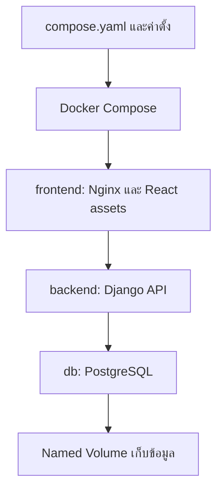

# Docker Compose — เปิดสามบริการด้วยชุดเดียว

## เรื่องนี้คืออะไร?

Docker Compose อ่านไฟล์ `compose.yaml` เพื่อสร้างหลายบริการพร้อม Network และ Volume ของแอป เราจึงไม่ต้องพิมพ์ `docker run` ยาว ๆ ทีละตัว ใช้คำสั่งแบบปัจจุบันคือ `docker compose` ไม่มีขีดคั่น

## ใช้ทำอะไร?

ใช้เปิด `frontend`, `backend`, `db` ของ Task App ในเครื่อง บทนี้ต้องมีไฟล์จาก [Task App](/technology-guides/docker/reference-project) และ [Dockerfile](/technology-guides/docker/dockerfile) ครบแล้ว ให้รันคำสั่งจาก `task-demo` เสมอ

## ทำงานอย่างไร?



ภาพนี้แสดงบริการในหนึ่ง Compose project ตัว `frontend` ส่งคำขอ API ต่อให้ `backend` ส่วน `db` ไม่มี Host port จึงไม่รับคำขอจาก Browser โดยตรง

## ขั้นตอนการทำงาน

### 1. .env.example

สร้างไฟล์นี้ที่ `task-demo/.env.example` ช่อง Secret เว้นว่างไว้โดยตั้งใจ:

```dotenv filename=".env.example"
COMPOSE_PROJECT_NAME=task-demo
APP_PORT=8080
POSTGRES_DB=task_demo
POSTGRES_USER=task_app
POSTGRES_PASSWORD=
DJANGO_SECRET_KEY=
DJANGO_ALLOWED_HOSTS=localhost,127.0.0.1,backend
DB_HOST=db
DB_PORT=5432
```

คัดลอกเป็นไฟล์สำหรับเครื่องตัวเอง:

```bash
cp .env.example .env
chmod 600 .env
```

เปิด `.env` ใน Editor แล้วตั้ง `POSTGRES_PASSWORD` กับ `DJANGO_SECRET_KEY` เป็นค่าสุ่มคนละค่า ใช้ Secret generator ของทีมและไม่ส่งค่าจริงผ่าน Chat/Git เลือกอักขระที่จัดเก็บใน `.env` ได้ถูกต้อง เช่น Hex และต้องไม่เว้นว่าง `chmod` จำกัดสิทธิ์ไฟล์บนระบบที่รองรับ ไม่ได้เข้ารหัสไฟล์

`.env` ที่อยู่ข้าง Compose ใช้แทน `${VARIABLE}` ในไฟล์ เรียกว่า **Interpolation** ไม่ได้ส่งค่าทุกตัวเข้า Container โดยอัตโนมัติ ตัวอย่างใช้ `env_file` ส่งค่าเข้า Backend และ `environment` ระบุค่าของ DB อีกชั้น หากมีชื่อตัวแปรเดียวกันใน Shell อาจทับค่าจาก `.env` ได้

### 2. compose.yaml

```yaml filename="compose.yaml"
services:
  frontend:
    build: ./frontend
    image: task-frontend:local
    ports:
      - "127.0.0.1:${APP_PORT:-8080}:8080"
    depends_on:
      backend:
        condition: service_healthy
    healthcheck:
      test: ["CMD", "wget", "-q", "-O", "/dev/null", "http://127.0.0.1:8080/"]
      interval: 10s
      timeout: 3s
      retries: 5
    restart: unless-stopped
    networks: [app]

  backend:
    build: ./backend
    image: task-backend:local
    env_file: .env
    environment:
      DB_HOST: db
      DB_PORT: "5432"
      DJANGO_SECRET_KEY: ${DJANGO_SECRET_KEY:?Set DJANGO_SECRET_KEY in .env}
    depends_on:
      db:
        condition: service_healthy
    healthcheck:
      test: ["CMD", "python", "-c", "import urllib.request; urllib.request.urlopen('http://127.0.0.1:8000/api/health/', timeout=2)"]
      interval: 10s
      timeout: 3s
      retries: 5
      start_period: 15s
    restart: unless-stopped
    stop_grace_period: 35s
    networks: [app]

  db:
    image: postgres:17-alpine
    environment:
      POSTGRES_DB: ${POSTGRES_DB:?Set POSTGRES_DB in .env}
      POSTGRES_USER: ${POSTGRES_USER:?Set POSTGRES_USER in .env}
      POSTGRES_PASSWORD: ${POSTGRES_PASSWORD:?Set POSTGRES_PASSWORD in .env}
    volumes:
      - db-data:/var/lib/postgresql/data
    healthcheck:
      test: ["CMD-SHELL", "pg_isready -h 127.0.0.1 -U \"$$POSTGRES_USER\" -d \"$$POSTGRES_DB\""]
      interval: 5s
      timeout: 3s
      retries: 10
      start_period: 10s
    restart: unless-stopped
    networks: [app]

volumes:
  db-data:

networks:
  app:
    driver: bridge
```

ใช้ PostgreSQL **17** จึง Mount ที่ `/var/lib/postgresql/data` หากเปลี่ยน Major version ต้องอ่านคู่มือ Image และวางแผนย้ายข้อมูล เช่นรุ่น 18 เปลี่ยน Layout เริ่มต้น อย่าเปลี่ยน Tag แล้วชี้ Volume เก่าทันที

### แต่ละส่วนมีหน้าที่อะไร?

| ส่วน | หน้าที่ในตัวอย่าง |
| --- | --- |
| `services` | โปรแกรมแต่ละตัวในแอป |
| `build` / `image` | Build จากโฟลเดอร์ แล้วตั้งชื่อ Image |
| `ports` | เปิดเฉพาะเว็บที่ `127.0.0.1:8080` |
| `environment` / `env_file` | ส่งค่าตั้งตอนรัน โดย `environment` ทับค่าชื่อเดียวใน `env_file` |
| `depends_on` / `healthcheck` | เรียงการเริ่มและรอเงื่อนไขพร้อมที่ระบุ |
| `restart` | ช่วยเริ่มใหม่หลังโปรแกรมจบตาม Policy ไม่ใช่แก้ต้นเหตุ |
| `volumes` / `networks` | เก็บ DB ถาวรและเชื่อมบริการใน Bridge network |

`depends_on` แบบรายชื่ออย่างเดียวรอเพียงเริ่ม Container ตัวอย่างจึงระบุ `service_healthy` ด้วย แต่ไม่ได้เฝ้ารอแทนแอปตลอดอายุงาน หาก DB ล่มภายหลัง Backend ยังต้องจัดการการเชื่อมต่อล้มเหลว และสถานะ Unhealthy ไม่ได้ทำให้ Restart อัตโนมัติโดยตัวมันเอง

`$$POSTGRES_USER` ส่ง `$` ผ่าน Compose ให้ Shell ใน Container อ่านค่า ไม่ใช่ให้ Compose แทนตั้งแต่เครื่องผู้ใช้ รายละเอียดอ้างอิง [Startup order](https://docs.docker.com/compose/how-tos/startup-order/) และ [Interpolation](https://docs.docker.com/compose/how-tos/environment-variables/variable-interpolation/)

### 3. ตรวจ Build และเตรียมฐานข้อมูล

```bash
docker compose config -q
docker compose build
docker compose up -d db
docker compose run --rm backend python manage.py migrate --noinput
docker compose up -d
docker compose ps
```

- `config -q` ตรวจรูปแบบและตัวแปรโดยไม่พิมพ์ค่าลับ แต่ไม่ได้ตรวจว่าแอปรันได้
- `build` สร้างสอง Images หากไม่ผ่านให้แก้ก่อน ไม่ทำขั้นต่อ
- `up -d db` เริ่ม DB เบื้องหลัง
- `run --rm ... migrate` สร้าง Backend ชั่วคราว รอ DB ตามเงื่อนไขแล้วใช้ Migration หนึ่งครั้ง ก่อนเริ่มแอป ไม่สั่งจากทุก Replica
- `up -d` เปิดบริการที่เหลือ คำสั่งนี้ใช้เริ่มใหม่วันต่อไปได้เมื่อเตรียมครบแล้ว ไม่ Build Source ที่แก้ใหม่ให้เสมอ ต้อง `build` หรือ `up --build` ตามงาน
- `ps` ควรแสดงบริการทำงานและ Healthy เมื่อพร้อม หากไม่ใช่ ให้ตรวจ Logs ไม่สมมติว่าผ่านเพราะคำสั่งจบ

### 4. ตรวจผลในเครื่อง

เปิด `http://localhost:8080` เพิ่ม “ทดลองสร้าง Task” แล้ว Refresh ต้องยังเห็นงาน ตรวจ API เพิ่มเติม:

```bash
curl --fail http://localhost:8080/api/health/
curl --fail http://localhost:8080/api/tasks/
```

คาดหวัง HTTP 200, Health เป็น `{"status":"ok"}` และ Tasks เป็น JSON array ถ้าเปลี่ยน `APP_PORT` ให้เปลี่ยน URL ด้วย Health ผ่านไม่ได้แทนการเพิ่ม/อ่าน Task ซึ่งตรวจ Schema และข้อมูลด้วย

### 5. Logs, Debug และหยุดใช้งาน

```bash
docker compose logs -f
docker compose exec backend sh
docker compose down
```

`logs -f` ติดตาม Logs ใช้ Ctrl+C หยุดติดตามโดยไม่หยุดบริการ `exec` เข้า Shell ของ Backend ที่รันอยู่ พิมพ์ `exit` เพื่อออก ส่วน `down` หยุดและลบ Containers/Network ของ Project แต่ Named Volume ยังอยู่ ใช้ `up -d` แล้วควรอ่าน Task เดิมได้เมื่อใช้ Project name/Volume เดิม

## ตัวอย่างการใช้งานจริง

เพื่อน Clone โฟลเดอร์ทดลอง ตั้ง `.env` ของตัวเอง สร้าง Lockfile แล้วทำตามขั้น Build → Migration → Up จากนั้นใช้ Browser ทดสอบ อย่าส่ง `.env` ของคุณให้เพื่อนแทน `.env.example`

## ข้อควรระวัง

ไม่ใส่ `version:` แบบเก่าและไม่ใช้ `links` เพื่อให้บริการค้นกัน ตัวอย่างนี้มี Local DB role จาก `POSTGRES_USER` ซึ่ง Official Image สร้างเป็น Superuser สำหรับ Lab ระบบจริงต้องแยก Role ของแอป/Migration และจำกัดสิทธิ์ ไม่ใช้บัญชีนี้เป็น Production app role

ห้ามใช้ `down -v` เป็นคำสั่งหยุดประจำวัน เพราะลบข้อมูล Volume ด้วย อ่าน [Volume](/technology-guides/docker/docker-volume) ก่อนทดลองลบ

## สรุปสิ่งที่ต้องจำ

- ต้องมีไฟล์ครบและตั้ง Secret ก่อนเปิด Compose
- ตรวจ Config ไม่เท่ากับทดสอบ Runtime
- รัน Migration แบบควบคุมหนึ่งครั้งแล้วตรวจ Task จริง
- หยุดด้วย `down` ได้ แต่ห้ามเติม `-v` โดยไม่เข้าใจผล

## อ่านต่อ

- [Volume และ Backup](/technology-guides/docker/docker-volume)
- [Network และชื่อบริการ](/technology-guides/docker/docker-network)
- [Environment precedence](https://docs.docker.com/compose/how-tos/environment-variables/envvars-precedence/)
- [PostgreSQL Official Image](https://hub.docker.com/_/postgres)
