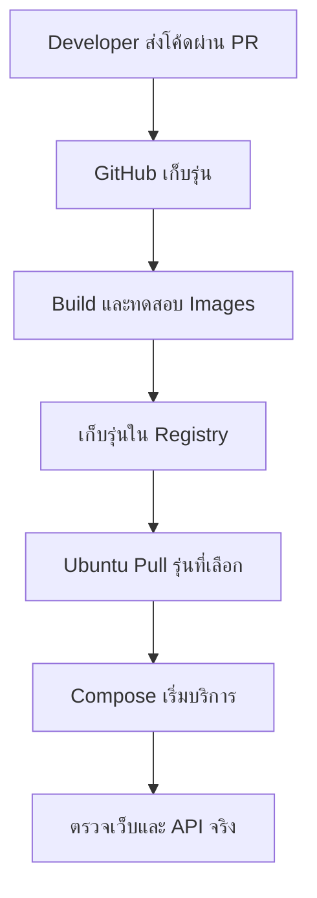

# Docker Deployment — เริ่มปล่อยงานบน Ubuntu

## เรื่องนี้คืออะไร?

Deployment คือการนำ Image รุ่นที่เลือกไปเริ่มบนเครื่องปลายทาง บทนี้ใช้ Ubuntu กับ Docker Compose เป็นจุดเริ่มต้นสำหรับทีมเล็ก ไม่ต้องมี Kubernetes ก่อน แต่เครื่องเดียวมีจุดล้มเหลวเดียวและอาจหยุดบริการระหว่างเปลี่ยนรุ่น

## ใช้ทำอะไร?

ใช้วางแผน DEV/UAT หรือทดลองบน Ubuntu ผ่าน SSH ซึ่งเป็นการเชื่อมต่อ Terminal แบบเข้ารหัส Task App ในคู่มือนี้ยังไม่มี Auth จึงทดลองผ่าน Loopback/SSH tunnel เท่านั้น **ไม่ใช่ Runbook พร้อมเปิด Production**

## ทำงานอย่างไร?



ภาพนี้เป็นเส้นทางตัวอย่าง ต้องเก็บผลตรวจจริงทุกช่วง งานเอกสารนี้ไม่ได้สร้าง GitHub Actions หรือเข้าเครื่อง Ubuntu ให้

### Local, DEV, UAT และ Production

| ที่ทำงาน | ใช้เพื่ออะไร |
| --- | --- |
| Local | เครื่อง Developer ทดลองด้วยข้อมูลของตัวเอง |
| DEV | ทีมตรวจการทำงานร่วมกันหลังรวมงาน |
| UAT | QA/ผู้รับผิดชอบธุรกิจยืนยันว่างานตรงความต้องการ |
| Production | ผู้ใช้จริง ต้องมีผู้อนุมัติ ผู้ดูแล และแผนกู้คืน |

Environment ไม่ใช่ชื่อ Branch ให้ใช้ Image เดิมที่ผ่านการทดสอบต่อไปเมื่อทำได้ ส่วนค่าตั้ง/Secrets แยกตาม Environment อ่าน [Environments & Secrets](/technology-guides/devops/environments-and-secrets)

## ขั้นตอนการทำงาน

### 1. เตรียม Server

ต้องมี Ubuntu รุ่นที่ Docker รองรับ, SSH user ที่มีสิทธิ์ดูแลตามนโยบาย, พื้นที่ดิสก์/Memory พอ และช่องทางเข้าถึง Registry เก็บ SSH key อย่างเหมาะสม ไม่ใส่ใน Repository ตรวจ CPU ว่าตรงกับ Images ที่ Build เช่น `amd64`/`arm64`

ทำตาม [การติดตั้งจาก Docker apt repository](https://docs.docker.com/engine/install/ubuntu/) รวมการตรวจแพ็กเดิมและตั้ง Repository ให้เสร็จ จากนั้นจึงติดตั้งแพ็กตามคู่มือ ไม่ใช้ขั้นตอนลบแพ็กหรือ Script ติดตั้งแบบเดาสุ่มบน Server ร่วม หลังติดตั้งตรวจ:

```bash
sudo docker info
sudo docker compose version
```

ตัวอย่าง Server ใช้ `sudo` ไม่เพิ่ม User เข้ากลุ่ม `docker` ให้เอง กลุ่มนั้นมีสิทธิ์สูง หากทีมเลือกวิธีอื่นต้องกำหนดสิทธิ์ให้ชัด

Firewall ต้องอนุญาต SSH เฉพาะแหล่งที่จำเป็นและพอร์ตเว็บเฉพาะตามแผน อย่าคิดว่า UFW จะกัน Docker published ports ทุกแบบ เพราะ Docker อาจส่ง Traffic ผ่านกฎอีกเส้นทาง ตัวอย่างจึง Bind เว็บที่ `127.0.0.1` และไม่ Publish DB ดู [Firewall behavior](https://docs.docker.com/engine/network/packet-filtering-firewalls/)

### 2. เตรียมรุ่นที่จะปล่อย

เริ่มจากแอปที่ผ่าน Review/Tests และ Build จาก [Dockerfile](/technology-guides/docker/dockerfile) แล้ว Push ไป Registry ของทีม ด้วยสิทธิ์เท่าที่จำเป็น บันทึก Frontend/Backend Digest และ Commit ไว้เป็นคู่ อย่าใช้ `latest` เป็นหลักฐานรุ่น

บน Server เตรียมโฟลเดอร์ `/opt/task-demo` เก็บ `compose.deploy.yaml` ที่มาจาก Git/PR ไม่ต้อง Clone Source หรือ Build ใหม่บน Server เมื่อมี Prebuilt images แล้ว ทางเลือก Build จาก Source เหมาะกับ Lab ที่ยังไม่มี Registry แต่ยังต้องจด Commit และทดสอบ Image ที่ได้ใหม่ ไม่อ้างว่าเป็นแพ็กเดียวกับ UAT เดิม

### 3. ตั้ง Runtime และ Persistent storage

คัดลอกตัวอย่างนี้ไปเป็น `/etc/task-demo/app.env` บน Server ให้ผู้ดูแลตั้งเจ้าของ/สิทธิ์ `600` และไม่ Commit ไฟล์จริง ค่า Image ทั้งสามต้องแทนด้วย Digest จริงจาก Registry; เว้นว่างเพื่อให้ตรวจพบถ้ายังไม่ได้ตั้ง

```dotenv filename=".env.deploy.example"
APP_ENV_FILE=/etc/task-demo/app.env
COMPOSE_PROJECT_NAME=task-demo
APP_PORT=8080
FRONTEND_IMAGE=
BACKEND_IMAGE=
DB_IMAGE=
POSTGRES_DB=task_demo
POSTGRES_USER=task_app
POSTGRES_PASSWORD=
DJANGO_SECRET_KEY=
DJANGO_ALLOWED_HOSTS=localhost,127.0.0.1,backend
DB_HOST=db
DB_PORT=5432
```

`DB_IMAGE` ของ Lab ต้องเป็น PostgreSQL 17 ตามข้อมูลเดิม อย่าเปลี่ยน Major version ไปพร้อม Release แอป ส่วนระบบจริงต้องแยก DB roles/จำกัดสิทธิ์ และใช้ Secret delivery ที่ทีมควบคุมได้ Environment variables/ไฟล์ที่จำกัดสิทธิ์ยังถูกอ่านได้โดยผู้มีสิทธิ์สูงบน Host ไม่ใช่ Secret vault

สร้างไฟล์ต่อไปนี้ที่ `/opt/task-demo/compose.deploy.yaml` เป็น **Lab deployment config** ไม่มี `build` และใช้ Volume ชื่อเดิมทุก Release:

```yaml filename="compose.deploy.yaml"
services:
  frontend:
    image: ${FRONTEND_IMAGE:?Set FRONTEND_IMAGE digest}
    ports:
      - "127.0.0.1:${APP_PORT:-8080}:8080"
    depends_on:
      backend:
        condition: service_healthy
    healthcheck:
      test: ["CMD", "wget", "-q", "-O", "/dev/null", "http://127.0.0.1:8080/"]
      interval: 10s
      timeout: 3s
      retries: 5
    restart: unless-stopped
    mem_limit: 128m
    cpus: 0.5
    networks: [app]

  backend:
    image: ${BACKEND_IMAGE:?Set BACKEND_IMAGE digest}
    env_file: ${APP_ENV_FILE:?Set APP_ENV_FILE}
    environment:
      DB_HOST: db
      DB_PORT: "5432"
    depends_on:
      db:
        condition: service_healthy
    healthcheck:
      test: ["CMD", "python", "-c", "import urllib.request; urllib.request.urlopen('http://127.0.0.1:8000/api/health/', timeout=2)"]
      interval: 10s
      timeout: 3s
      retries: 5
      start_period: 15s
    restart: unless-stopped
    stop_grace_period: 35s
    mem_limit: 512m
    cpus: 1.0
    networks: [app]

  db:
    image: ${DB_IMAGE:?Set DB_IMAGE digest for PostgreSQL 17}
    environment:
      POSTGRES_DB: ${POSTGRES_DB:?Set POSTGRES_DB}
      POSTGRES_USER: ${POSTGRES_USER:?Set POSTGRES_USER}
      POSTGRES_PASSWORD: ${POSTGRES_PASSWORD:?Set POSTGRES_PASSWORD}
    volumes:
      - db-data:/var/lib/postgresql/data
    healthcheck:
      test: ["CMD-SHELL", "pg_isready -h 127.0.0.1 -U \"$$POSTGRES_USER\" -d \"$$POSTGRES_DB\""]
      interval: 5s
      timeout: 3s
      retries: 10
      start_period: 10s
    restart: unless-stopped
    mem_limit: 512m
    cpus: 1.0
    networks: [app]

volumes:
  db-data:

networks:
  app:
    driver: bridge
```

ตัวเลข Resource limits เป็นจุดทดลอง ต้องวัดและปรับกับเครื่องจริง โดยเฉพาะ DB และ Gunicorn อย่าเปลี่ยน `COMPOSE_PROJECT_NAME` หรือชี้ Data volume คนละตัวกลาง Release ควรมี Backup นอกเครื่องและตรวจ Restore ก่อนปล่อย

### 4. Pull, Migration และเริ่มแอป

รันใน `/opt/task-demo` ใช้ไฟล์เดิม/Project เดิมทุกคำสั่ง หาก Registry เป็น Private ต้อง Login ด้วย Deploy credential ที่อ่าน Image ได้เท่าที่ต้องใช้ ไม่ใส่ Token ลง Command history

```bash
sudo docker compose --env-file /etc/task-demo/app.env -f compose.deploy.yaml config -q
sudo docker compose --env-file /etc/task-demo/app.env -f compose.deploy.yaml pull
sudo docker compose --env-file /etc/task-demo/app.env -f compose.deploy.yaml up -d db
sudo docker compose --env-file /etc/task-demo/app.env -f compose.deploy.yaml run --rm --no-deps backend python manage.py migrate --plan
```

ตรวจว่า DB Healthy ก่อนคำสั่ง `run --no-deps` เพราะตัวเลือกนี้ข้ามการเริ่ม/รอ Dependencies ตรวจ Plan กับ Backup และ Code/Schema compatibility ก่อนทำจริง ให้ผู้รับผิดชอบสั่ง Migration เพียงหนึ่งงาน:

```bash
sudo docker compose --env-file /etc/task-demo/app.env -f compose.deploy.yaml run --rm --no-deps backend python manage.py migrate --noinput
sudo docker compose --env-file /etc/task-demo/app.env -f compose.deploy.yaml up -d
sudo docker compose --env-file /etc/task-demo/app.env -f compose.deploy.yaml ps
```

นี่เป็นลำดับสำหรับ Initial deployment หรือ Migration ที่เข้ากับโค้ดเก่าได้ หาก Schema ไม่เข้ากัน ต้องวาง Maintenance/Expand-and-Contract ก่อน ไม่เอาลำดับนี้ไปใช้ทุกกรณี อย่ารัน `makemigrations` บน Server แล้วได้ไฟล์ที่ไม่อยู่ใน Git

### 5. ตรวจการเข้าถึงและเก็บหลักฐาน

บน Server ตรวจเว็บกับ API:

```bash
curl --fail http://127.0.0.1:8080/
curl --fail http://127.0.0.1:8080/api/health/
curl --fail http://127.0.0.1:8080/api/tasks/
```

ดู Logs และสร้าง/อ่าน Task ผ่านเว็บด้วย ถ้าจะเปิด Browser จากเครื่องตัวเอง ให้ใช้ SSH tunnel แทนเปิดพอร์ต Lab สู่ Public จากเครื่องผู้ใช้รัน โดยแทน User/Host จริงและตรวจพอร์ต `8080` ฝั่งเครื่องว่าง:

```bash
ssh -L 8080:127.0.0.1:8080 SERVER_USER@SERVER_HOST
```

เปิด `http://localhost:8080` ขณะ Tunnel เชื่อมอยู่ จดรุ่น Images, Environment, ผลตรวจ, เวลา และผู้ดำเนินการจริง ไม่เขียนว่าผ่านถ้ายังไม่ได้ตรวจ

## ตัวอย่างการใช้งานจริง

จะปล่อย `1.0.1` ให้เปลี่ยน Frontend/Backend digests ผ่านกระบวนการที่ทีม Review แล้ว Pull และทำขั้นตรวจตามแผน อย่า `down` ทั้งชุดทุกครั้งเพียงเพื่อเปลี่ยนแอป หากต้องย้อนใช้ Image pair เดิมที่ยังเข้ากับ Schema ปัจจุบันได้ การย้อน Image **ไม่ย้อน DB** ดู [Release & Rollback](/technology-guides/devops/rollback-and-release)

### Docker กับ GitHub Actions

แนวทางคือ Build Image → Run tests → Tag/บันทึก Digest → Push → Pull รุ่นที่อนุมัติ → Deploy → Smoke test หรือการตรวจเส้นทางหลักหลังปล่อย → Rollback/Forward fix เมื่อจำเป็น งาน CI ต้องทดสอบจุดของโค้ดที่ใช้สร้าง Release จริง และจำกัดสิทธิ์ Secrets/Registry ดู [Deployment Workflow](/technology-guides/devops/deployment-workflow) งานนี้ไม่มีไฟล์ Workflow ที่เปิดใช้งาน

### ก่อนใช้กับ Production ต้องเตรียมอะไรอีก?

- **Reverse Proxy และ HTTPS/TLS**: ใช้ Domain ถ้าต้องเปิดบริการสาธารณะ จัด Certificate/ต่ออายุและ Trusted proxy headers ให้ถูก ไม่มี TLS ในตัวอย่างนี้
- **Application security**: เพิ่ม Auth/สิทธิ์รายผู้ใช้, CSRF/CORS ตามรูปแบบ Auth, จำกัด Request และตรวจ `manage.py check --deploy` กับค่าจริง ไม่เปิด Task API แบบ Lab
- **Secrets/DB**: แยก Runtime/Migration roles, แผน Rotate, สิทธิ์ไฟล์/ระบบส่ง Secret และ Backup/Restore นอก Host
- **Logs/Monitoring**: เก็บ Logs โดยไม่ปนค่าลับ ตั้ง Log rotation เช่น `json-file` พร้อม `max-size`/`max-file` หรือ Driver ที่ทีมใช้ เฝ้า Disk/Memory/Errors และแจ้งผู้รับผิดชอบ ไม่ดูแค่ Healthy
- **Reliability/Updates**: Restart policy ไม่ทดแทน Monitoring หรือ HA ทดสอบ Resource limits, Graceful shutdown, Security updates ของ Host/Images และแผนหยุดบำรุง

## ข้อควรระวัง

Compose บนเครื่องเดียวไม่ได้ย้ายงานไปเครื่องใหม่เมื่อ Host ล่ม ไม่มี Zero-downtime โดยอัตโนมัติ ไม่เปิด PostgreSQL สู่ Public และไม่ใช้ค่าสุ่ม/Password เดียวกันข้าม Environment ก่อนเพิ่ม Kubernetes ควรทำ Runbook, Backup และ Monitoring ให้ใช้งานได้จริงก่อน

## สรุปสิ่งที่ต้องจำ

- Pull Image ที่ระบุรุ่นแทน Build ใหม่ทุก Environment
- แยกค่าลับและเก็บข้อมูล DB ใน Volume ที่ตามชื่อได้
- Migration ต้องมีลำดับ ผู้รับผิดชอบ และวิธีตรวจ
- เปิด Lab ผ่าน SSH tunnel; Production ต้องมี Security/Operations เพิ่ม

## อ่านต่อ

- [Deployment Workflow](/technology-guides/devops/deployment-workflow)
- [PostgreSQL Migration](/technology-guides/postgresql/migrations)
- [Docker Troubleshooting](/technology-guides/docker/troubleshooting)
- [ตัวอย่าง CI Build/Test/Push Images](/technology-guides/devops/image-release)
- [Manual Deploy และ GitHub Actions แบบเอกสาร](/technology-guides/devops/deployment-workflow)
