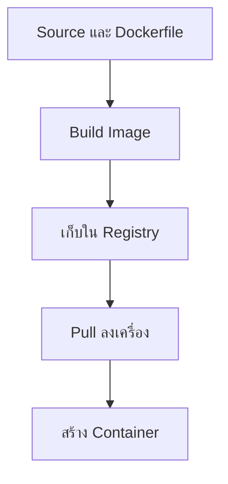

# Docker Image — ต้นแบบสำหรับรันโปรแกรม

## เรื่องนี้คืออะไร?

Image คือแพ็กไฟล์ของโปรแกรมและสิ่งที่ต้องใช้รัน Docker ใช้แพ็กนี้สร้าง Container ได้หลายตัว ตัว Image ไม่ได้เก็บสถานะการทำงานใหม่ของ Container ย้อนกลับเข้าไปเอง

## ใช้ทำอะไร?

ใช้ส่งแอปเวอร์ชันหนึ่งให้ทีมทดสอบหรือปล่อยงาน โดยระบุได้ว่าแพ็กมาจากโค้ดใด

## ทำงานอย่างไร?



ภาพนี้แยกขั้นสร้างแพ็กออกจากขั้นรัน เมื่อแก้ Source ต้อง Build แพ็กใหม่ ไม่ใช่เข้าไปแก้ไฟล์ใน Container ที่ใช้งานจริง

**Layer** คือส่วนของไฟล์ที่ Build ทีละขั้น Docker ใช้ Cache หรือผลเดิมช่วยให้ Build เร็วขึ้น ถ้าคำสั่งและสิ่งที่เกี่ยวข้องไม่เปลี่ยน Cache ไม่ได้ตรวจว่ารุ่น Dependency ปลอดภัยขึ้นหรือยัง ต้องวางแผนอัปเดตเองด้วย

### ชื่อ Tag และ Digest

- `postgres:17-alpine`: Repository คือ `postgres`, Tag คือ `17-alpine` Tag เปลี่ยนไปชี้แพ็กใหม่ได้ แม้ชื่อเดิม
- **Digest** เช่นรูปแบบ `repository@sha256:...` คือรหัสเนื้อหาของ Image ระบุแพ็กเดิมได้ชัดกว่า Tag
- `latest` เป็นแค่ชื่อ Tag ไม่รับประกันว่าใหม่สุดหรือผ่าน Tests

## ขั้นตอนการทำงาน

```bash
docker pull postgres:17-alpine
docker images
docker image inspect postgres:17-alpine --format '{{json .RepoDigests}}'
```

คำสั่งแรกดึงต้นแบบ ยังไม่เริ่มฐานข้อมูล คำสั่งสองแสดงแพ็กในเครื่อง ส่วนคำสั่งสุดท้ายดู Digest ที่ Registry ให้มา เลือกแพ็กให้ตรง CPU เช่น `linux/amd64` หรือ `linux/arm64` โดยเฉพาะเมื่อ Build บน Mac แล้วปล่อย Ubuntu

เมื่อมีไฟล์จาก [Dockerfile](/technology-guides/docker/dockerfile) และอยู่ที่โฟลเดอร์ `task-demo`:

```bash
docker build -t task-backend:local ./backend
```

`-t` ตั้งชื่อแพ็กในเครื่อง ส่วน `./backend` คือ Build context หรือโฟลเดอร์ไฟล์ที่ Docker ได้รับ ชื่อนี้ตรงกับ Compose ตัวอย่าง ไม่ได้ Push ไปที่ใด

## ตัวอย่างการใช้งานจริง

ทีมสร้าง `task-backend:1.0.0` แล้ว Push ไป Registry ที่มีสิทธิ์เข้าถึง เก็บ Commit กับ Digest ไว้ใน Release record จากนั้นใช้ Digest เดิมใน DEV/UAT/Production ตามความพร้อม อย่า Build ใหม่เพียงเพราะย้าย Environment

Base images ในคู่มือใช้ Tag ที่อ่านง่ายสำหรับ Lab จึงยังไม่ใช่ Build ที่ทำซ้ำได้ทุกบิต ก่อนใช้งานจริงให้ Pin Base digest, ล็อก Dependencies และสแกนช่องโหว่ พร้อมมีรอบอัปเดต ไม่ Pin แล้วหยุดดูแล

## ข้อควรระวัง

ไฟล์ Secret ที่ COPY เข้า Layer แล้วยังอาจถูกอ่านจาก Layer เดิม แม้ลบทิ้งในขั้นถัดไป อย่าใส่ Password ใน Image หรือ Build arguments ใช้ Secret mount สำหรับขั้น Build ที่จำเป็น และระบบส่งค่าลับตอน Runtime

## สรุปสิ่งที่ต้องจำ

- Image คือต้นแบบ ไม่ใช่ Container ที่กำลังรัน
- Tag ย้ายได้ Digest ใช้ตามแพ็กที่เลือก
- Build ใหม่เมื่อโค้ดเปลี่ยนและทดสอบแพ็กใหม่
- Registry ต้องมีสิทธิ์และนโยบายเก็บรุ่นของทีม

## อ่านต่อ

- [Docker Container](/technology-guides/docker/docker-container)
- [Build practices](https://docs.docker.com/build/building/best-practices/)
- [Release & Rollback](/technology-guides/devops/rollback-and-release)
