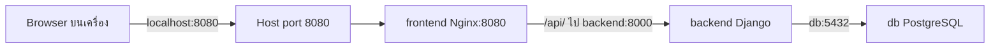

# Docker Network — ให้บริการคุยกันถูกที่

## เรื่องนี้คืออะไร?

Docker Network เชื่อม Containers ให้ส่งข้อมูลหากันได้ ใน Compose บริการที่อยู่ Network เดียวกันค้นอีกบริการผ่านชื่อ เช่น `backend` และ `db` ได้ ชื่อเหล่านี้เป็น DNS ภายใน Docker ไม่ใช่ชื่อที่ Browser บนเครื่องคุณรู้จัก

## ใช้ทำอะไร?

ใช้เมื่อ Frontend ต้องเรียก API หรือ Backend ต้องต่อ DB และเมื่อเจอ Connection refused/Name not resolved

## ทำงานอย่างไร?



ภาพนี้แยกคำขอจาก Browser ออกจากการส่งต่อใน Network: Browser รับ React assets จาก Frontend แล้ว JavaScript เรียก `/api/` ที่ Origin เดิม Nginx ใน `frontend` จึงเป็นผู้ค้นชื่อ `backend` ให้

### localhost อยู่ที่ไหน?

| จุดที่ใช้ | `localhost` หมายถึง | ที่ต้องใช้ใน Lab |
| --- | --- | --- |
| Browser/Terminal บน Host | เครื่องของผู้ใช้ | `http://localhost:8080` |
| Backend container | Backend เอง | ต่อ DB ด้วย `db:5432` |
| Frontend container | Frontend เอง | ส่ง API ไป `backend:8000` |

Backend ใช้ `HOST=db`, `PORT=5432` ไม่ใช่ `localhost` เพราะ DB เป็นอีก Container ที่มีพื้นที่ Network แยกกัน พอร์ตภายในไม่ต้อง Publish ออก Host เพื่อให้บริการใน Network เดียวกันคุยกัน

### Bridge กับ Host Network

**Bridge** เป็น Network แยกที่ Containers ต่อเข้ามา Lab นี้ใช้ User-defined bridge ของ Compose จึงมี Service discovery หรือการหาบริการผ่าน DNS ชื่อเดิมยังใช้ได้เมื่อ IP เปลี่ยน แอปต้องเชื่อมใหม่ได้และ Proxy ต้อง Resolve ชื่อใหม่ตามที่ตั้งใน [nginx.conf](/technology-guides/docker/dockerfile)

**Host network** ใช้ Network ของ Host โดยตรงบนระบบที่รองรับ ทำให้แยกพอร์ตน้อยลงและมีข้อจำกัดตาม Platform/Docker Desktop ไม่ใช้เป็นทางลัดแก้ DNS/Port ของ Lab นี้ และไม่ใช้ `ports` แบบ Bridge มาคาดหวังผลเดียวกัน

## ขั้นตอนการทำงาน

หลังเปิด Compose แล้ว ดูชื่อ Network:

```bash
docker network ls
docker network inspect task-demo_app
```

ดูว่ามีสามบริการใน Network เดียวกัน ชื่อ `task-demo_app` มาจาก Project กับ Key `app` ไม่ Hardcode IP ของ Container

ตรวจ DNS และ DB จาก Backend โดยใช้ Python ที่มีอยู่แล้ว:

```bash
docker compose exec backend python -c "import socket; print(socket.gethostbyname('db'))"
docker compose exec backend python manage.py check --database default
```

คำสั่งแรกตรวจเฉพาะ DNS ส่วนคำสั่งสองรัน Django system checks ไม่ได้ยืนยัน Query ทุกแบบ ถ้าต้องตรวจการเชื่อม DB จริง ใช้ Endpoint Health ที่มี `SELECT 1` แล้วอ่าน/เพิ่ม Task ตาม [Compose Lab](/technology-guides/docker/docker-compose)

ตรวจเส้นทางจาก Host:

```bash
curl --fail http://localhost:8080/api/health/
```

ต้องผ่านพอร์ตของ Frontend ไม่ใช้ `curl http://backend:8000` จาก Host แล้วสรุปว่า Docker DNS เสีย

## ตัวอย่างการใช้งานจริง

React เรียก `http://backend:8000/api/tasks/` แล้ว Browser แจ้งหา Host ไม่พบ ให้แก้ Frontend เป็น `/api/tasks/` และตั้ง Nginx proxy ตามตัวอย่าง หากตั้งแยก Origin จริง ต้องใช้ API URL ที่ Browser เข้าถึงได้และจัด CORS/CSRF ตามรูปแบบ Auth ไม่เปิด `*` เพื่อให้ Error หายอย่างเดียว

## ข้อควรระวัง

Lab เปิดเฉพาะ `127.0.0.1:8080` จึงเข้าจากเครื่องอื่นไม่ได้ตามตั้งใจ ไม่ Publish `5432` สู่ Public internet และไม่คิดว่าไม่มี `ports` แปลว่า Containers ใน Network เดียวกันเข้าถึง DB ไม่ได้ การแยก Network เป็นเพียงส่วนหนึ่งของการจำกัดสิทธิ์

## สรุปสิ่งที่ต้องจำ

- `localhost` เปลี่ยนความหมายตามจุดที่รัน
- ใช้ชื่อ Service ภายใน Network และ Host port จากภายนอก
- Browser ไม่รู้จักชื่อ `backend`/`db` ของ Compose
- ไม่จำเป็นต้องเปิดพอร์ต DB ออกสู่ Host

## อ่านต่อ

- [Compose networking](https://docs.docker.com/compose/how-tos/networking/)
- [Host network limitations](https://docs.docker.com/engine/network/drivers/host/)
- [Authentication Flow](/technology-guides/fullstack/authentication-flow)
