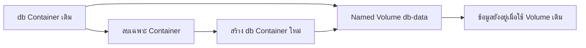

# Docker Volume — เก็บข้อมูลให้อยู่หลังเปลี่ยน Container

## เรื่องนี้คืออะไร?

Volume คือพื้นที่เก็บไฟล์ที่ Docker จัดการแยกจาก Container จึงสร้าง DB container ใหม่โดยยังใช้ข้อมูลเดิมได้ ถ้าเก็บข้อมูลไว้แค่ใน Writable layer ของ Container เมื่อถูกลบก็สูญเสียข้อมูลส่วนนั้นได้

Mount คือการผูกพื้นที่เก็บเข้ากับ Path หรือตำแหน่งใน Container เพื่อให้โปรแกรมอ่านและเขียนไฟล์ที่พื้นที่นั้น

## ใช้ทำอะไร?

ใช้เก็บฐานข้อมูลหรือไฟล์ที่ต้องอยู่ต่อหลังเปลี่ยน Image ไม่ได้ใช้แทนระบบสำรองข้อมูล

## ทำงานอย่างไร?



ภาพนี้แสดงว่าข้อมูลผูกกับ Volume เดิม ไม่ใช่อายุของ Container หากเผลอลบ Volume หรือชี้ไป Volume คนละตัว ผลย่อมต่างออกไป

| ที่เก็บ | ใครดูแล/ใช้เมื่อไร |
| --- | --- |
| Writable layer | อยู่กับ Container ตัวนั้น ใช้กับไฟล์ชั่วคราว |
| Named Volume | Docker ดูแลและมีชื่อ ใช้ DB ใน Lab นี้ |
| Bind Mount | ชี้โฟลเดอร์ Host โดยตรง เช่น Source ตอนพัฒนา ต้องดู Paths/สิทธิ์ |
| Anonymous Volume | Docker สร้างชื่อให้เอง ไม่ได้ผูกกลับอัตโนมัติทุกครั้ง จัดการยากกว่าถ้าไม่บันทึกไว้ |

### คำสั่งมีผลต่อข้อมูลอย่างไร?

| การกระทำ | Named Volume `db-data` |
| --- | --- |
| Build Image ใหม่ | ยังอยู่ ไม่อัปเกรด Schema หรือ Major DB ให้เอง |
| `docker compose stop` | ยังอยู่ และ Containers เดิมยังอยู่ |
| `docker compose down` | ยังอยู่ แต่ Containers ถูกลบ |
| สร้างใหม่ด้วย Project name เดิม | กลับมาใช้ Volume เดิมตาม Config |
| `docker compose down -v` | ลบ Named Volumes ที่ Compose จัดการใน Project นี้และ Anonymous volumes ที่เกี่ยวข้อง; External volumes ไม่ถูกลบ |

## ขั้นตอนการทำงาน

### 1. ดูว่า DB ใช้ Volume อะไร

หลังทำ [Compose Lab](/technology-guides/docker/docker-compose):

```bash
docker volume ls
docker volume inspect task-demo_db-data
```

ชื่อข้างต้นมาจาก `COMPOSE_PROJECT_NAME=task-demo` กับ Key `db-data` หากใช้ชื่อ Project อื่นต้องปรับตามจริง บน Docker Desktop ตำแหน่งไฟล์จริงอยู่ใน Linux VM อย่าเข้าไปแก้ไฟล์ PostgreSQL ตรง ๆ

### 2. ทดลอง Persistence โดยไม่ลบ Volume

เพิ่ม Task จากเว็บ แล้วรันในโฟลเดอร์เดิม:

```bash
docker compose down
docker compose up -d
```

เปิดเว็บใหม่ควรยังอ่าน Task เดิมได้ อย่าใช้ `-v` ในการทดลองนี้ หากรายการว่าง ให้ตรวจว่า Project name/Context/Volume เปลี่ยนหรือไม่ก่อนสรุปว่าข้อมูลถูกลบ

### 3. สำรอง PostgreSQL แบบ Logical backup

ใช้กับ Lab ที่ DB กำลังรันอยู่ รันบน Host แบบ Bash/Zsh สร้างโฟลเดอร์ส่วนตัวและ Dump ชื่อใหม่ทุกครั้ง:

```bash
mkdir -p backups
chmod 700 backups
dump_file="backups/task-demo-$(date +%Y%m%d-%H%M%S).dump"
docker compose exec -T db sh -c 'pg_dump -U "$POSTGRES_USER" -d "$POSTGRES_DB" -Fc' > "$dump_file"
```

`-T` ไม่เปิด TTY เพื่อไม่ปนข้อมูล Terminal, `-Fc` ใช้ Custom archive ส่วน `>` เขียนไฟล์ในเครื่อง Host ตรวจ Exit status ของคำสั่งก่อนใช้ไฟล์ (`echo $?` ต้องเป็น `0` ทันทีหลัง Dump) จากนั้นดูโครงสร้าง Archive:

```bash
docker compose exec -T db pg_restore --list < "$dump_file"
```

รายการ Archive อ่านได้ยังไม่เท่ากับ Restore สำเร็จ ต้องนำไปกู้ใน DB ทดสอบแยกและตรวจ Task/Constraints จริง ห้ามลอง Restore ทับ UAT/Production ใช้ค่าลับแยก สิทธิ์จำกัด และลบข้อมูลทดสอบตามนโยบาย

Dump นี้สำรองฐานเดียว ไม่รวมทุก Role/Cluster configuration และไม่ใช่การกู้ได้ทุกจุดเวลา ระบบจริงต้องตกลง RPO (ยอมเสียข้อมูลย้อนหลังได้เท่าไร), RTO (ต้องกลับมาในเท่าไร), รอบ Backup และที่เก็บนอกเครื่อง พร้อมทดสอบ Restore อ้างอิง [pg_dump](https://www.postgresql.org/docs/17/app-pgdump.html)

## ตัวอย่างการใช้งานจริง

จะอัปเดต Backend จึงเก็บ Backup ตามแผนและจด Volume เดิมก่อน เปลี่ยนเฉพาะ Image แอปแล้วตรวจ Task ซ้ำ Volume ไม่ได้ทำให้ Migration ที่ลบข้อมูลย้อนคืนได้

## ข้อควรระวัง

- การลบ Volume อาจลบข้อมูลฐานถาวร ต้องตรวจชื่อ ผู้ใช้งาน และ Backup ก่อนเสมอ
- ไม่ Copy ไฟล์ดิบของ DB ที่กำลังเขียนแล้วเรียกว่า Backup ที่สอดคล้องกัน ใช้เครื่องมือ DB หรือวิธี Physical backup ที่ PostgreSQL รองรับ
- เปลี่ยน `POSTGRES_PASSWORD` ใน `.env` ไม่ได้เปลี่ยนรหัส Role ใน DB ที่ Initialize แล้ว ให้ Rotate ผ่านขั้นตอนที่ควบคุม ไม่ลบ Volume เพื่อแก้ Password ในระบบร่วม

## สรุปสิ่งที่ต้องจำ

- Named Volume อยู่ต่อหลังลบ Container ตามปกติ
- Bind Mount กับ Volume มีการดูแล Paths/สิทธิ์ต่างกัน
- Volume ไม่ใช่ Backup และ Backup ต้องลอง Restore
- ไม่ใช้ `down -v` เป็นคำสั่งประจำวัน

## อ่านต่อ

- [Commands ที่ลบข้อมูล](/technology-guides/docker/docker-commands)
- [PostgreSQL Migration](/technology-guides/postgresql/migrations)
- [Docker volumes](https://docs.docker.com/engine/storage/volumes/)
