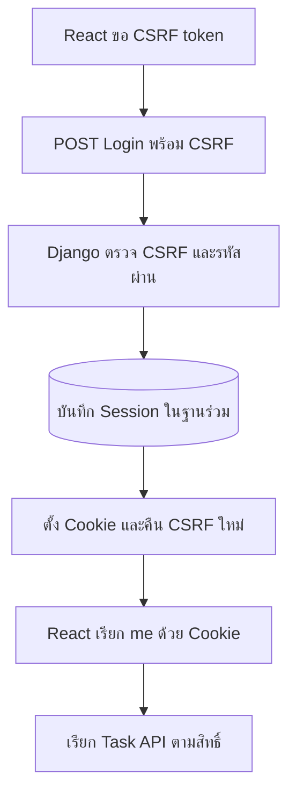

# Authentication Flow — Session Cookie และ CSRF

## เรื่องนี้คืออะไร?

Session คือข้อมูลฝั่ง Server ที่จำว่าผู้ใช้ Login แล้ว Browser เก็บเพียง Session identifier ใน Cookie เมื่อส่งคำขอ Django อ่าน identifier แล้วหาผู้ใช้จาก Session storage ไม่ส่งรหัสผ่านซ้ำทุกครั้ง

## ทำงานอย่างไร?

ภาพใช้ 7 ขั้นตอน CSRF token ช่วยป้องกันเว็บไซต์อื่นสั่งเขียนข้อมูลแทนผู้ใช้ ไม่ใช่ Token สำหรับพิสูจน์ตัวตน Session Cookie ต่างหากที่ผูกกับผู้ใช้

## ทำอย่างไร?

1. GET csrf ตั้ง Cookie และส่ง Masked token ผ่าน JSON จึงใช้ CSRF_COOKIE_HTTPONLY ได้โดยไม่ต้องอ่าน Cookie จาก JavaScript
2. React ส่ง username/password ผ่าน HTTPS พร้อม CSRF header และ `credentials: include`
3. Login endpoint ใช้ csrf_protect แม้ยังเป็น Anonymous เพราะ DRF SessionAuthentication เพียงอย่างเดียวไม่บังคับ CSRF สำหรับ Anonymous
4. `login()` เปลี่ยน Session key ตามกรณีและหมุน CSRF secret React ต้องแทน Token เก่าด้วย csrfToken จาก Login response
5. GET me ยืนยันผู้ใช้หลัง Refresh หากหมดอายุส่ง 403 AUTHENTICATION_REQUIRED แล้วกลับหน้า Login
6. Logout เป็น POST พร้อม CSRF ล้าง Session ฝั่ง Server แล้ว React ล้าง Auth/Task state และ CSRF ใน Memory

## Cookie แต่ละค่าช่วยอะไร?

| ค่า | หน้าที่ |
| --- | --- |
| HttpOnly | JavaScript อ่าน Cookie ไม่ได้ แต่ Browser ยังส่งให้ Server |
| Secure | ส่ง Cookie ผ่าน HTTPS |
| SameSite=Lax | ลดการส่ง Cookie ข้าม Site บางกรณี ยังต้องตรวจ CSRF |

Local HTTP ใช้ DEBUG=1 เพื่อปิด Secure เฉพาะพื้นที่ทดลอง และเรียกผ่าน Vite proxy บน localhost เดียวกัน อย่าสลับ localhost กับ 127.0.0.1 ใน URL Browser โดยไม่ตรวจ Cookie scope

CORS ควบคุมการอ่าน Response ข้าม Origin ส่วน CSRF ตรวจคำขอเขียนที่อาศัย Cookie เป็นคนละเรื่อง Cross-origin ที่ใช้ Cookie ต้องมี `credentials: include` ฝั่ง Client และ Origin allowlist พร้อม Allow-Credentials ฝั่ง Server หากเป็น Cross-site จริงอาจต้อง SameSite=None;Secure และยังติดนโยบาย Third-party cookies ได้ จึงควรออกแบบ First-party ให้เรียบง่ายก่อน

## หลาย Django instances ทำอย่างไร?

Session backend นี้เก็บใน PostgreSQL ที่ทุก Instance เข้าถึงร่วมกัน ใช้ Settings และ Secret key ตามแผนเดียวกัน จึงไม่ต้องผูกผู้ใช้กับ Instance เดิม หากเก็บ Session ใน Memory ของ Process ผู้ใช้ที่ถูกส่งไปอีก Instance อาจเหมือน Logout Redis-backed session เป็นทางเลือกเมื่อออกแบบ Persistence/Expiry/Availability แล้ว ไม่จำเป็นต้องเพิ่มตั้งแต่เริ่ม

Instance ที่ไม่เก็บ State เฉพาะเครื่องยังใช้ Server-side session ได้ เพราะ State อยู่ในระบบภายนอก ไม่ใช่ตัว Process

## วิธีทดสอบ

ใช้ [Django Auth tests](/technology-guides/django-python/testing) ตรวจไม่มี CSRF, Token เก่าหลัง Login, Logout และ Session ถูกลบ จากนั้นทดสอบ Browser จริงเพื่อยืนยัน Cookie flags, Proxy และ HTTPS ของ Environment ที่เลือก

## ข้อควรระวัง

อย่าเก็บรหัสผ่านหรือ Long-lived authentication token ใน localStorage เพื่อแก้ Login ไม่ติด Token-based authentication ต้องออกแบบอายุและการเพิกถอนแยก ต่างจาก CSRF token ใน Memory ไม่ใช้เป็นสิ่งเดียวกัน

## สรุปสิ่งที่ต้องจำ

- Cookie ใช้ผูก Session ส่วน CSRF ป้องกันคำขอข้ามเว็บ
- Login ต้องตรวจ CSRF และส่ง Token ใหม่กลับมา
- Shared session storage รองรับหลาย Instance
- Frontend guard ไม่แทน Backend authorization

## อ่านต่อ

- [Django Authentication](/technology-guides/django-python/authentication)
- [React Authentication](/technology-guides/react-typescript/authentication)
- [Authorization](/technology-guides/django-python/authorization)
