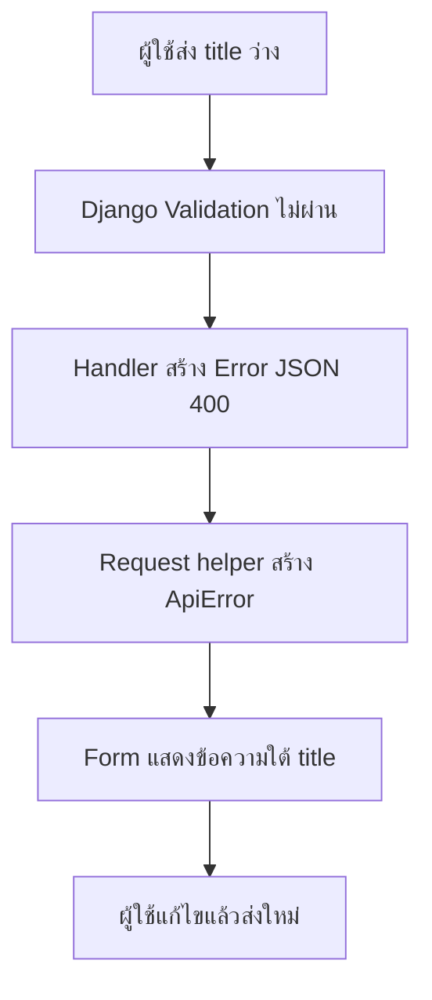

# Error Flow — จาก Django ถึงข้อความใต้ Form

## เรื่องนี้คืออะไร?

Error flow คือทางเดินของข้อผิดพลาดจาก Server ไปถึงข้อความที่ผู้ใช้แก้ตามได้ ใช้ Error code กลางแทนการเดาจากข้อความหรือ HTTP status อย่างเดียว

## ทำงานอย่างไร?

ภาพมี 6 ขั้นตอน โดย Form เก็บ Input เดิมไว้ การกดส่งใหม่เป็นการตัดสินใจของผู้ใช้ ไม่ Retry คำขอเขียนอัตโนมัติ

## ตัวอย่างการใช้งานจริง

POST Task ที่ title เป็นช่องว่างได้ 400 และ Body ตาม [Contract กลาง](/technology-guides/fullstack) Handler ของเราครอบ DRF ValidationError เป็น error.code/message/details ซึ่งต่างจาก DRF ปกติที่อาจคืน Fields ตรง ๆ

React helper ตรวจ `response.ok` เพราะ fetch ไม่ Throw สำหรับ 400/500 เอง จากนั้นแปลง details.title ให้ Form แสดง ข้อความภาพรวมใช้ Code ที่ควบคุมไว้ ไม่แสดง Stack trace หรือ HTML ของ Proxy

| HTTP / Code | ผู้ใช้หรือทีมควรทำอะไร |
| --- | --- |
| 400 VALIDATION_ERROR | แก้ Input ตาม Fields |
| 403 AUTHENTICATION_REQUIRED | กลับ Login เพราะ Session ไม่มี/หมดอายุ |
| 403 CSRF_FAILED | ตรวจ Cookie/Origin ขอ Token ใหม่ แล้วให้ผู้ใช้ส่งใหม่ |
| 403 PERMISSION_DENIED | ไม่มีสิทธิ์ ไม่วน Login ทุกครั้ง |
| 404 NOT_FOUND | ไม่พบหรือไม่เปิดเผย Task ที่ไม่มีสิทธิ์ |
| 409 CONFLICT | โหลดข้อมูลล่าสุดแล้วแก้ความขัดแย้งตามกติกางาน |
| 500 INTERNAL_ERROR | แจ้งปัญหาอย่างปลอดภัย ตรวจ Log ฝั่ง Server |

401 ใช้เมื่อ Authentication scheme ส่ง Challenge เหมาะสม ตัวอย่าง Session นี้ไม่บังคับเปลี่ยนเป็น 401 เพื่อให้ตารางดูคุ้น ส่วน 409 เป็นรูปแบบรองรับเมื่อเพิ่ม Business conflict จริง ยังไม่มี Endpoint ที่ตรวจ Concurrent version แล้วตอบ 409 โดยอัตโนมัติ

## วิธีทดสอบ

ทดสอบ title ว่าง, ไม่ Login, ไม่มี CSRF, id ของผู้ใช้อื่น และ Mock HTML 500 ฝั่ง React ตรวจทั้ง status/code/ข้อความที่ผู้ใช้เห็น ดู Test source ที่ [Django](/technology-guides/django-python/testing) และ [React](/technology-guides/react-typescript/testing)

## ข้อควรระวัง

DRF handler จัดรูปแบบ Error ภายใน APIView ส่วน CSRF middleware, Django handler500 และ Reverse proxy อยู่คนละชั้น ต้องมี Fallback ไม่รับประกันว่าทุก Response เป็น JSON เสมอ Log เฉพาะข้อมูลจำเป็น ห้าม Password, Cookie, Authorization header, CSRF token และ SQL parameters ที่มีข้อมูลส่วนบุคคล

## สรุปสิ่งที่ต้องจำ

- Status บอกกลุ่มปัญหา Code บอกเหตุผลเฉพาะ
- Validation แสดงใกล้ Input และเก็บสิ่งที่กรอกไว้
- HTTP Error และ Network Error ต่างกัน
- ตรวจ Log ฝั่ง Server โดยไม่ส่งข้อมูลลับกลับผู้ใช้

## อ่านต่อ

- [Django Error Handling](/technology-guides/django-python/error-handling)
- [React Error Handling](/technology-guides/react-typescript/error-handling)
- [Troubleshooting](/technology-guides/fullstack/troubleshooting)
