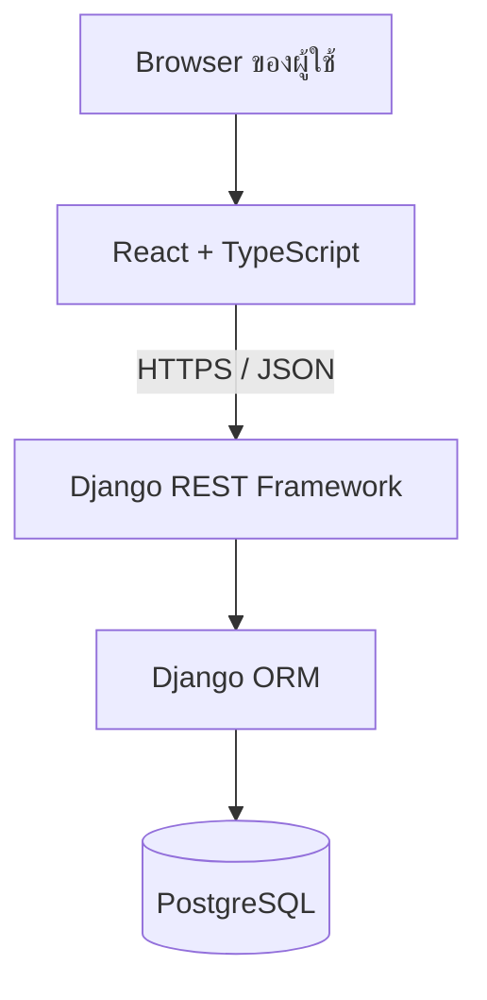

# Fullstack Integration — Django + React

## เรื่องนี้คืออะไร?

ส่วนนี้เชื่อม Django และ React ด้วยตัวอย่าง Task Management เดียวกัน ผู้ใช้ Login แล้วดู สร้าง แก้ไข ลบ และทำ Task ของตัวเองให้เสร็จได้ **นี่คือแบบตัวอย่างสำหรับเรียนรู้ในเอกสาร** ไม่ใช่ระบบที่ติดตั้งหรือเปิดใช้งานใน Engineering Hub

เริ่ม Backend ที่ [Django Getting Started](/technology-guides/django-python/getting-started) และ Frontend ที่ [React Getting Started](/technology-guides/react-typescript/getting-started) Code อยู่ใน MDX และต้องคัดลอกไฟล์ให้ครบในพื้นที่ทดลองแยกก่อนรัน

## ทำงานอย่างไร?



React ดูแลหน้าจอ Django ตรวจ Input, ตัวตน และสิทธิ์ ส่วน ORM แปลงคำสั่ง Python เป็น SQL ให้ PostgreSQL ใน Local ใช้ HTTP และ Vite proxy ส่วน Production ต้องมี HTTPS และ Reverse proxy ที่ตั้งค่าตามระบบจริง

## Contract กลาง: Task v1

Contract คือข้อตกลงว่าฝั่งส่งและรับจะใช้ URL และข้อมูลแบบใด User มี id และ username ส่วน Task มี 8 Fields ด้านล่าง ข้อมูลเป็นตัวอย่างสมมติ ไม่ใช่ข้อมูลผู้ใช้จริง

```json
{
  "id": 42,
  "title": "เพิ่ม Login",
  "description": "ให้ผู้ใช้เข้าสู่ระบบก่อนดูงาน",
  "status": "todo",
  "created_at": "2026-10-01T09:00:00Z",
  "updated_at": "2026-10-01T09:00:00Z",
  "owner": 7
}
```

- id และ owner เป็นเลขจำนวนเต็มบวก ตัวอย่างนี้ใช้ Auto-increment key ไม่ได้เลือก UUID
- status ใช้ `todo`, `in_progress`, `completed` เท่านั้น
- title ต้องมีข้อความหลังตัดช่องว่าง ยาวไม่เกิน 200 ตัวอักษร description ว่างได้
- เวลาเป็น ISO 8601 จาก Server เก็บโดยใช้ Timezone ไม่ใช้เวลาจาก Browser เป็นหลัก
- owner มาจาก User ใน Session การส่ง owner ใน Input ไม่เปลี่ยนเจ้าของ

### REST API

| Method / Path | หน้าที่ | ผลสำเร็จ |
| --- | --- | --- |
| GET `/api/v1/tasks/` | List เฉพาะงานตัวเอง | 200 แบบแบ่งหน้า |
| POST `/api/v1/tasks/` | สร้าง Task | 201 Task |
| GET `/api/v1/tasks/{id}/` | อ่าน Task ตัวเอง | 200 Task |
| PATCH `/api/v1/tasks/{id}/` | แก้บาง Fields / completed | 200 Task |
| DELETE `/api/v1/tasks/{id}/` | ลบ Task ตัวเอง | 204 ไม่มี Body |

List เป็น `{count, next, previous, results}` ใช้ `page` และ `page_size` ค่าเริ่มต้น 20 สูงสุด 100 ตัวกรอง `status` เป็น Optional ไม่เปิด PUT ในตัวอย่างนี้ ดู Code ที่ [REST API](/technology-guides/django-python/rest-api)

### Authentication และ Error

| Method / Path | หน้าที่ |
| --- | --- |
| GET `/api/v1/auth/csrf/` | ตั้ง CSRF Cookie และคืน `{csrfToken}` แบบ Masked |
| POST `/api/v1/auth/login/` | รับ `{username,password}` คืน `{user,csrfToken}` ใหม่ |
| GET `/api/v1/auth/me/` | คืน `{id,username}` ของผู้ใช้ใน Session |
| POST `/api/v1/auth/logout/` | ลบ Session คืน 204 |

ใช้ Django Session ในฐานข้อมูลร่วม Cookie แบบ HttpOnly/Secure/SameSite Lax เป็นค่าเริ่มต้นสำหรับ HTTPS แบบ First-party การส่ง POST/PATCH/DELETE ต้องมี CSRF token รวมถึง Login ไม่ใช้การปิด CSRF เพื่อให้ตัวอย่างสั้นลง

Error กลางเป็น `{error:{code,message,details}}` โดย details เป็น Fields หรือ `{}` ถ้าไม่มีรายละเอียด เช่น Validation 400 ด้านล่าง ส่วน Session ที่ไม่มี/หมดอายุเป็น 403 `AUTHENTICATION_REQUIRED` ตาม DRF SessionAuthentication; Task ของผู้อื่นตอบ 404 ดูเหตุผลที่ [Authorization](/technology-guides/django-python/authorization)

```json
{
  "error": {
    "code": "VALIDATION_ERROR",
    "message": "ข้อมูลไม่ถูกต้อง",
    "details": { "title": ["กรุณาระบุชื่องาน"] }
  }
}
```

## ใช้งานคู่มือนี้อย่างไร?

1. ตกลง Contract นี้ก่อนแก้ Code ถ้าจะเปลี่ยนให้ปรับ Backend/Frontend/tests พร้อมกัน
2. ทำ Backend และ Test ในฐานทดลองแยก แล้วเปิด API ด้วย Local settings
3. ทำ Frontend ให้ครบไฟล์ เรียก API ผ่าน Vite proxy และ Login
4. ทดลอง [Request Flow](/technology-guides/fullstack/request-flow), [Authentication Flow](/technology-guides/fullstack/authentication-flow) และ [Error Flow](/technology-guides/fullstack/error-flow)
5. ตรวจ [Troubleshooting](/technology-guides/fullstack/troubleshooting) เมื่อผลไม่ตรงกัน

## ข้อควรระวัง

[Docker lab](/technology-guides/docker) เดิมเป็นตัวอย่างอีกชุดและอาจใช้ Routes/Authentication ต่างกัน ห้ามคัดลอกสลับแล้วถือว่าเข้ากันได้ทันที [PostgreSQL Order Lab](/technology-guides/postgresql) ใช้ Domain การสั่งซื้อ ไม่ใช่ Schema ของ Task ต้องสร้างฐานแยกและให้ Django migrations จัดการ Schema นี้

ตัวอย่างยังไม่ครอบคลุม Rate limiting, Password reset, E2E ทุก Browser, Production deployment หรือ Load test ไม่ได้เป็นนโยบายที่องค์กรอนุมัติแล้ว และไม่แทน Architecture review ของโครงการจริง

## ขอบเขตการตรวจตัวอย่าง

ตรวจวันที่ 2026-11-01 โดยคัด Code blocks ไปพื้นที่ชั่วคราวนอก Repository ไม่เพิ่มแอปลง Hub:

- Backend: Python 3.12, Django 5.2.18, DRF 3.18.3 ผ่าน Tests 12 กรณีทั้ง SQLite ใน Memory และ PostgreSQL 17.11 ฐานทิ้งได้ รวม Model, CRUD, Ownership, Validation, Session และ CSRF
- Frontend: Node.js 22.23.4, React 19.3.1, TypeScript 6.0.3, Vite 8.3.5 ผ่าน strict Build และ Vitest 5.0.5 จำนวน 7 Tests สำหรับ Form/Login/API errors โดย Mock fetch
- Test client ตรวจ Cookie flags และ CSRF ได้ แต่ยังไม่ได้ทดสอบ React → Django ร่วมกันใน Browser หรือ HTTPS ของ Environment จริง ผลเหล่านี้ไม่ใช่หลักฐาน Production readiness

เมื่อเปลี่ยน Code blocks ต้องคัดและรันใหม่ตามบท Testing ทั้งสองฝั่ง ผลครั้งนี้ไม่รับประกันการแก้ไขในอนาคต และไม่ทำให้สถานะเอกสาร Draft เปลี่ยนเป็น Approved

## สรุปสิ่งที่ต้องจำ

- ใช้ Contract เดียวทั้ง Django และ React
- Session ตรวจตัวตน Ownership ตรวจสิทธิ์
- Error และ Success ต้องมีรูปแบบที่ตกลงกัน
- ตัวอย่างเอกสารต้องทดลองแยกก่อนนำไปใช้จริง

## อ่านต่อ

- [Django / Python](/technology-guides/django-python)
- [React / TypeScript](/technology-guides/react-typescript)
- [Projects](/projects)
- [Docker](/technology-guides/docker) และ [PostgreSQL](/technology-guides/postgresql)
