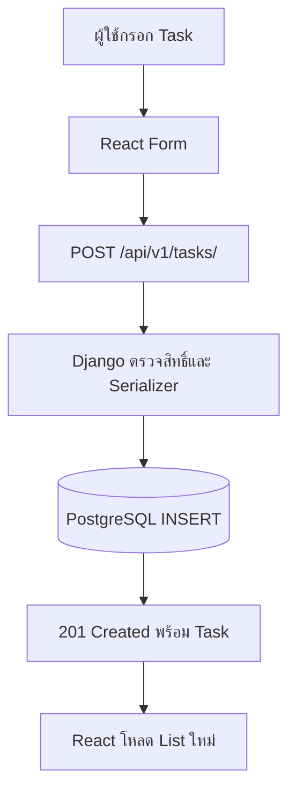

# Request Flow — สร้าง Task ตั้งแต่ Form ถึงฐานข้อมูล

## เรื่องนี้คืออะไร?

Request คือคำขอที่ Browser ส่งให้ Server ส่วน Response คือผลที่ส่งกลับ เราจะตามการเพิ่ม Task หนึ่งรายการให้เห็นว่าข้อมูลผ่านส่วนไหนและใครตรวจอะไร

## ทำงานอย่างไร?



ภาพนี้มี 7 ขั้นตอน โดยก่อนถึง Serializer Django ต้องตรวจ Session, CSRF และ Permission ให้ผ่านด้วย ถ้าไม่ผ่านจะไม่สร้าง Task และส่ง Error ให้ React

## ตัวอย่างการใช้งานจริง

Prerequisite: ผู้ใช้ Login แล้ว Cookie ยังใช้ได้ Helper มี CSRF ใหม่จาก Login และ Task tables ถูกสร้างด้วย Migrations แล้ว

1. ผู้ใช้กรอก “เพิ่ม Login” แล้วกดเพิ่มงาน Form ปิดปุ่มระหว่างรอ
2. Service ส่ง JSON ด้านล่าง พร้อม Session Cookie และ `X-CSRFToken` ไม่ส่ง owner
3. Django ตรวจ Session/CSRF แล้ว Serializer ตัดช่องว่างและตรวจ title/status
4. View กำหนด owner เป็น request.user แล้ว ORM INSERT ลง PostgreSQL คำขอสร้างหนึ่ง Task นี้ใช้การเขียนหนึ่งรายการ หากมีหลายรายการที่ต้องสำเร็จร่วมกันจึงใช้ `transaction.atomic()`
5. Server ตอบ 201 เป็น Task ที่มี id/owner/timestamps จากฐานข้อมูลตาม [Contract](/technology-guides/fullstack)
6. React ตรวจ JSON ล้าง Form และโหลด List ใหม่ให้ข้อมูลตรง Server

```http
POST /api/v1/tasks/
Content-Type: application/json
X-CSRFToken: <masked-csrf-token-from-login-response>
```

```json
{
  "title": "เพิ่ม Login",
  "description": "ให้ผู้ใช้เข้าสู่ระบบก่อนดูงาน",
  "status": "todo"
}
```

Header เป็นรูปแบบอธิบาย ใช้ Token จริงจาก Endpoint ในพื้นที่ทดลอง ไม่คัดลอก Placeholder นี้ไปใช้เป็น Credential

## วิธีทดสอบ

ทดสอบ CRUD ด้วย [curl](/technology-guides/django-python/rest-api) หรือหน้า React: สร้าง → โหลด List → เปลี่ยน status เป็น completed → ลบ แล้วลองส่ง title ว่างและใช้บัญชีอื่นอ่าน id เดิม ต้องถูกปฏิเสธตาม Contract

## ข้อควรระวัง

Connection ขาดหลัง INSERT ไม่ได้แปลว่าบันทึกล้มเหลวเสมอ ตรวจ List ก่อนกดซ้ำ หลีกเลี่ยง Retry POST อัตโนมัติโดยไม่มีวิธีกันข้อมูลซ้ำ และไม่ส่งเมล/เรียก Service ภายนอกค้างใน Transaction ยาว ๆ

## สรุปสิ่งที่ต้องจำ

- Browser ไม่เข้าฐานข้อมูลโดยตรง
- Server ตรวจ Input และตั้ง owner
- แสดงข้อมูลจาก Response ที่ผ่านการตรวจ
- เมื่อไม่แน่ใจว่าบันทึกแล้วหรือยัง ให้ตรวจผลก่อนส่งซ้ำ

## อ่านต่อ

- [Serializers](/technology-guides/django-python/serializers)
- [Models & ORM](/technology-guides/django-python/models-and-orm)
- [API Integration](/technology-guides/react-typescript/api-integration)
