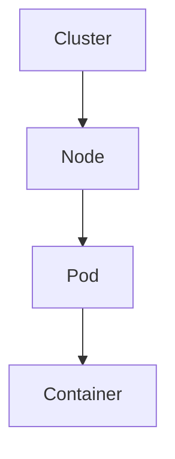
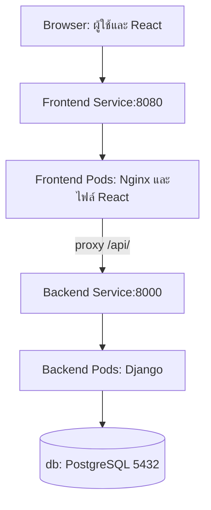

# Architecture — Cluster Node Pod และเส้นทางคำขอ

## เรื่องนี้คืออะไร?

Cluster คือกลุ่มเครื่องที่ Kubernetes ดูแล Control Plane รับ Desired State หรือสภาพที่ต้องการ เช่น Backend 3 Pods แล้ว Controllers คอยปรับให้ใกล้เคียง ส่วน Worker Node คือเครื่องที่รันงานจริง

Node อาจเป็น VM/เครื่องจริง สำหรับ kind เป็น Container ของ Docker การฝึกเครื่องเดียวจึงไม่ใช่หลักฐานว่าแอปรอดเมื่อเครื่องจริงเสีย

## ทำงานอย่างไร?

Pod เป็นหน่วยที่ Scheduler เลือก Node ให้ Containers ใน Pod เดียวกันแชร์ Network และอาจแชร์ Volumes กัน ไม่ย้าย Compose service มาเป็น Pod แบบหนึ่งต่อหนึ่งโดยไม่ดูหน้าที่

| ส่วน | หน้าที่แบบง่าย |
| --- | --- |
| API server | รับคำขอจาก kubectl และส่วนอื่นของระบบ |
| etcd | เก็บ State ของ Cluster ต้องดูแล Access/Backup |
| Scheduler | เลือก Node ให้ Pod ตาม Resource และข้อกำหนด |
| Controllers | เปรียบเทียบสิ่งที่ต้องการกับที่มีแล้วสร้าง/ปรับ Resources |
| kubelet / Container runtime | ดูแล Containers บน Node ตาม Pod spec |

หนึ่ง Node อาจมีทั้งบทบาท Control Plane และ Worker โดยเฉพาะ Lab ไม่ใช่ว่าทุก Cluster มีเครื่องแยกครบตามตาราง

### Docker Compose กับ Kubernetes

Container Image เป็นแพ็กแอปที่ใช้ได้ทั้งสองระบบ Kubernetes ใช้ Runtime ที่รองรับมาตรฐานของมัน ไม่จำเป็นต้องมี Docker Engine เป็น Runtime บน Worker ทุกเครื่อง

| Docker Compose | Kubernetes |
| --- | --- |
| เปิด Services จาก compose.yaml มักใช้กับเครื่องเดียว | จัด Pods ข้าม Nodes ใน Cluster |
| Service name/Network ของ Compose | Service DNS/Pod networking ของ Cluster |
| ตั้งจำนวนและ Restart ตาม Compose runtime | Deployment/ReplicaSet/HPA ดูแล Desired State |
| เริ่มง่าย เหมาะ Local/ระบบที่ข้อกำหนดพอ | เพิ่มงานดูแล Cluster, Security, Storage และ Upgrades |

Namespace แบ่งชื่อและขอบเขต Resources เช่น `task-demo` แต่ไม่ใช่ Network isolation ที่สมบูรณ์ และ Git branch ไม่ใช่ Namespace/Environment โดยอัตโนมัติ

## เส้นทางคำขอของ Task Lab

ภาพเป็นเส้นทางผ่าน Frontend server: JavaScript ของ React **ทำงานใน Browser** ไม่ใช่ใน Pod เมื่อ React เรียก `/api/tasks/` ที่ Origin เดิม Nginx จึงส่งต่อไป Backend Service ภายใน Cluster

ClusterIP ของ Frontend ในภาพยังต้องมีทางเข้าจากภายนอก เช่น Lab ใช้ port-forward ส่วน Production ใช้ Gateway/Ingress/LoadBalancer ที่ติดตั้งและตั้งค่าจริง Browser ไม่ได้ Resolve `backend.task-demo.svc.cluster.local` โดยตรง ชื่อนี้ใช้ภายใน Cluster ที่ตั้ง Domain ดังกล่าว

## ตัวอย่างการใช้งานจริง

ต้องการ Backend 3 ตัว: Deployment สร้าง ReplicaSet ดูแล Pods และ Service เลือก Pods ที่ Labels ตรงและ Ready ไม่สร้าง Service 3 ชื่อ และไม่เพิ่ม PostgreSQL replicas แบบเว็บเพื่อให้เขียนข้อมูลร่วมกันทันที

## ข้อควรระวัง

Kubernetes ไม่สร้าง Auth, Health endpoints, Database migrations หรือ Backup ให้แอปอัตโนมัติ Container restart แก้บางอาการได้ แต่แก้ Schema ผิด Secret ผิด และ DB outage ไม่ได้

## สรุปสิ่งที่ต้องจำ

- Cluster มี Nodes ที่รัน Pods และ Containers
- Deployment ดูจำนวน/รุ่น Service ดูทางเข้าหา Pods
- Browser ใช้ปลายทางที่เข้าถึงได้ ไม่ใช้ DNS ภายในโดยตรง
- Kubernetes เพิ่มความสามารถพร้อมภาระดูแล

## อ่านต่อ

- [Pods](/technology-guides/kubernetes/pods)
- [Docker Network](/technology-guides/docker/docker-network)
- [Kubernetes components](https://kubernetes.io/docs/concepts/overview/components/)
