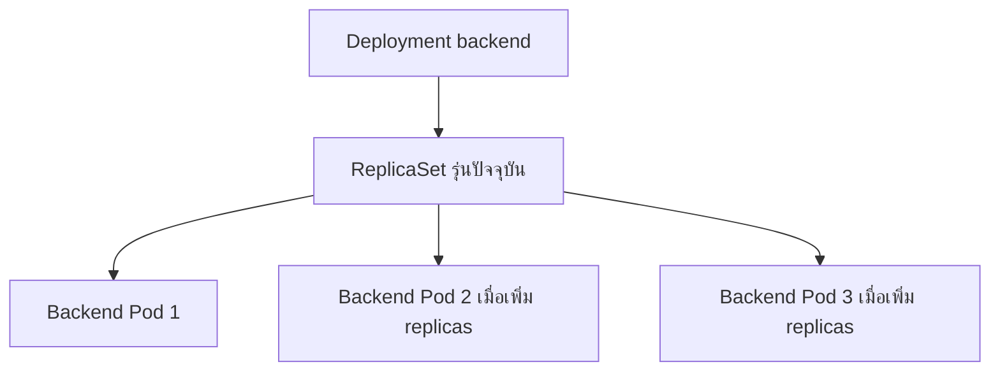

# Deployments — รักษาจำนวนและรุ่นของ Backend

## เรื่องนี้คืออะไร?

Deployment บอกว่าต้องการแอปรุ่นไหนและกี่ Pods ส่วน ReplicaSet เป็นตัวช่วยรักษาจำนวน Pods ของรุ่นนั้น เราจึงไม่ต้องสร้าง Pod ใหม่เองทุกครั้งที่ถูกแทนที่

## ทำงานอย่างไร?



ภาพแสดงความสัมพันธ์ ไม่ได้แปลว่าค่าเริ่มต้นมี 3 Pods ตัวอย่าง YAML เริ่มที่ 1 Replica หาก Container ตายใน Pod เดิม kubelet อาจ Restart ให้ ส่วน Pod หาย Controller จะสร้างตัวแทนเมื่อระบบและ Capacity อนุญาต ไม่รับประกันกู้ได้ทันทีทุก Failure

## ตัวอย่างการใช้งานจริง

**Prerequisites:** Images ต้อง Build หลังเพิ่ม [Health endpoints](/technology-guides/kubernetes/health-checks) แล้ว Namespace/ConfigMap/Secret ต้องมาจาก [Configuration](/technology-guides/kubernetes/configuration) และ DB/Migration ต้องพร้อมตาม [Storage](/technology-guides/kubernetes/storage) กับ [Rollout](/technology-guides/kubernetes/rollout-rollback)

ไฟล์นี้เป็นต้นฉบับ Backend ของทุกบท รวม HTTP probes ที่อธิบายในหน้า Health Checks ไม่ต้อง Apply Deployment อีกเวอร์ชันทับกัน:

```yaml filename="k8s/backend-deployment.yaml"
apiVersion: apps/v1
kind: Deployment
metadata:
  name: backend
  namespace: task-demo
spec:
  replicas: 1
  revisionHistoryLimit: 3
  progressDeadlineSeconds: 180
  strategy:
    type: RollingUpdate
    rollingUpdate:
      maxUnavailable: 0
      maxSurge: 1
  selector:
    matchLabels:
      app: backend
  template:
    metadata:
      labels:
        app: backend
    spec:
      automountServiceAccountToken: false
      terminationGracePeriodSeconds: 35
      containers:
        - name: backend
          image: task-backend:k8s-lab-v1
          imagePullPolicy: IfNotPresent
          ports:
            - name: http
              containerPort: 8000
          envFrom:
            - configMapRef: {name: app-config}
            - secretRef: {name: app-secrets}
          resources:
            requests: {cpu: "100m", memory: "256Mi"}
            limits: {cpu: "500m", memory: "512Mi"}
          startupProbe:
            httpGet:
              path: /health/live/
              port: http
              httpHeaders: [{name: Host, value: kube-health.internal}]
            periodSeconds: 5
            timeoutSeconds: 2
            failureThreshold: 30
          livenessProbe:
            httpGet:
              path: /health/live/
              port: http
              httpHeaders: [{name: Host, value: kube-health.internal}]
            initialDelaySeconds: 0
            periodSeconds: 10
            timeoutSeconds: 2
            failureThreshold: 3
          readinessProbe:
            httpGet:
              path: /health/ready/
              port: http
              httpHeaders: [{name: Host, value: kube-health.internal}]
            periodSeconds: 10
            timeoutSeconds: 7
            failureThreshold: 3
```

### Fields สำคัญ

| Field | ความหมาย |
| --- | --- |
| apiVersion / kind | รุ่น API กับชนิด Resource ใช้ apps/v1 Deployment |
| metadata | ชื่อและ Namespace ของ Resource |
| spec / replicas | สิ่งที่ต้องการ เช่น เริ่ม 1 Pod |
| selector / template.metadata.labels | ต้องตรงกันเพื่อให้ Controller รู้ว่า Pods ใดอยู่ในงานนี้ |
| template.spec.containers | รายการ Containers พร้อม Image/Config |
| image / ports | แพ็กแอปและพอร์ตที่ตั้งชื่อให้ Service/Probe อ้าง ไม่ได้เปิด Public port |

`requests` คือ Resource ที่ใช้ประกอบการจัด Node; CPU `100m` คือ 0.1 CPU ส่วน `Mi` เป็นหน่วยหน่วยความจำ Limit เป็นเพดาน CPU อาจถูก Throttle เมื่อเกิน ส่วน Memory เกินอาจถูก OOM kill ไม่ได้ทำให้เครื่องมี RAM เพิ่ม ตัวเลขนี้เป็นจุดเริ่มต้น Lab ยังไม่ได้วัดรองรับ Load จริง

## ขั้นตอนทดลอง

จากโฟลเดอร์ทดลองหลังเตรียมครบแล้ว:

```bash
kubectl --context kind-task-lab -n task-demo apply -f k8s/backend-deployment.yaml
kubectl --context kind-task-lab -n task-demo get deployments
kubectl --context kind-task-lab -n task-demo get pods -l app=backend
kubectl --context kind-task-lab -n task-demo describe deployment backend
kubectl --context kind-task-lab -n task-demo rollout status deployment/backend --timeout=180s
```

apply สร้าง/ปรับ Deployment; get ดู READY/AVAILABLE; describe ดู ReplicaSets และ Conditions; rollout status รอการเปลี่ยนรุ่น ไม่ใช่ Test ว่า API ถูกต้องทุกกรณี ต่อด้วย [Services](/technology-guides/kubernetes/services) เพื่อเรียกแอป

## ข้อควรระวัง

อย่าใช้ latest/แก้ Tag เดิมแล้วคาดว่า Pod จะเปลี่ยนเอง Lab ใช้ Tag ระบุรุ่นที่ต้องไม่เขียนทับ สำหรับ Release ใช้ Digest ของ Artifact ที่ทดสอบแล้ว ส่วน RollingUpdate ต้องมี Resource พอสำหรับ Surge 1 Pod และแอปเก่า/ใหม่ต้องใช้ Schema ร่วมกันได้

Gunicorn ใน Dockerfile รับ SIGTERM และมี graceful timeout 25 วินาที Lab ให้ Kubernetes 35 วินาที แต่ยังต้องทดสอบ Drain/คำขอค้างและ Proxy propagation ก่อนอ้างว่าไม่มีคำขอหลุด

## สรุปสิ่งที่ต้องจำ

- Deployment/ReplicaSet ดูแล Pods ตาม Desired State
- Selector ต้องตรง Labels ของ Pod template
- Resource requests ไม่ใช่ผลวัด Capacity
- Restart ไม่แก้ Secret/Schema/Database outage ให้เอง

## อ่านต่อ

- [Health Checks](/technology-guides/kubernetes/health-checks)
- [Scaling](/technology-guides/kubernetes/scaling)
- [Deployments reference](https://kubernetes.io/docs/concepts/workloads/controllers/deployment/)
- [Container resources](https://kubernetes.io/docs/concepts/configuration/manage-resources-containers/)
