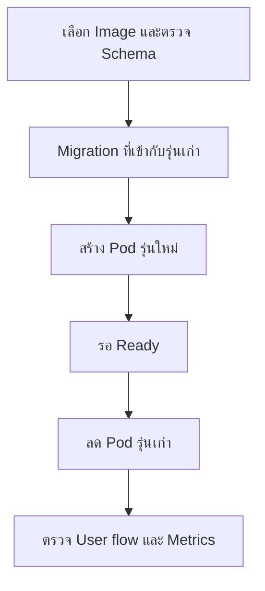

# Rollout / Rollback — เปลี่ยนรุ่นอย่างตามรอยได้

## เรื่องนี้คืออะไร?

Rollout คือค่อย ๆ นำ Pod template รุ่นใหม่ไปใช้ ส่วน Rollback คือกลับ Template ไป Revision ก่อนหน้า Deployment revision บันทึก Template ไม่ได้สำรอง Database หรือย้อน ConfigMap/Secret ทุกอย่างให้

## ทำงานอย่างไร?



ภาพมี 6 ขั้นตอน สำหรับการเปลี่ยน Schema ที่เข้ากันได้ ใช้แนว Expand/Contract: เพิ่มสิ่งใหม่ให้รุ่นเก่ายังใช้ได้ ปล่อย Code ใหม่ แล้วค่อยถอดสิ่งเก่าใน Release ถัดไปหลังตรวจการใช้งาน ไม่ใช้ลำดับนี้กับทุก Migration โดยไม่วิเคราะห์

## ตัวอย่างการใช้งานจริง: Migration ครั้งแรกของ Lab

DB ต้อง Ready และ Config/Secret มีแล้ว ใช้ Backend Image เดียวกับที่จะ Deploy **ไม่ให้ทุก Pod รัน Migration แข่งกันตอนเริ่ม**:

```yaml filename="k8s/backend-migrate-v1.yaml"
apiVersion: batch/v1
kind: Job
metadata:
  name: backend-migrate-v1
  namespace: task-demo
spec:
  backoffLimit: 1
  activeDeadlineSeconds: 120
  template:
    metadata:
      labels: {app: backend-migration}
    spec:
      restartPolicy: Never
      automountServiceAccountToken: false
      containers:
        - name: backend
          image: task-backend:k8s-lab-v1
          imagePullPolicy: IfNotPresent
          command: ["python", "manage.py", "migrate", "--noinput"]
          envFrom:
            - configMapRef: {name: app-config}
            - secretRef: {name: app-secrets}
          resources:
            requests: {cpu: "100m", memory: "256Mi"}
            limits: {cpu: "500m", memory: "512Mi"}
```

Job เป็นงานที่จบได้ ชื่อแยกตาม Release และ Labels ไม่ตรง Backend Service ป้องกัน Service ส่ง Traffic ไปงาน Migration กำหนด Deadline/Retry ของ Lab ไม่ใช้เป็นค่าทั่วไปของงานย้ายข้อมูลนาน ๆ

```bash
kubectl --context kind-task-lab -n task-demo apply -f k8s/backend-migrate-v1.yaml
kubectl --context kind-task-lab -n task-demo wait --for=condition=complete job/backend-migrate-v1 --timeout=180s
kubectl --context kind-task-lab -n task-demo logs job/backend-migrate-v1
```

wait สำเร็จแล้วจึงทำ [Backend Deployment](/technology-guides/kubernetes/deployments) หาก Failed/Timeout หยุดอ่าน Logs และ DB state ก่อน ไม่วนสร้าง Job ใหม่ทันที Jobs ที่เสร็จแล้วไม่รันซ้ำเพียง Apply ชื่อเดิม ต้องมีชื่อ Release ใหม่และ Review Migration ก่อนรอบถัดไป เก็บ Log ตาม Retention โดยไม่ Log Secrets

## เปลี่ยน Image รุ่นใหม่

ตัวอย่าง `k8s-lab-v2` เป็นชื่อ **สมมติ ต้อง Build/Test/Load เข้า kind ก่อน** และไม่เขียนทับ v1 Image ที่ใช้ Migration/Deployment ต้องตามกลับ Commit/Release เดียวกันได้

สำหรับการทดลองแบบ Manual หลังตรวจความเข้ากันได้แล้ว:

```bash
kubectl --context kind-task-lab -n task-demo set image deployment/backend backend=task-backend:k8s-lab-v2
kubectl --context kind-task-lab -n task-demo rollout status deployment/backend --timeout=180s
kubectl --context kind-task-lab -n task-demo rollout history deployment/backend
```

set image เปลี่ยน Pod template จึงเกิด Revision ใหม่ จากนั้นรอและตรวจ API จริง เช่น List/Create Task งานจริงต้องปรับ Manifest ใน Git ให้ตรงด้วย ไม่ปล่อยให้ Apply รอบถัดไปกลับเป็น v1

Tag เป็นชื่อที่ Registry อาจเขียนทับได้ ส่วน Digest เช่น `registry.example.invalid/team/backend@sha256:<verified-digest>` ผูกกับเนื้อหา Image ต้องแทน Placeholder ด้วย Digest ของ Artifact ที่ทดสอบแล้วก่อนใช้ ไม่สร้าง Digest สมมติที่ดูเหมือนใช้งานได้ และไม่ Build ใหม่ทุก Environment แล้วอ้างว่าเป็น Artifact เดิม

## กลับรุ่นเมื่อมีปัญหา

**คำสั่งนี้เปลี่ยนแอปที่กำลังรัน** ตรวจ Context, Revision, Schema compatibility, Config และสิทธิ์อนุมัติตาม Runbook ก่อน การย้อน Code ไม่ย้อน Database/Migration และไม่ได้ย้อน Mutable ConfigMap/Secret ที่ชื่อเดิม:

```bash
kubectl --context kind-task-lab -n task-demo rollout history deployment/backend
kubectl --context kind-task-lab -n task-demo rollout undo deployment/backend --to-revision=1
kubectl --context kind-task-lab -n task-demo rollout status deployment/backend --timeout=180s
```

เลข 1 เป็นตัวอย่าง ให้เลือก Revision จาก History ที่ยังเก็บอยู่ หากใช้ `rollout undo deployment/backend` โดยไม่มี to-revision จะกลับรุ่นก่อนหน้าที่มีอยู่ อย่าเดาว่าเป็นรุ่นที่ต้องการเสมอ หลัง Undo ต้องปรับ Git source of truth และทดสอบ User flow อีกครั้ง ระบบไม่ได้ Rollback ให้อัตโนมัติเพียง ProgressDeadlineExceeded

## ข้อควรระวัง

Config ผ่าน Environment/subPath ต้อง Rollout จึงรับค่าใหม่ และ Deployment history ไม่ได้บันทึกค่า Secret ทุกครั้ง หาก Migration ลบ Column/เปลี่ยนข้อมูลที่ย้อนยาก Code เก่าอาจใช้ไม่ได้ ต้องใช้ Forward fix หรือแผนกู้ข้อมูลที่ทดสอบแล้ว ไม่สั่ง Reverse migration บนฐานจริงโดยไม่มีแผน

## สรุปสิ่งที่ต้องจำ

- เปลี่ยน Image ต้องตามรอยและทดสอบ Artifact เดิม
- รัน Migration เป็นงานที่ควบคุม ไม่แข่งกันทุก Pod
- Rollout ผ่านยังต้องตรวจผู้ใช้และข้อมูล
- Undo Code ไม่ Undo DB/Config ทั้งระบบ

## อ่านต่อ

- [PostgreSQL Migration](/technology-guides/postgresql/migrations)
- [Release & Rollback](/technology-guides/devops/rollback-and-release)
- [Deployments / rollout reference](https://kubernetes.io/docs/concepts/workloads/controllers/deployment/#rolling-back-a-deployment)
