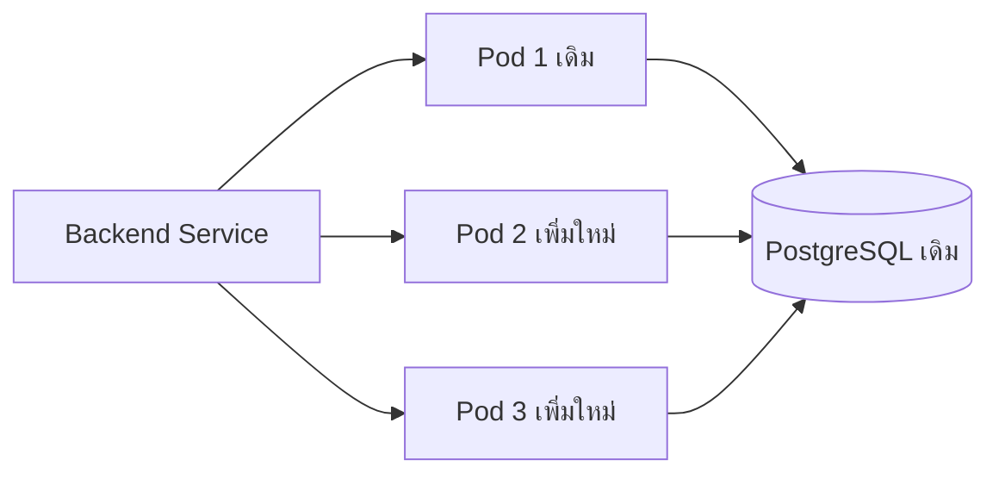

# Scaling — เพิ่ม Pods โดยดูคอขวดร่วมด้วย

## เรื่องนี้คืออะไร?

Scaling คือการปรับกำลังให้เหมาะกับงาน Vertical scaling เพิ่ม CPU/Memory ให้ตัวเดิม ส่วน Horizontal scaling เพิ่มจำนวน Pods ทั้งสองวิธีต้องวัดว่าแอปช้าตรงไหนก่อน ไม่ใช่เพิ่ม Pods ทุกครั้งที่ Response ช้า

## ทำงานอย่างไร?



ภาพมี 5 Nodes: เพิ่ม Backend 1 เป็น 3 แต่ยังใช้ DB เดิม ReplicaSet สร้าง Pods เพิ่ม Scheduler ต้องหา Node ที่มี Resource พอ และ Service จึงใช้ปลายทางใหม่หลัง Ready ไม่รับประกันเพิ่ม Throughput เป็นสามเท่า

## ขั้นตอนทดลอง: Manual scaling

ใช้กับ Backend ที่ Deploy และทดสอบแล้วตามบทก่อนหน้า:

```bash
kubectl --context kind-task-lab -n task-demo scale deployment backend --replicas=3
kubectl --context kind-task-lab -n task-demo get pods -l app=backend
kubectl --context kind-task-lab -n task-demo get deployments backend
```

scale เปลี่ยนจำนวนที่ต้องการ get pods ดูว่าตัวใหม่ Pending/Ready หรือไม่ หาก Apply Manifest ที่ยังมี replicas: 1 อีกจะย้อน Desired State กลับเป็น 1 งานจริงต้องบันทึกจำนวนที่เลือกใน Git/Configuration ให้สอดคล้อง

### HPA ช่วยปรับให้ได้อย่างไร?

Horizontal Pod Autoscaler (HPA) เป็น Controller ที่คำนวณจำนวน Pods จาก Metrics เช่น CPU usage เทียบกับ requests ตัวอย่างนี้ใช้ CPU ไม่ได้ใช้ Memory และไม่ใช้ CPU limit เป็นฐานคิด

**Prerequisites ก่อน Apply:**

1. มี Resource metrics API เช่น Metrics Server ที่ Cluster administrator ติดตั้งและดูแลแล้ว kind ไม่ได้ให้ครบอัตโนมัติ
2. Backend กำหนด CPU requests ของ Containers ที่เกี่ยวข้อง และ Metrics อ่านได้
3. Cluster มี Capacity หรือระบบเพิ่ม Nodes แยกต่างหาก HPA ไม่ได้เพิ่ม Nodes ให้เอง
4. ทดสอบ Baseline load/DB budget และกำหนด min/max ให้เหมาะสม

```yaml filename="k8s/backend-hpa.yaml"
apiVersion: autoscaling/v2
kind: HorizontalPodAutoscaler
metadata:
  name: backend
  namespace: task-demo
spec:
  scaleTargetRef:
    apiVersion: apps/v1
    kind: Deployment
    name: backend
  minReplicas: 1
  maxReplicas: 3
  metrics:
    - type: Resource
      resource:
        name: cpu
        target:
          type: Utilization
          averageUtilization: 70
  behavior:
    scaleDown:
      stabilizationWindowSeconds: 300
```

เป้าหมาย 70% ของ request 100m คือเฉลี่ยประมาณ 70m ต่อ Pod ไม่ใช่ 70% ของ Node CPU การ Scale ใช้ Sampling/เงื่อนไขของ Controller จึงไม่เกิดทันที และการลดจำนวนมีหน้าต่างช่วยลดการแกว่ง

ก่อนเปิด HPA ให้เอา `spec.replicas` ออกจาก Manifest ที่จะ Apply ต่อเนื่องและให้ HPA เป็นผู้ดูแลจำนวน ป้องกัน Manual/Git automation เขียนทับกัน อย่า Apply HPA โดยยังใช้ Manual scale เป็นวิธีประจำพร้อมกัน

```bash
kubectl --context kind-task-lab -n task-demo top pods
kubectl --context kind-task-lab -n task-demo apply -f k8s/backend-hpa.yaml
kubectl --context kind-task-lab -n task-demo get hpa
kubectl --context kind-task-lab -n task-demo describe hpa backend
```

top แสดง Metrics ถ้า API ไม่มีต้องแก้ Prerequisites ก่อน get/describe ดู TARGETS/Conditions เช่น ScalingActive ไม่ใช้การลด Target อย่างเดียวแก้ `<unknown>`

## Stateless และ Shared state

Stateless ในที่นี้หมายถึง Pod ไม่พึ่ง State เฉพาะเครื่อง เช่น Session ใน Memory หรือไฟล์ Upload บน Container ถ้าใช้ [Django Session](/technology-guides/django-python/authentication) หลาย Pods ต้องอ่าน Session backend ร่วม เช่น PostgreSQL/Redis ที่ออกแบบไว้ ไม่จำเป็นต้องเลิก Server-side sessions เพื่อ Scale

Docker Lab เดิมยังไม่มี Login ข้อกำหนด Session นี้ใช้เมื่อเพิ่ม Auth baseline ของจริง ต้องใช้ Keys/Settings ที่สอดคล้องและมีแผน Rotation

เพิ่ม Pods ทำให้ DB connections เพิ่มด้วย ตัวอย่างคร่าว ๆ 3 Replicas + maxSurge 1 = 4 Pods ชั่วคราว ถ้าแต่ละ Pod มี Gunicorn 2 Sync workers อาจใช้ถึง 8 Persistent connections สำหรับ API และยังมี Migration/งานอื่น ต้องวัดและเผื่อทั้ง Pool, max_connections และ Query load ไม่ถือเป็นขีดสูงสุดที่ทดสอบแล้ว

## ข้อควรระวัง

Memory metrics ต้องเลือก Target/Requests ให้สัมพันธ์กับลักษณะงาน Memory ไม่ลดทันทีแบบ CPU เสมอ HPA จึงไม่แทนการแก้ Memory leak หรือ Slow query และไม่มีเหตุให้ Scale PostgreSQL จาก 1 เป็น 3 Writers ด้วย Manifest เดิม

## สรุปสิ่งที่ต้องจำ

- Vertical เพิ่มขนาด Horizontal เพิ่มจำนวน
- HPA ต้องมี Metrics และ Requests ที่ถูกต้อง
- จำนวน Pods ไม่เพิ่มกำลัง DB อัตโนมัติ
- ใช้ Shared state และคุมผลของ Connections/Surge

## อ่านต่อ

- [Troubleshooting HPA](/technology-guides/kubernetes/troubleshooting)
- [HPA concepts](https://kubernetes.io/docs/concepts/workloads/autoscaling/horizontal-pod-autoscale/)
- [Metrics Server prerequisites](https://github.com/kubernetes-sigs/metrics-server)
