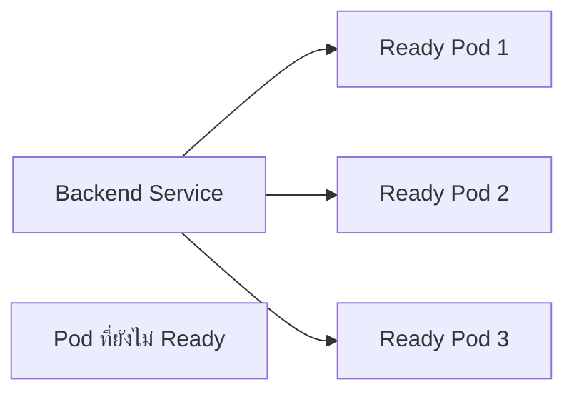

# Services — ชื่อคงที่และทางเข้าถึง Pods

## เรื่องนี้คืออะไร?

Service เป็นจุดติดต่อคงที่ให้ Pods ที่ชื่อ/IP เปลี่ยนได้ Deployment ดูแลการรันและจำนวน ส่วน Service เลือกปลายทางจาก Labels และความพร้อม จึงมี Deployment แล้วก็ยังต้องออกแบบทางเข้าหาแอป

## ทำงานอย่างไร?



ภาพแสดงหลายปลายทางที่พร้อมรับ Traffic Service ไม่ส่ง Traffic ปกติให้ Pod ที่ไม่ Ready ตามเงื่อนไข EndpointSlice แต่ Connection เดิมอาจยังค้างและระบบ Network ใช้เวลาอัปเดต ไม่ได้ย้าย Request กลางทางให้สำเร็จเอง

| Type | ใช้เมื่อไร? |
| --- | --- |
| ClusterIP | ติดต่อภายใน Cluster เป็นค่าเริ่มต้นของ frontend/backend ใน Lab |
| NodePort | เปิดพอร์ตบน Nodes ต้องมีทางถึง Node/Firewall ที่เหมาะสม ไม่รับประกันเข้าได้จาก Host ของ kind |
| LoadBalancer | ขอ External load balancer จาก Integration ที่ติดตั้ง Cloud/provider อาจมีค่าใช้จ่าย; kind ไม่ได้ให้ Public IP โดยอัตโนมัติ |

Ingress เป็นกติกา HTTP routing ต้องมี Ingress Controller ที่รองรับจึงทำงาน ส่วน Gateway API แยกบทบาท Gateway/Routes ชัดขึ้นและต้องติดตั้ง CRDs กับ Controller/Infrastructure ที่ตรงรุ่น ทั้งสองอย่างไม่ได้สร้าง TLS/DNS ที่ถูกต้องให้ทันทีเพียงเขียน Resource

## ตัวอย่างการใช้งานจริง

### Backend และ Frontend ClusterIP

```yaml filename="k8s/services.yaml"
apiVersion: v1
kind: Service
metadata:
  name: backend
  namespace: task-demo
spec:
  type: ClusterIP
  selector:
    app: backend
  ports:
    - name: http
      port: 8000
      targetPort: http
---
apiVersion: v1
kind: Service
metadata:
  name: frontend
  namespace: task-demo
spec:
  type: ClusterIP
  selector:
    app: frontend
  ports:
    - name: http
      port: 8080
      targetPort: http
```

selector ต้องตรง Pod labels; `port` คือพอร์ตของ Service ส่วน `targetPort: http` ชี้ชื่อ containerPort ใน Deployment ทั้งสองตัวอยู่ Namespace task-demo จึงเรียกสั้น ๆ ว่า `backend:8000` ได้ ชื่อเต็มมักเป็น `backend.task-demo.svc.cluster.local` เมื่อ Cluster domain เป็น cluster.local

### ให้ Frontend server เป็น Reverse proxy

Browser เรียก `/api/tasks/` ที่ Origin เดียวกับเว็บ ส่วน Nginx ใน Frontend Pod เป็นผู้ Resolve ชื่อ backend ไม่ตั้ง API Base URL ใน Browser เป็นชื่อ Service ภายใน

```yaml filename="k8s/frontend-proxy.yaml"
apiVersion: v1
kind: ConfigMap
metadata:
  name: frontend-proxy
  namespace: task-demo
data:
  default.conf: |
    server {
        listen 8080;
        server_name _;
        root /usr/share/nginx/html;
        index index.html;
        location /api/ {
            proxy_pass http://backend:8000;
            proxy_set_header Host $host;
            proxy_connect_timeout 5s;
            proxy_read_timeout 30s;
        }
        location / {
            try_files $uri $uri/ /index.html;
        }
    }
```

Config นี้แทน Docker resolver `127.0.0.11` ด้วยการ Resolve ตาม DNS ของ Pod เมื่อ Nginx เริ่ม ใช้ ClusterIP Service เดิมที่คงที่ ไม่ผูก Pod IP หากลบ/สร้าง Service จน ClusterIP เปลี่ยนต้องให้ Nginx Resolve ใหม่ เช่น Rollout Frontend อย่างควบคุม นี่เป็นข้อจำกัดของ Proxy แบบ Static ในตัวอย่าง

### Frontend Deployment

```yaml filename="k8s/frontend-deployment.yaml"
apiVersion: apps/v1
kind: Deployment
metadata:
  name: frontend
  namespace: task-demo
spec:
  replicas: 1
  selector:
    matchLabels: {app: frontend}
  template:
    metadata:
      labels: {app: frontend}
    spec:
      automountServiceAccountToken: false
      containers:
        - name: frontend
          image: task-frontend:k8s-lab-v1
          imagePullPolicy: IfNotPresent
          ports:
            - {name: http, containerPort: 8080}
          resources:
            requests: {cpu: "50m", memory: "64Mi"}
            limits: {cpu: "250m", memory: "128Mi"}
          volumeMounts:
            - name: proxy-config
              mountPath: /etc/nginx/conf.d/default.conf
              subPath: default.conf
              readOnly: true
          readinessProbe:
            httpGet: {path: /, port: http}
            periodSeconds: 5
            timeoutSeconds: 2
      volumes:
        - name: proxy-config
          configMap: {name: frontend-proxy}
```

Image จาก Docker Lab เสิร์ฟ Static React ด้วย Nginx 8080 ส่วน ConfigMap ถูก Mount ทับไฟล์ Proxy เดิม การ Mount แบบ subPath ไม่อัปเดตไฟล์ใน Container เดิมอัตโนมัติ ต้อง Rollout หลังเปลี่ยน Config ที่ Review แล้ว

## ขั้นตอนทดลอง

Backend ต้องพร้อมก่อน ทำจากโฟลเดอร์ทดลองที่คัดไฟล์ครบ:

```bash
kubectl --context kind-task-lab -n task-demo apply -f k8s/services.yaml
kubectl --context kind-task-lab -n task-demo apply -f k8s/frontend-proxy.yaml
kubectl --context kind-task-lab -n task-demo apply -f k8s/frontend-deployment.yaml
kubectl --context kind-task-lab -n task-demo rollout status deployment/frontend --timeout=180s
kubectl --context kind-task-lab -n task-demo get services
kubectl --context kind-task-lab -n task-demo describe service backend
kubectl --context kind-task-lab -n task-demo get endpointslices -l kubernetes.io/service-name=backend
```

ดู Selector/Ports และ EndpointSlice ว่ามี Addresses กับ Ready หรือไม่ ถ้าไม่มีปลายทางให้ตาม Labels/Readiness ไม่เริ่มจากลบ Service

เปิด Terminal แยกสำหรับพอร์ตชั่วคราว ใช้ Ctrl+C หยุด:

```bash
kubectl --context kind-task-lab -n task-demo port-forward service/frontend 8080:8080 --address 127.0.0.1
```

เปิด `http://localhost:8080` แล้วสร้าง/อ่าน Task ผ่าน `/api/tasks/` หากต้องแยกตรวจ Backend ใช้อีก Terminal:

```bash
kubectl --context kind-task-lab -n task-demo port-forward service/backend 8000:8000 --address 127.0.0.1
curl --fail http://localhost:8000/health/ready/
```

port-forward ผ่าน API ไป Pod ที่เลือก ใช้ Debug ชั่วคราว ไม่ใช่ Public load balancer และไม่ได้ยืนยัน Service dataplane ทุกเส้นทาง การสร้าง Task ผ่าน Frontend proxy ช่วยตรวจทางเข้าที่ใช้ใน Lab เพิ่ม

## ข้อควรระวัง

อย่าเปิด DB ด้วย NodePort/LoadBalancer เพื่อแก้การเชื่อมต่อ Namespace อย่างเดียวไม่แยก Network ต้องวาง NetworkPolicy/CNI ที่รองรับเมื่อใช้งานจริง ส่วน HTTPS, Proxy headers, ALLOWED_HOSTS และ CSRF trusted origin ต้องตรงระบบเป้าหมาย ไม่ใส่ wildcard เพื่อให้ผ่าน

## สรุปสิ่งที่ต้องจำ

- Deployment รันงาน Service เชื่อมปลายทาง
- Labels และ targetPort ต้องตรง Pod
- Browser ไม่รู้จัก Cluster DNS ภายใน
- Ingress/Gateway ต้องมี Controller และ Configuration ที่ครบ

## อ่านต่อ

- [Troubleshooting](/technology-guides/kubernetes/troubleshooting)
- [Service reference](https://kubernetes.io/docs/concepts/services-networking/service/)
- [Ingress](https://kubernetes.io/docs/concepts/services-networking/ingress/) และ [Gateway API](https://kubernetes.io/docs/concepts/services-networking/gateway/)
- [Django Authentication](/technology-guides/django-python/authentication)
