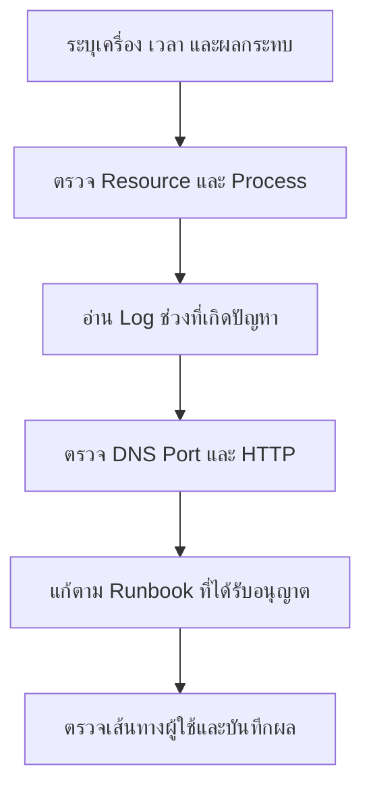

# Linux — คำสั่งพื้นฐานและการดูแลแอป

## เรื่องนี้คืออะไร?

Linux เป็นแกนของระบบปฏิบัติการที่ใช้รันแอปและ Containers ส่วน Ubuntu เป็น Distribution หรือชุดระบบที่รวม Linux กับเครื่องมือให้ใช้งาน คู่มือนี้ช่วยให้เปิด Terminal แล้วตรวจปัญหาได้เป็นลำดับ โดยไม่ต้องจำทุกคำสั่ง

ใช้ Ubuntu 24.04 LTS, Bash 5 และ GNU tools เป็นตัวอย่าง ไม่ได้ติดตั้ง Server, เปลี่ยน Firewall หรือเข้าเครื่องจริงจากงานเอกสารนี้ คำสั่ง systemctl/journalctl ต้องมี systemd ทำงาน ไม่ใช่ทุก Container จะใช้ได้

## เริ่มอ่านตรงไหน?

1. [Getting Started](/technology-guides/linux/getting-started): รู้จัก Terminal/Paths และสร้างพื้นที่ฝึก
2. [Files & Permissions](/technology-guides/linux/files-and-permissions): อ่าน เขียน ค้นหา และกำหนดสิทธิ์ไฟล์
3. [Processes & Services](/technology-guides/linux/processes-and-services): หา Process แยก Service state และหยุดงานให้ถูกตัว
4. [Networking](/technology-guides/linux/networking): ไล่ DNS, Listener, HTTP และขอบเขต localhost
5. [Logs & Resources](/technology-guides/linux/logs-and-resources): อ่าน Log, CPU, Memory และ Disk
6. [SSH & File Transfer](/technology-guides/linux/ssh-and-file-transfer): เชื่อมเครื่องและส่งไฟล์อย่างระบุปลายทาง
7. [Shell Scripting](/technology-guides/linux/shell-scripting): รวมคำสั่งเป็น Script เล็ก ๆ ที่อ่านและตรวจได้
8. [Troubleshooting](/technology-guides/linux/troubleshooting) และ [Commands](/technology-guides/linux/commands): เปิดดูระหว่างทำงาน

## ใช้กับงานของทีมอย่างไร?

ตัวอย่างสถานการณ์คือหน้า Task เปิดไม่ได้หลังปล่อยงาน: เริ่มจากดูว่าอยู่เครื่องไหนและช่วงเวลาใด แล้วแยก Process, Resources และ Network ก่อนแก้ไข Source/Config ต้องผ่าน Git/PR ตาม Workflow ไม่ SSH แก้ Code บน UAT/Production เป็นขั้นตอนปกติ

ภาพนี้มี 6 ขั้นตอน ไม่จำเป็นต้องรันคำสั่งทุกอย่างเมื่อมีหลักฐานชัดแล้ว และไม่ใช้ Restart เป็นคำตอบแรก เพราะอาจทำ Log/State ที่จำเป็นหาย

## แยกว่ากำลังตรวจอะไร

| จุดที่ตรวจ | เครื่องมือหลัก |
| --- | --- |
| Linux Host/VM | ps, ss, df, free และ systemctl/journalctl เมื่อใช้ systemd |
| Docker container | docker compose ps/logs/exec ตาม [Docker guide](/technology-guides/docker) |
| Kubernetes Pod | kubectl get/describe/logs ตาม [Kubernetes guide](/technology-guides/kubernetes) |

บน macOS/Windows ที่ใช้ Docker Desktop มี Linux VM อีกชั้น อย่าใช้ Memory/Network ของ Laptop สรุปแทน Container หรือ Node โดยตรง ส่วน WSL/Minimal image อาจไม่มีคำสั่งบางตัว ต้องตรวจ Environment ก่อน

## ข้อควรระวัง

เริ่มจากคำสั่งอ่านข้อมูล ใช้ sudo เมื่อมีเหตุและสิทธิ์ที่เหมาะสม ไม่ใช้ chmod 777, kill -9, ลบ Log/Volume หรือปิด Firewall เพื่อให้ Error หายโดยไม่หาสาเหตุ ค่าตั้งและคำสั่งในคู่มือเป็นตัวอย่าง ไม่ใช่นโยบายองค์กรที่อนุมัติแล้วทุก Environment

## ขอบเขตการตรวจตัวอย่าง

ตรวจวันที่ 2026-11-01 ใน Ubuntu 24.04 container ชั่วคราวด้วยผู้ใช้ที่ไม่ใช่ root: Bash 5.2.21 ตรวจ Syntax ของ Code blocks 29 ชุดผ่าน และ ShellCheck 0.9.0 ตรวจ collect-system-info.sh ผ่าน

รันตัวอย่างสร้าง/ค้นหา/Copy/Move ไฟล์, Mode 640/750, Archive และเปรียบเทียบไฟล์ที่แตกกลับ, ค้น Log สมมติ และส่ง TERM ให้ Process ที่สร้างเพื่อทดสอบแล้ว รวมถึง Script ทั้ง Path ปกติ/มีช่องว่าง/ไม่มีอยู่/Arguments เกิน/Dependency ล้มเหลว และคำสั่ง Network ภายใน Container

SSH ตรวจเฉพาะการ Parse Client configuration และ rsync ทดสอบ Dry run ระหว่างโฟลเดอร์ใน Container **ไม่ได้เชื่อม Remote server, ทดสอบ systemd lifecycle, เปลี่ยน Firewall หรือทดสอบ Production/User flow จริง** Container ไม่แทน Linux VM เต็มระบบ ผลตรวจนี้ไม่ครอบคลุมการแก้ตัวอย่างในอนาคต และเอกสารยังเป็น Draft

## สรุปสิ่งที่ต้องจำ

- รู้ว่าอยู่ Host, VM หรือ Container ก่อนตรวจ
- อ่าน State/Logs ก่อนเปลี่ยนระบบ
- คำสั่ง Linux บาง Flags ต่างจาก macOS
- แก้แล้วต้องตรวจ User flow และบันทึกผลจริง

## อ่านต่อ

- [Docker Deployment บน Ubuntu](/technology-guides/docker/docker-deployment)
- [Monitoring](/technology-guides/devops#monitoring)
- [Operations & Incident](/technology-guides/devops/operations)
