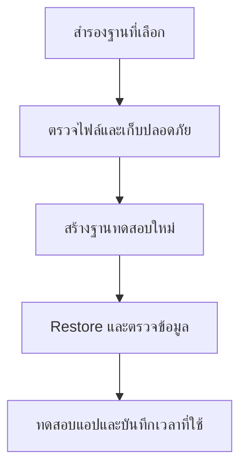

# Backup & Restore — สำรองแล้วต้องลองกู้

## เรื่องนี้คืออะไร?

Backup คือสำเนาที่ใช้กู้เมื่อข้อมูลเสีย ถูกลบ หรือเครื่องสูญหาย Restore คือการนำสำเนานั้นกลับมาใช้งาน ไฟล์ Backup ที่มีอยู่เฉย ๆ ยังไม่พิสูจน์ว่ากู้ได้ ต้องลอง Restore แล้วตรวจข้อมูลและแอปจริงด้วย

## ใช้เมื่อไร?

ใช้วางแผนประจำวัน ก่อนงานเปลี่ยนข้อมูลเสี่ยง และระหว่างซ้อมกู้คืน กำหนดขอบเขตว่า Backup ฐานใด รวม Roles/ค่าตั้ง/ไฟล์ภายนอกหรือไม่ ไม่ถือ Replication หรือ Docker Volume เป็น Backup

## ทำอย่างไร?

### รู้จักวิธีและเป้าหมาย

| คำ | ความหมาย |
| --- | --- |
| Logical backup | ส่งออกโครงสร้าง/ข้อมูลเป็น SQL หรือ Archive เช่น `pg_dump` |
| Physical backup | สำรองระดับไฟล์ของ PostgreSQL ด้วยวิธีที่รองรับ ต้องมีองค์ประกอบที่สอดคล้องกัน ไม่ Copy Data directory ขณะเขียนเฉย ๆ |
| Full backup | สำรองขอบเขตที่เลือกครบ ณ ช่วงหนึ่ง เช่นทั้งฐาน ไม่ได้แปลว่ารวมทั้ง Cluster และทุกไฟล์ภายนอก |
| PITR | Point-in-Time Recovery: กู้ถึงเวลาที่เลือกด้วย Base backup และ WAL ที่เก็บต่อเนื่องตามแผน ไม่ได้มาจาก `pg_dump` อย่างเดียว |
| RPO | ยอมเสียข้อมูลย้อนหลังได้เท่าไร เช่น 1 ชั่วโมงเป็นตัวอย่างเป้าหมาย |
| RTO | ต้องกู้บริการกลับภายในเท่าไร เช่น 30 นาทีเป็นตัวอย่างที่ต้องวัดจริง |

WAL คือบันทึกการเปลี่ยนของ DB ที่ใช้กับการกู้คืน Physical/PITR บทนี้เน้น Logical backup ก่อน ยังไม่ได้ตั้ง PITR หรือรับรอง RPO/RTO ของระบบใด



ต้องทำครบเส้นทาง ไม่ดูแค่ Exit code ของ pg_dump หรือขนาดไฟล์

### 1. เตรียมเครื่องมือและปลายทาง

ตัวอย่างใช้ Client tools รุ่น 17 กับ PostgreSQL 17 Lab ที่ `127.0.0.1:5433`, User `order_admin` และฐาน `order_lab` จาก [Docker Lab](/technology-guides/postgresql/postgresql-docker) ต้องมี `pg_dump`, `pg_restore`, `psql`, `createdb`, `pg_dumpall` ในเครื่อง หากไม่มี ใช้วิธีผ่าน Container ในหัวข้อถัดไป

`--password` ให้ถาม Password ผ่าน Prompt ไม่ใส่จริงใน Command line/URL สำหรับ Scheduled jobs ให้ผู้ดูแลส่ง Credential ผ่านระบบที่ควบคุม หรือ `.pgpass`/`PGPASSFILE` ที่จำกัดสิทธิ์ `0600` ตามคู่มือ ไม่ Commit ไฟล์นั้น การเชื่อม Remote ต้องตั้ง TLS และตรวจ Certificate ตามระบบจริง ไม่คัดลอกค่าของ Local ไปใช้

### 2. สำรองฐานเดียวแบบ Custom format

ใช้ Bash/Zsh และ Terminal เดิมตลอดตัวอย่าง ตัวแปร `backup_base` เป็นชื่อไฟล์ใหม่เพื่อไม่ทับสำเนาเก่า ตรวจว่าชื่อนี้ยังไม่มีและพื้นที่พอก่อน:

```bash
mkdir -p backups
chmod 700 backups
backup_base="backups/order-lab-$(date +%Y%m%d-%H%M%S)"
pg_dump --host=127.0.0.1 --port=5433 --username=order_admin \
  --dbname=order_lab --password --format=custom --file="$backup_base.dump"
```

ตรวจ Exit status ทันที (`echo $?` ต้องเป็น 0) และ Error output ถ้าไม่ผ่านอย่าใช้ไฟล์ที่อาจเขียนไม่ครบ `pg_dump` เก็บ Snapshot ที่สอดคล้องกันของฐานหนึ่งขณะ Backup ได้ แต่ไม่รวม Cluster-wide Roles หรือไฟล์ Upload ภายนอก DB

ดูรายการใน Archive โดยไม่ Restore:

```bash
pg_restore --list "$backup_base.dump"
```

### 3. Restore ลงฐานใหม่เท่านั้น

ต้องยืนยันว่า `order_lab_restore` **ยังไม่มีอยู่และเป็นชื่อทดสอบที่เรารับผิดชอบ** `createdb` จะหยุดหากมีชื่อซ้ำ ให้เลือกชื่อใหม่ ไม่ลบของเดิมเพื่อให้ผ่าน:

```bash
createdb --host=127.0.0.1 --port=5433 --username=order_admin \
  --password --template=template0 order_lab_restore
pg_restore --host=127.0.0.1 --port=5433 --username=order_admin \
  --dbname=order_lab_restore --password --exit-on-error \
  --no-owner --no-privileges "$backup_base.dump"
```

Custom archive ใช้ `pg_restore` ไม่ใช่ `psql` ตัวเลือก `--no-owner --no-privileges` เหมาะกับ Lab ที่ให้ User ปัจจุบันเป็นเจ้าของ โดยไม่พยายามสร้าง Ownership/GRANT จากระบบต้นทาง **ไม่ได้ทดสอบว่าสิทธิ์ Production ถูกกู้ครบ** ต้องจัด Roles/Permissions ตามแผนแยกกัน หาก Restore ล้มเหลวบางส่วนให้เก็บหลักฐานแล้วเลือกฐานว่างใหม่ ไม่รันซ้ำทับฐานที่ค้างโดยไม่ตรวจ

### 4. ทางเลือก SQL format

สร้าง SQL dump แล้วกู้ด้วย `psql` ลงชื่อใหม่อีกชื่อ:

```bash
pg_dump --host=127.0.0.1 --port=5433 --username=order_admin \
  --dbname=order_lab --password --format=plain --no-owner --no-privileges \
  --file="$backup_base.sql"
createdb --host=127.0.0.1 --port=5433 --username=order_admin \
  --password --template=template0 order_lab_sql_restore
psql -X --set=ON_ERROR_STOP=on --host=127.0.0.1 --port=5433 \
  --username=order_admin --dbname=order_lab_sql_restore --password \
  --file="$backup_base.sql"
```

`-X` ไม่โหลด Startup file ของ psql และ `ON_ERROR_STOP` ให้หยุดเมื่อ Error เลือก Custom หรือ SQL ตามงาน ไม่จำเป็นต้องสำรองสองรูปแบบทุกครั้ง และ Restore เฉพาะไฟล์จากแหล่งที่เชื่อถือได้ เพราะ Dump สามารถมีคำสั่งที่ถูกประมวลผลด้วยสิทธิ์ของผู้กู้

### 5. สำรองและกู้ผ่าน Docker Container

ใช้ Compose **Order Lab** ไม่ใช่ Task App รันบน Host ในโฟลเดอร์ `order-lab` ที่ DB กำลังทำงาน ไฟล์ `backups` อยู่บน Host:

```bash
mkdir -p backups
chmod 700 backups
docker_backup="backups/order-lab-docker-$(date +%Y%m%d-%H%M%S).dump"
docker compose exec -T db sh -c \
  'pg_dump -U "$POSTGRES_USER" -d "$POSTGRES_DB" -Fc' > "$docker_backup"
```

ตรวจ Exit status ทันที ไม่เปิด TTY กับไฟล์ Binary และไม่เขียนไฟล์ไว้แค่ใน Writable layer ของ Container

จากนั้นสร้างฐานทดสอบชื่อ `order_lab_docker_restore` ที่ยังไม่มี **ก่อน** Restore ไม่ใช้ชื่อฐานหลัก:

```bash
docker compose exec -T db sh -c \
  'createdb -U "$POSTGRES_USER" -T template0 order_lab_docker_restore'
docker compose exec -T db sh -c \
  'pg_restore -U "$POSTGRES_USER" -d order_lab_docker_restore --exit-on-error --no-owner --no-privileges' < "$docker_backup"
```

การเชื่อมผ่าน Unix socket ภายใน Official Image ของ Lab ไม่ใช่ตัวอย่าง Auth ของ Remote Production ถ้าสิทธิ์/นโยบายต่างออกไปต้องใช้ Credential mechanism จริง ไม่เปลี่ยน `pg_hba.conf` เป็น Trust เพื่อข้าม Error

### 6. ตรวจข้อมูลหลัง Restore

คัดลอก Block เป็น `verify-restored.sql` แล้วรันกับทั้งต้นทางและฐานกู้คืน การเทียบต้องอิงข้อมูลช่วง Backup หรือควบคุมการเขียน ไม่คาดว่า DB ที่ยังมีผู้ใช้เขียนต่อจะมี Counts เท่าเดิมตลอด:

```sql filename="verify-restored.sql"
SELECT current_database();
SELECT 'customers' AS table_name, COUNT(*) AS row_count FROM customers
UNION ALL SELECT 'products', COUNT(*) FROM products
UNION ALL SELECT 'orders', COUNT(*) FROM orders
UNION ALL SELECT 'order_items', COUNT(*) FROM order_items
UNION ALL SELECT 'inventory_movements', COUNT(*) FROM inventory_movements;

SELECT o.id, SUM(oi.quantity * oi.unit_price) AS total_thb
FROM orders o JOIN order_items oi ON oi.order_id = o.id
GROUP BY o.id ORDER BY o.id;

SELECT p.sku, p.stock, COALESCE(SUM(m.quantity_delta), 0) AS movement_balance
FROM products p LEFT JOIN inventory_movements m ON m.product_id = p.id
GROUP BY p.id, p.sku, p.stock
HAVING p.stock <> COALESCE(SUM(m.quantity_delta), 0);

SELECT o.id FROM orders o
WHERE o.status = 'confirmed'
AND NOT EXISTS (SELECT 1 FROM order_items oi WHERE oi.order_id = o.id);
```

สอง Query ท้ายควรไม่มีแถวผิดกติกาใน Lab นี้ ยังต้องตรวจ FK/Indexes, สิทธิ์, Identity/Sequences และให้แอปทดสอบสร้าง/อ่าน Order บนฐานกู้คืน อย่าเปิดแอปกู้คืนให้ส่ง Email/ชำระเงินหรืองาน Scheduled จริง

ใช้ psql รันไฟล์กับฐานกู้ Custom ที่สร้างไว้:

```bash
psql -X --set=ON_ERROR_STOP=on --host=127.0.0.1 --port=5433 \
  --username=order_admin --dbname=order_lab_restore --password \
  --file=verify-restored.sql
```

หรือสำหรับฐานกู้ผ่าน Docker:

```bash
docker compose exec -T db sh -c \
  'psql -X -v ON_ERROR_STOP=1 -U "$POSTGRES_USER" -d order_lab_docker_restore' < verify-restored.sql
```

### Roles และ pg_dumpall

หากต้องสำรอง Roles/Cluster globals ให้ผู้ดูแลตรวจสิทธิ์และเลือกขอบเขต เช่น:

```bash
pg_dumpall --host=127.0.0.1 --port=5433 --username=order_admin \
  --password --globals-only --no-role-passwords --file="$backup_base.globals.sql"
```

ไฟล์นี้ไม่รวม Password hashes เพราะระบุ `--no-role-passwords` แต่ยังมีข้อมูลสิทธิ์ที่ต้องเก็บปลอดภัย และ **ไม่รวมข้อมูลตาราง** ไม่นำ Globals ไปรันทับ Cluster ที่มี Roles เดิมโดยไม่ Review จัด Roles/Authentication ใหม่ตามแผนก่อนกู้ Ownership/GRANT จริง ส่วน `pg_dumpall` ที่ไม่จำกัด Globals ใช้ส่งออกหลายฐานเป็น SQL แต่ไม่ใช่ระบบ PITR

### Version และการเก็บสำเนา

- ใช้ Client major version ที่อ่าน Server ได้ `pg_dump` รุ่นเก่ากว่า Server major จะไม่ Dump ให้ โดยทั่วไป Dump ใช้กู้ไป PostgreSQL รุ่นใหม่กว่าได้ตามข้อจำกัดที่ต้องทดสอบ ไม่รับประกันกู้ย้อนรุ่นเก่า
- Physical backup ผูกกับ Version/รูปแบบไฟล์มากกว่า Logical อย่าเอา Data directory ข้าม Major มาเปิดตรง ๆ
- เก็บสำเนานอก Host/Volume เดียวกับ DB เข้ารหัสตอนส่งและตอนเก็บ จำกัดผู้เข้าถึง และแยกวิธีกู้ Encryption key ให้พร้อม
- ตั้ง Scheduled backup ตาม RPO พร้อมแจ้งเตือนเมื่อไม่สำเร็จ ตรวจพื้นที่/Retention และซ้อม Restore ตามรอบ ไม่ลบ Backup เก่าทั้งหมดก่อนยืนยันสำเนาใหม่

## ตัวอย่างการใช้งานจริง

ทีมตั้งเป้าหมาย RPO 1 ชั่วโมง แต่สำรองวันละครั้งและยังไม่มี PITR จึงยังรับรองเป้าหมายนั้นไม่ได้ ต้องปรับแผนแล้ววัดตอนซ้อมกู้ รวมเวลาสร้างเครื่อง โหลดไฟล์ Restore ตรวจข้อมูล และเปิดบริการ ไม่วัดแค่เวลาของ pg_restore

## ข้อควรระวัง

ตัวเลือกที่ลบหรือทับของเดิม เช่น `pg_restore --clean`, `DROP DATABASE` และการ Restore เข้า DB ที่ใช้งานอยู่ อาจทำข้อมูลหาย จึงไม่ใช้ในขั้นทดลองนี้ หากจำเป็นกับงานจริงต้องมีผู้อนุมัติ ขอบเขต และแผนกู้ที่ทดสอบแล้ว การ Rollback แอปไม่คืนข้อมูลที่ลบ และ Volume ไม่ใช่สำเนาแยกที่กัน Host พัง

## สรุป

- Custom ใช้ pg_restore ส่วน SQL ใช้ psql
- Restore ลงฐานทดสอบใหม่แล้วตรวจข้อมูล/สิทธิ์/แอป
- pg_dump ฐานเดียวไม่รวมทุก Roles และไม่ใช่ PITR
- RPO/RTO ต้องพิสูจน์จากการซ้อม ไม่ใช่แค่มีไฟล์ Backup

## อ่านต่อ

- [Backup documentation](https://www.postgresql.org/docs/17/backup.html)
- [pg_dump](https://www.postgresql.org/docs/17/app-pgdump.html)
- [pg_restore](https://www.postgresql.org/docs/17/app-pgrestore.html)
- [Password file](https://www.postgresql.org/docs/17/libpq-pgpass.html)
- [Docker Volume และ Backup](/technology-guides/docker/docker-volume)
