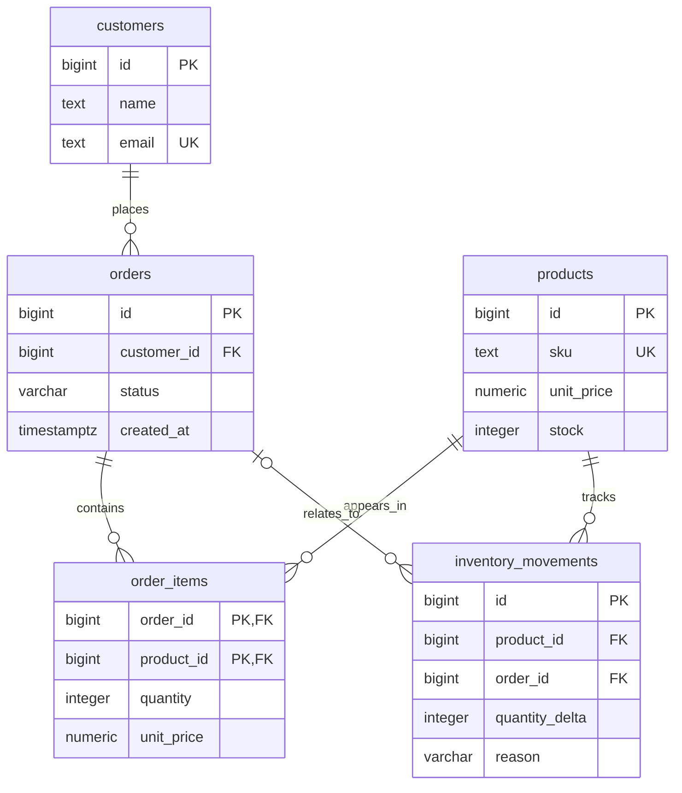

# Database Design — ออกแบบข้อมูลระบบสั่งซื้อ

## เรื่องนี้คืออะไร?

Database Design คือการตกลงว่าเก็บข้อมูลอะไร แยกเป็นตารางไหน และป้องกันข้อมูลผิดอย่างไร เริ่มจากกติกางานก่อนเขียน `CREATE TABLE` เช่น Order ต้องมีลูกค้า จำนวนซื้อต้องมากกว่าศูนย์ และสต็อกห้ามติดลบ

## ใช้เมื่อไร?

ใช้ก่อนเริ่ม Model/API หรือเพิ่มฟังก์ชันที่เปลี่ยนความหมายข้อมูล Schema ในหน้านี้เป็นต้นทางของ SQL Lab ทั้งหมวด ไม่ใช่ Schema ของ Task App หรือของระบบ Production

## ทำอย่างไร?

### 1. แยกข้อมูลและความสัมพันธ์



ลูกค้ามีหลาย Order และ Order มีหลายรายการ สินค้าตัวเดียวอยู่หลาย Order ได้ผ่าน `order_items` ส่วน Movement บางชนิด เช่นยอดยกมา ไม่ได้ผูกกับ Order ภาพแสดงโครงสร้างที่ DB ยอมรับ; กติกาว่า Order ยืนยันแล้วต้องมีรายการต้องตรวจใน Transaction ด้วย

### 2. เลือกชื่อและชนิดข้อมูล

ใช้ชื่อ `snake_case` เช่น `customer_id` ไม่ใช้ชื่อสลับหลายแบบ หน่วยเงินใน Lab คือ THB ทั้งระบบ และ `unit_price` ในรายการสั่งซื้อเป็นราคาที่บันทึกขณะซื้อ ไม่ตามราคาสินค้าที่แก้ภายหลัง

| ชนิด | ใช้เมื่อไร |
| --- | --- |
| `INTEGER` / `BIGINT` | จำนวนเต็ม เลือกตามช่วงค่าที่ต้องรองรับ; PK ของ Lab ใช้ BIGINT ส่วนจำนวนสินค้าใช้ INTEGER |
| `UUID` | รหัสที่หลายส่วนสร้างแยกกันได้ โดยวางวิธีสร้าง/Index ให้เหมาะสม ไม่ได้ป้องกันการอ่านข้อมูลแทน Authorization |
| `VARCHAR(n)` / `TEXT` | ข้อความที่ต้องจำกัดความยาวด้วยกติกา / ข้อความทั่วไป ไม่ใช่ว่า VARCHAR เร็วกว่าเสมอ |
| `NUMERIC(p,s)` | ทศนิยมแบบแม่นยำ เช่น `NUMERIC(12,2)` เก็บราคาและต้องตกลงกฎปัดเศษ |
| `DATE` | วันอย่างเดียว เช่นวันนัดส่ง |
| `TIMESTAMP` / `TIMESTAMPTZ` | เวลาแบบไม่มีเขตเวลา / จุดเวลาที่เทียบข้ามเขตเวลาได้ ใช้แบบหลังกับเหตุการณ์สั่งซื้อ |
| `BOOLEAN` | จริง/เท็จ เช่นสินค้ายังขายอยู่ |
| `JSONB` | คุณสมบัติเสริมที่รูปแบบอาจต่างกัน ไม่ใช้ซ่อน FK/ข้อมูลหลักทั้งหมดไว้ใน JSON |

เงินควรใช้ NUMERIC ตามความละเอียดธุรกิจ เพราะ `REAL`/`DOUBLE PRECISION` เก็บค่าโดยประมาณอาจคลาดเคลื่อนทศนิยม `TIMESTAMPTZ` เก็บจุดเวลา ไม่เก็บชื่อ Time zone ต้นฉบับ ต้องเก็บชื่อแยกหากธุรกิจต้องใช้

### 3. สร้าง Schema บนฐานว่าง

เชื่อม `order_lab` ที่ว่างเท่านั้น คัดลอก Block เป็น `schema.sql` แล้วรันครั้งเดียว ไม่เติม `DROP ... CASCADE` เพื่อทับตารางเดิมถ้าพบชื่อซ้ำ

```sql filename="schema.sql"
BEGIN;
CREATE TABLE customers (
    id BIGINT GENERATED ALWAYS AS IDENTITY PRIMARY KEY,
    name TEXT NOT NULL CHECK (btrim(name) <> ''),
    email TEXT NOT NULL UNIQUE
);

CREATE TABLE products (
    id BIGINT GENERATED ALWAYS AS IDENTITY PRIMARY KEY,
    sku TEXT NOT NULL UNIQUE,
    name TEXT NOT NULL,
    unit_price NUMERIC(12,2) NOT NULL CHECK (unit_price >= 0),
    stock INTEGER NOT NULL DEFAULT 0 CHECK (stock >= 0),
    active BOOLEAN NOT NULL DEFAULT TRUE,
    metadata JSONB NOT NULL DEFAULT '{}'::jsonb
);

CREATE TABLE orders (
    id BIGINT GENERATED ALWAYS AS IDENTITY PRIMARY KEY,
    customer_id BIGINT NOT NULL REFERENCES customers(id) ON DELETE RESTRICT,
    status VARCHAR(20) NOT NULL DEFAULT 'pending',
    created_at TIMESTAMPTZ NOT NULL DEFAULT CURRENT_TIMESTAMP,
    CONSTRAINT orders_status_check
        CHECK (status IN ('pending', 'confirmed', 'cancelled'))
);

CREATE TABLE order_items (
    order_id BIGINT NOT NULL REFERENCES orders(id) ON DELETE RESTRICT,
    product_id BIGINT NOT NULL REFERENCES products(id) ON DELETE RESTRICT,
    quantity INTEGER NOT NULL CHECK (quantity > 0),
    unit_price NUMERIC(12,2) NOT NULL CHECK (unit_price >= 0),
    PRIMARY KEY (order_id, product_id)
);

CREATE TABLE inventory_movements (
    id BIGINT GENERATED ALWAYS AS IDENTITY PRIMARY KEY,
    product_id BIGINT NOT NULL REFERENCES products(id) ON DELETE RESTRICT,
    order_id BIGINT REFERENCES orders(id) ON DELETE RESTRICT,
    quantity_delta INTEGER NOT NULL CHECK (quantity_delta <> 0),
    reason VARCHAR(20) NOT NULL,
    created_at TIMESTAMPTZ NOT NULL DEFAULT CURRENT_TIMESTAMP,
    CONSTRAINT inventory_movement_direction_check CHECK (
        (reason = 'sale' AND quantity_delta < 0 AND order_id IS NOT NULL)
        OR (reason IN ('opening', 'restock', 'return') AND quantity_delta > 0)
    )
);
COMMIT;
```

`NOT NULL` ห้ามว่าง, `UNIQUE` ห้ามซ้ำ, `CHECK` ตรวจเงื่อนไข, `DEFAULT` เติมค่าเมื่อไม่ได้ระบุ และ `REFERENCES` สร้าง FK รายละเอียดอยู่ใน [Constraints](/technology-guides/postgresql/constraints) ส่วน `RESTRICT` ป้องกันการลบข้อมูลที่ยังถูกอ้างถึง จึงไม่ลบ Order ทิ้งเงียบ ๆ แล้วเสียประวัติ

### 4. ข้อมูลตั้งต้น

รัน `seed.sql` **หนึ่งครั้งหลัง Schema บนฐานว่าง** ไม่ใช่ Seed ของ Production ข้อมูลลูกค้าเป็นตัวอย่างสมมติ และใช้ Domain `.invalid`:

```sql filename="seed.sql"
BEGIN;
INSERT INTO customers (name, email) VALUES
    ('Demo Customer', 'demo@example.invalid'),
    ('Second Customer', 'second@example.invalid');

INSERT INTO products (sku, name, unit_price, stock) VALUES
    ('SKU-001', 'Notebook', 100.00, 10),
    ('SKU-002', 'Pen Set', 200.00, 5);

INSERT INTO inventory_movements (product_id, quantity_delta, reason)
SELECT id, stock, 'opening' FROM products;

WITH new_order AS (
    INSERT INTO orders (customer_id, status)
    SELECT id, 'confirmed' FROM customers
    WHERE email = 'demo@example.invalid'
    RETURNING id
)
INSERT INTO order_items (order_id, product_id, quantity, unit_price)
SELECT o.id, p.id, 2, p.unit_price
FROM new_order o CROSS JOIN products p
WHERE p.sku = 'SKU-001';

UPDATE products SET stock = stock - 2 WHERE sku = 'SKU-001';

INSERT INTO inventory_movements
    (product_id, order_id, quantity_delta, reason)
SELECT p.id, o.id, -2, 'sale'
FROM orders o
JOIN customers c ON c.id = o.customer_id
CROSS JOIN products p
WHERE c.email = 'demo@example.invalid' AND p.sku = 'SKU-001';
COMMIT;
```

หลัง Seed มี Order หนึ่งใบ จำนวน 2 ชิ้น รวม 200 THB สต็อก `SKU-001` เหลือ 8 และ `SKU-002` เหลือ 5 การเลือก Order ใน Seed นี้อาศัยเงื่อนไขว่าฐานยังว่างและกำลังสร้างข้อมูลตั้งต้นเท่านั้น งานจริงใช้ Order ID ที่ `RETURNING` ได้และ Transaction ที่ป้องกันการซื้อพร้อมกันใน [Transactions](/technology-guides/postgresql/transactions)

### 5. อ่านข้อมูลที่เชื่อมกัน

```sql filename="design-queries.sql"
SELECT p.sku, p.stock, p.unit_price FROM products p ORDER BY p.sku;

SELECT o.id, c.name, o.status,
       SUM(oi.quantity * oi.unit_price) AS total_thb
FROM orders o
JOIN customers c ON c.id = o.customer_id
JOIN order_items oi ON oi.order_id = o.id
GROUP BY o.id, c.name, o.status
ORDER BY o.id;
```

`JOIN` เชื่อมแถวด้วยรหัส ส่วน `GROUP BY` รวมรายการของ Order แล้ว `SUM` คำนวณยอด ไม่คำนวณด้วยราคาสินค้าปัจจุบัน

### Normalization แบบที่ใช้ทำงาน

- **1NF**: หนึ่งช่องเก็บหนึ่งค่าตามชนิดที่ออกแบบ ไม่ใส่รายการ SKU คั่นด้วย comma ใน `orders`
- **2NF**: ข้อมูลใน `order_items` ต้องเกี่ยวกับ Key ทั้งชุด เช่นจำนวนที่ซื้อ ไม่เอาชื่อลูกค้าที่ไม่ได้ขึ้นกับรายการสินค้ามาเก็บซ้ำ
- **3NF**: แยกข้อมูลที่ขึ้นกับอีกเรื่อง เช่นชื่อลูกค้าอยู่ `customers` แทนคัดลอกไปทุก Order

ไม่ต้องแยกทุกค่ากลายเป็นตารางเล็กจำนวนมาก `status` จำนวนน้อยใน Lab ใช้ CHECK ได้ และราคาขณะซื้อเป็นข้อเท็จจริงในประวัติ ไม่ใช่การเก็บซ้ำที่ต้องลบทิ้ง ถ้าต้องทำสำเนาเพื่อรายงานให้วัดประสิทธิภาพและกำหนดวิธีรักษาความถูกต้องก่อน

## ตัวอย่างการใช้งานจริง

พนักงานเปลี่ยนราคาสินค้าจาก 100 เป็น 120 THB Order เดิมยังต้องรวมเป็น 200 THB เพราะใช้ `order_items.unit_price` ที่ 100 ไม่ Join ราคาปัจจุบันมาคิดใหม่

## ข้อควรระวัง

CHECK ของแถวเดียวไม่ยืนยันว่า `products.stock` เท่ากับผลรวม Movements หรือทุก Confirmed order มีรายการเสมอ ต้องรักษากติกาข้ามตารางใน Transaction และตรวจตามรอย ไม่เปิดให้แก้ Stock โดยตรงเป็นขั้นตอนปกติ หากต้องยกเลิก Order ต้องออกแบบคืน Stock/Movement ให้ครบ ไม่แค่เปลี่ยน `status`

## สรุป

- ออกแบบจากกติกางานแล้วค่อยเลือกชนิดข้อมูล
- เก็บราคาขณะสั่งซื้อแยกจากราคาปัจจุบัน
- FK/Constraints ช่วยกันข้อมูลผิด แต่ไม่แทนกติกาข้ามตารางทั้งหมด
- Schema และ Seed นี้ใช้เฉพาะฐานทดลองใหม่

## อ่านต่อ

- [Relationships](/technology-guides/postgresql/relationships)
- [Constraints](/technology-guides/postgresql/constraints)
- [Numeric types](https://www.postgresql.org/docs/17/datatype-numeric.html)
- [Date/time types](https://www.postgresql.org/docs/17/datatype-datetime.html)
