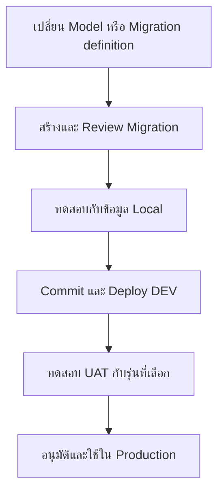

# Database Migration — เปลี่ยน Schema ผ่านไฟล์ที่ตามรอยได้

## เรื่องนี้คืออะไร?

Migration คือไฟล์บอกว่าจะเปลี่ยนฐานข้อมูลจากรุ่นหนึ่งไปอีกรุ่นอย่างไร ทีมเก็บไฟล์กับโค้ดใน Git เพื่อให้ Local/DEV/UAT/Production ทำตามลำดับที่ตรวจแล้ว ไม่ต้องจำว่าเคยกดแก้ตารางที่ไหน

## ใช้เมื่อไร?

ใช้เมื่อเพิ่มช่อง เปลี่ยนชนิดข้อมูล เปลี่ยนชื่อ ลบ Column หรือเพิ่ม Index บทนี้ลงรายละเอียด PostgreSQL ส่วนขั้น PR และ Approval ต้องใช้ข้อตกลงจริงของโปรเจกต์

## ทำอย่างไร?



ภาพนี้เป็นแนวทาง ต้องมีผู้รับผิดชอบและผลตรวจของแต่ละโปรเจกต์จริง ไม่รัน SQL ตรงบน UAT เพื่อแทนการส่ง Migration

### 1. ตัวอย่าง SQL: เพิ่ม phone_number

ใช้ Schema/Seed เดิมจาก [Database Design](/technology-guides/postgresql/database-design) ให้บันทึกเป็น Migration รุ่นถัดไปและรันหนึ่งครั้งบน Lab:

```sql filename="0002-customer-phone.sql"
BEGIN;
SET LOCAL lock_timeout = '3s';
ALTER TABLE customers ADD COLUMN phone_number VARCHAR(30);
COMMIT;
```

Column ใหม่ยอมให้ NULL จึงยังไม่ต้องเดาเบอร์ให้ข้อมูลเก่า โค้ดเก่าที่ระบุชื่อ Columns ชัดและไม่พึ่งจำนวนช่องจาก `SELECT *` มีโอกาสอยู่ร่วมได้ แต่ยังต้องทดสอบจริง ตรวจหลังเปลี่ยน:

```sql filename="migration-check.sql"
SELECT column_name, data_type, is_nullable
FROM information_schema.columns
WHERE table_schema = 'public' AND table_name = 'customers'
ORDER BY ordinal_position;

SELECT email, phone_number FROM customers ORDER BY id;
```

ชื่อไฟล์ช่วยเรียงรุ่น แต่ถ้าใช้ SQL migration tool ต้องให้เครื่องมือติดตาม Applied versions ด้วย ไม่ใช่ให้คนเปิดไฟล์ทั้งหมดมารันซ้ำทุก Deploy `IF NOT EXISTS` ก็ไม่ยืนยันว่า Column ที่มีอยู่ถูกชนิด/ความหมายแล้ว

### 2. ทางเลือก Django-managed schema

Django สร้าง SQL ให้ PostgreSQL จาก Model และเก็บประวัติ Migration ของตัวเอง ตัวอย่างต่อไปสมมติว่ามี Django App ชื่อ `shop`, Model `Customer` ที่ตั้ง `Meta.db_table = 'customers'` และ Migration เดิมถูกต้องแล้ว **ไม่ใช่ Django project ที่เพิ่มให้ Hub**

ใน Model เดิมเพิ่ม Field fragment นี้ ไม่สร้าง Customer model ใหม่ทับ:

```python filename="customer-phone-field.py"
from django.db import models

# Field ภายใน Customer model เดิม
phone_number = models.CharField(max_length=30, null=True, blank=True)
```

รันในโปรเจกต์ Django ที่ตั้ง Local database ถูกต้องแล้ว:

```bash
python manage.py makemigrations shop
python manage.py showmigrations shop
python manage.py migrate --plan
python manage.py migrate
```

`makemigrations` สร้างไฟล์ ยังไม่ Apply, `showmigrations` ดูรายการ/สถานะ, `--plan` ดูสิ่งที่จะทำ และ `migrate` จึงใช้จริง ตรวจไฟล์ที่ Generate ก่อน โดยโครงตัวอย่างคือ:

```python filename="0002_customer_phone_number.py"
from django.db import migrations, models


class Migration(migrations.Migration):
    dependencies = [("shop", "0001_initial")]
    operations = [
        migrations.AddField(
            model_name="customer",
            name="phone_number",
            field=models.CharField(max_length=30, null=True, blank=True),
        ),
    ]
```

Dependency/App/Model เป็นชื่อสมมติ ต้องแทนตามประวัติจริง เลือกเจ้าของ Schema เพียงแนวทางเดียว: **SQL Lab กับ Django-managed DB เป็นคนละเส้นทางทดลอง** ห้าม Apply ทั้ง `0002-customer-phone.sql` และ Django AddField บนฐานเดียวกันโดยไม่จัดการ State และไม่ `--fake` เพื่อข้ามปัญหาโดยยังไม่ตรวจ

### 3. เปลี่ยนชนิด Rename Drop และเพิ่ม Index

การเปลี่ยนต่อไปนี้อาจล็อกตาราง ทำข้อมูลหาย หรือทำให้โค้ดเก่าอ่านไม่ได้ **อย่ารันบนฐานร่วมเป็นตัวอย่าง** ตารางนี้อธิบายสิ่งที่ต้องวางแผนก่อน:

| การเปลี่ยน | สิ่งที่ต้องตรวจ |
| --- | --- |
| เพิ่ม Column | เริ่ม Nullable หากข้อมูลเดิมยังไม่พร้อม แล้วเติมจากแหล่งที่ยืนยัน |
| เปลี่ยนชนิด เช่น `NUMERIC(12,2)` เป็น `(14,2)` | ค่าที่แปลงไม่ได้, การปัดเศษ, Rewrite/Lock และเวลาทำงาน |
| Rename `phone_number` | โค้ดเก่า/Reports/Jobs ที่อ้างชื่อเดิมจะพังได้ ไม่ใช่แค่เปลี่ยน Model |
| Drop Column | ตรวจผู้ใช้ข้อมูล/Backup และ Roll-forward plan เพราะย้อนโค้ดไม่คืนข้อมูลที่ลบ |
| เพิ่ม Index | วัด Query และ Lock; Concurrent index ต้องมี Migration ที่ไม่ครอบ Transaction แบบปกติ |

### 4. Expand-and-Contract

1. **Expand** เพิ่ม `phone_number` แบบยอมว่างก่อน
2. Deploy โค้ดที่อ่าน/เขียนได้แม้ยังไม่มีเบอร์ และอยู่ร่วมกับรุ่นเก่าได้
3. เติมข้อมูลเก่าจากแหล่งที่ตรวจแล้วผ่าน Data migration ไม่ใส่เบอร์ปลอมให้ครบ
4. ตรวจข้อมูล/งานเบื้องหลังและแอปเก่าทั้งหมดก่อนเปลี่ยนเงื่อนไขเข้มขึ้นหรือเอาช่องเก่าออกในรุ่นหลัง

ลำดับ SQL/Code/Backfill ขึ้นกับความเข้ากันได้ของงานจริง ไม่รัน Migration แข่งกันจากทุก API replica กำหนด Job/ผู้ดำเนินการเพียงหนึ่งชุดต่อรุ่น

## ตัวอย่างการใช้งานจริง

UAT ต้องเก็บเบอร์ติดต่อเพิ่ม ทีมเพิ่ม Migration Nullable, ทดสอบข้อมูลเก่า, Commit กับโค้ด, เปิด PR แล้วส่งแพ็กเดิมผ่าน DEV/UAT เมื่ออนุมัติจึง Apply ที่ Production ตาม Runbook ไม่เข้า DBeaver กดเพิ่ม Column แล้วลืมใส่ Git

## ข้อควรระวัง

ไม่แก้หรือลบ Migration ที่ใช้ร่วมกันแล้วเพื่อให้ลำดับสวย หากหลายคนสร้างชนกันให้ Review Dependencies/ความหมายข้อมูล ไม่ใช่แค่เปลี่ยนเลขไฟล์ ตรวจเวลาล็อกกับข้อมูลใกล้จริงและเตรียม Backup ที่ Restore ได้ก่อนงานเสี่ยง การ Rollback แอปไม่ย้อน Schema ให้เอง

## สรุป

- Migration เป็นส่วนหนึ่งของ Release และต้องตามรุ่นใน Git
- แยก SQL Lab ออกจาก Django-managed migration state
- เพิ่มอย่างเข้ากันได้ก่อน แล้วค่อยเติมข้อมูล/เลิกของเก่า
- ทดสอบ Locks, ข้อมูลเดิม และ Recovery plan ก่อนปล่อย

## อ่านต่อ

- [Data Migrations](/technology-guides/postgresql/data-migrations)
- [Release & Rollback](/technology-guides/devops/rollback-and-release)
- [Django migrations](https://docs.djangoproject.com/en/5.2/topics/migrations/)
- [PostgreSQL ALTER TABLE](https://www.postgresql.org/docs/17/sql-altertable.html)
