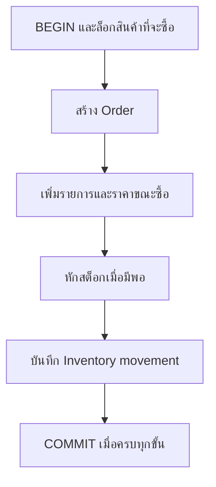

# Transactions — สำเร็จทั้งชุดหรือยกเลิกทั้งชุด

## เรื่องนี้คืออะไร?

Transaction คือขอบเขตของคำสั่งที่ต้องสำเร็จร่วมกัน ถ้าขั้นใดผิดพลาด เราสามารถยกเลิกการเปลี่ยนในขอบเขตนั้นได้ เพื่อไม่ให้เหลือ Order ที่หักสต็อกไม่ครบหรือมีรายการแต่ไม่มียอดขาย

## ใช้เมื่อไร?

ใช้เมื่อหลายการเปลี่ยนแปลงต้องจริงพร้อมกัน เช่นยืนยัน Order คำสั่ง SQL เดี่ยวก็มี Transaction ของตัวเองอยู่แล้ว แต่การทำหลายคำสั่งแยก Auto-commit จะไม่กลายเป็นชุดเดียวให้อัตโนมัติ การอ่านหนึ่ง Query ธรรมดาอาจไม่ต้องเปิด Transaction ยาวเอง

## ทำอย่างไร?

### ACID แบบใช้งานจริง

| หลัก | ความหมาย |
| --- | --- |
| Atomicity | งานในชุดสำเร็จทั้งหมดหรือยกเลิกทั้งหมด |
| Consistency | หลังจบยังตรงกติกาที่ออกแบบ เช่น Stock ไม่ติดลบ ต้องมี Constraints/โค้ดช่วยรักษา |
| Isolation | งานที่ทำพร้อมกันเห็นข้อมูลและรอกันตามระดับที่เลือก ไม่ได้แปลว่ากัน Race ได้ทุกแบบ |
| Durability | หลัง Commit สำเร็จ การตั้งค่าความทนทานของ DB ช่วยให้ข้อมูลคงอยู่ ไม่ได้ทดแทน Backup หรือกัน Host สูญหาย |



ถ้าขั้นใด Error ให้ Rollback ทั้งชุด ภาพนี้เป็นขอบเขตฐานข้อมูล ไม่ครอบการชำระเงินหรือส่ง Email ภายนอก

### 1. เตรียมฟังก์ชัน Lab

ต้องมี [Schema/Seed](/technology-guides/postgresql/database-design) ก่อน คัดลอก Block นี้เป็น `place-order.sql` แล้วรันหนึ่งครั้งใน Lab ฟังก์ชันคือชุด SQL ที่เรียกซ้ำได้ ช่วยให้ตัวอย่างสำเร็จ/ล้มเหลวและสอง Connections ใช้ขั้นตอนเดียวกัน ไม่ได้กำหนดว่าทุกโปรเจกต์ต้องเก็บ Business logic ใน DB

```sql filename="place-order.sql"
CREATE FUNCTION place_order(
    p_email TEXT, p_sku TEXT, p_quantity INTEGER
) RETURNS BIGINT LANGUAGE plpgsql AS $$
DECLARE
    v_customer_id BIGINT;
    v_product_id BIGINT;
    v_price NUMERIC(12,2);
    v_order_id BIGINT;
BEGIN
    IF p_quantity IS NULL OR p_quantity <= 0 THEN
        RAISE EXCEPTION 'quantity must be positive' USING ERRCODE = '22023';
    END IF;

    SELECT id INTO STRICT v_customer_id
    FROM customers WHERE email = p_email;

    SELECT id, unit_price INTO STRICT v_product_id, v_price
    FROM products WHERE sku = p_sku FOR UPDATE;

    INSERT INTO orders (customer_id, status)
    VALUES (v_customer_id, 'confirmed') RETURNING id INTO v_order_id;

    INSERT INTO order_items (order_id, product_id, quantity, unit_price)
    VALUES (v_order_id, v_product_id, p_quantity, v_price);

    UPDATE products SET stock = stock - p_quantity
    WHERE id = v_product_id AND active AND stock >= p_quantity;
    IF NOT FOUND THEN
        RAISE EXCEPTION 'stock unavailable';
    END IF;

    INSERT INTO inventory_movements
        (product_id, order_id, quantity_delta, reason)
    VALUES (v_product_id, v_order_id, -p_quantity, 'sale');

    RETURN v_order_id;
END;
$$;
```

`INTO STRICT` ต้องพบข้อมูลหนึ่งแถว ไม่พบหรือพบมากกว่าหนึ่งจะ Error `FOR UPDATE` ถือ Row lock จน Transaction จบ `RETURNING` ส่งรหัสที่ DB สร้างกลับมา ไม่เดาว่าเป็นเลขถัดไป ส่วน `IF NOT FOUND` ตรวจว่าหัก Stock สำเร็จจริง ห้าม Commit Order ถ้า UPDATE ได้ศูนย์แถว

ฟังก์ชัน Lab นี้สร้างหนึ่ง Order ที่มีหนึ่ง SKU ต่อการเรียก หากต้องซื้อหลาย SKU ใน Order เดียว ต้องขยายให้ล็อกสินค้าตามลำดับเดียวกันและเพิ่มทุกรายการใน Transaction เดียว ไม่เรียกฟังก์ชันนี้หลายครั้งแล้วถือว่าเป็น Order เดียวกัน

### 2. Transaction ที่สำเร็จ

```sql filename="successful-order.sql"
BEGIN;
SET LOCAL lock_timeout = '3s';
SET LOCAL statement_timeout = '10s';
SELECT place_order('demo@example.invalid', 'SKU-001', 2) AS order_id;
COMMIT;
```

`BEGIN` เริ่มชุด `SET LOCAL` จำกัดเวลารอ Lock/คำสั่งเฉพาะชุดนี้ และ `COMMIT` ยืนยัน เมื่อเริ่มจาก Seed ที่ Stock 8 คาดว่าเหลือ 6 มี Order/รายการ/Movement เพิ่มอย่างละหนึ่ง รันซ้ำคือซื้อเพิ่มอีกครั้ง ไม่ใช่คำสั่งที่ทำซ้ำแล้วไม่มีผล

### 3. Transaction ที่ล้มเหลว

ตัวอย่างนี้ตั้งใจให้ Error เพราะซื้อเกิน Stock ทดลองทีละ Block ไม่ใช้เป็นคำสั่งปล่อยงาน:

```sql filename="failed-order.sql"
BEGIN;
SELECT place_order('demo@example.invalid', 'SKU-001', 999999);
ROLLBACK;
```

หลัง “stock unavailable” ถ้าใช้ Editor แบบคง Connection ต้องสั่ง `ROLLBACK` ไม่เปลี่ยนเป็น COMMIT แล้วทำต่อ ถ้าใช้ `psql -v ON_ERROR_STOP=1 -f ...` Script จะหยุดก่อนถึงบรรทัด Rollback แต่เมื่อ Connection จบ DB ยกเลิกชุดที่ยังไม่ Commit

**ผลที่ต้องตรวจ**: Stock, จำนวน Orders, Order items และ Movements ต้องเท่าเดิมก่อนคำสั่งที่ล้มเหลว แต่เลข Identity อาจข้ามไป ไม่ใช่ข้อมูลหาย

```sql filename="transaction-check.sql"
SELECT sku, stock FROM products ORDER BY sku;
SELECT COUNT(*) AS orders_count FROM orders;
SELECT COUNT(*) AS items_count FROM order_items;
SELECT COUNT(*) AS movements_count FROM inventory_movements;

SELECT p.sku, p.stock, COALESCE(SUM(m.quantity_delta), 0) AS movement_balance
FROM products p
LEFT JOIN inventory_movements m ON m.product_id = p.id
GROUP BY p.id, p.sku, p.stock
ORDER BY p.sku;
```

เริ่มจาก Seed แล้วรัน Success หนึ่งครั้งและ Failure หนึ่งครั้ง คาดว่า Orders=2, Items=2, Movements=4 และ Stock ตรง Movement balance ทุกสินค้า ข้อมูลที่เพิ่มจากบทอื่นอาจเปลี่ยน Counts จึงควรเก็บค่าก่อน/หลังด้วย

### 4. SAVEPOINT ย้อนเฉพาะส่วน

SAVEPOINT คือจุดย่อยที่ย้อนกลับได้โดยยังอยู่ใน Transaction เดิม ตัวอย่างเปลี่ยนชื่อแล้วถอยกลับ ไม่ Commit ข้อมูลทดลอง:

```sql filename="savepoint-lab.sql"
BEGIN;
INSERT INTO customers (name, email)
VALUES ('Savepoint Demo', 'savepoint@example.invalid');
SAVEPOINT before_name_change;
UPDATE customers SET name = 'Changed'
WHERE email = 'savepoint@example.invalid';
ROLLBACK TO SAVEPOINT before_name_change;
SELECT name FROM customers WHERE email = 'savepoint@example.invalid';
ROLLBACK;
```

SELECT ควรเห็น `Savepoint Demo` ถ้าเกิด Error หลัง Savepoint ต้อง Rollback ไปจุดนั้นก่อนส่ง SQL ต่อ อย่าใช้ Savepoint เพื่อยอมให้ขั้นตอนสำคัญอย่าง Movement ล้มเหลวแล้วยังปล่อย Order

### 5. Django transaction.atomic()

ตัวอย่าง Python นี้เป็น Fragment สำหรับ Django ที่ตั้ง PostgreSQL และมีฟังก์ชัน Lab `place_order` แล้ว ไม่ใช่คำสั่งที่รันกับ Engineering Hub:

```python filename="django-order-transaction.py"
from django.db import connection, transaction


def create_order(email, sku, quantity):
    with transaction.atomic():
        with connection.cursor() as cursor:
            cursor.execute(
                "SELECT place_order(%s, %s, %s)",
                [email, sku, quantity],
            )
            order_id = cursor.fetchone()[0]
    return order_id
```

`atomic()` Commit เมื่อออกจาก Block ตามปกติ และ Rollback เมื่อ Exception หลุดออกมา ใช้ Parameters แทนการต่อ SQL หากจับ `DatabaseError` ให้จับ **ด้านนอก** atomic เพื่อไม่ส่งคำสั่งต่อใน Transaction ที่เสียแล้ว ถ้าใช้ ORM ก็ต้องเก็บ Order/Items/Stock/Movement ในขอบเขตเดียวกัน

## ตัวอย่างการใช้งานจริง

DB แจ้ง Stock ไม่พอหลังเพิ่ม Order items แล้ว โค้ดจึง Raise error และยกเลิกทั้งชุด ผู้ใช้ได้รับข้อความให้เลือกจำนวนใหม่ ไม่เหลือ Order ค้างที่คิดเงินได้แต่หัก Stock ไม่ได้

## ข้อควรระวัง

อย่าถือ Transaction รอผู้ใช้ตอบหรือเรียก Payment/Email ผ่าน Network เพราะ Lock จะค้างและผลภายนอกไม่ย้อนตาม DB ให้กำหนดกระบวนการหลัง Commit และวิธี Retry ของงานภายนอกแยกกัน Transaction ไม่ทำให้คำขอที่ส่งซ้ำกลายเป็นครั้งเดียว ต้องออกแบบ Idempotency ของ API เพิ่มหากธุรกิจต้องการ

## สรุป

- รวมการเปลี่ยนที่ต้องสำเร็จร่วมกันไว้ในขอบเขตเดียว
- Error แล้วจบ Transaction ให้ถูก ไม่ฝืนทำต่อ
- ตรวจทั้ง Rows, Stock และ Movement balance
- รักษา Transaction ให้สั้นและอย่าอ้างว่าครอบผลภายนอก DB

## อ่านต่อ

- [Concurrency และ Locking](/technology-guides/postgresql/concurrency)
- [PostgreSQL transactions](https://www.postgresql.org/docs/17/tutorial-transactions.html)
- [Django transactions](https://docs.djangoproject.com/en/5.2/topics/db/transactions/)
